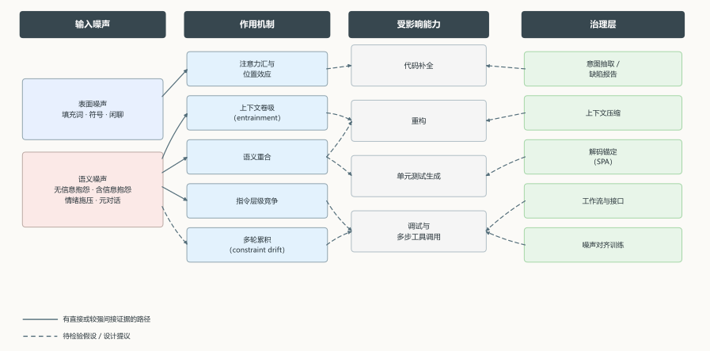
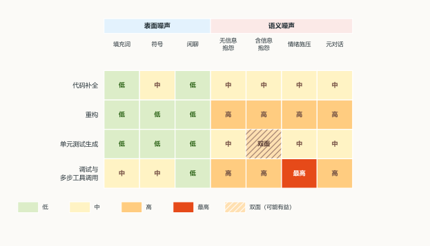

## 摘要

本文讨论与 Coding Agent 对话时混入语气词、抱怨与闲聊等无关内容对其编码表现的影响。文章不把噪声视为单一变量，而是沿表面/语义、可压缩/含信息、单轮/多轮三个维度加以区分，并把位置效应、上下文卷吸、语义重合、指令层级竞争与约束漂移等机制整合为一条解释链。基于可核验的实验证据，本文指出噪声的危害主要取决于其与任务共享的语义结构，而非噪声率本身；多轮交互会放大这种影响，不同任务的敏感度亦不相同，模型规模并非鲁棒性的单调保证。文章进一步给出面向任务的评估协议与“意图隔离”治理框架，并明确区分直接证据、跨域外推与待检验假设。

**关键词**：对话噪声；Coding Agent；上下文鲁棒性；指令遵循；意图隔离

## 1 干净基准与嘈杂对话之间的落差

以 Codex [@chen2021humaneval]、Claude Code 为代表的 Coding Agent（编码智能体），其评测语境与实际使用语境之间存在明显落差，而这一落差尚未得到充分关注。以 HumanEval 为代表的函数级基准将任务限定为根据函数签名和文档字符串生成函数体 [@chen2021humaneval]；MBPP 以一两句自包含的问题描述作为任务说明 [@austin2021mbpp]；LiveCodeBench 强调防污染设计 [@jain2024livecodebench]；BigCodeBench 则通过复杂指令和多样化函数调用检验组合能力 [@zhuo2024bigcodebench]。**这些设计的共同前提是输入提示本身干净、完整且与任务相关。**然而，真实开发对话几乎永远无法满足这一前提，用户可能犹豫、改口或抱怨，可能会粘贴旧日志和其他项目的讨论，也可能在同一句话中混合工作指令与情绪表达 [@babe2023studenteval]。

由此形成一种看似符合常识、实则缺乏系统证据的判断：“与工作无关的内容会降低 Coding Agent 的表现”。该判断的问题不在于其方向，而在于其将一个复杂的多维条件问题简化为非黑即白的单一命题。本文旨在恢复问题的多维结构，具体考察噪声的类型、位置与语义相关性，以及任务形态、模型规模与交互轮次分别如何改变影响的方向与幅度。

## 2 噪声的多维结构

本文所称噪声，指输入上下文中与任务目标缺乏语义支撑、但占据 token 并参与注意力计算的文本单元；此界定参照 Wu 等对“不相关信息”的操作化 [@wu2024irrelevant]。其危害并不随语义无关程度单调上升，语义相关的不相关信息反而更易误导模型。许多观点将噪声简单理解为"与任务无关的 token 比例"，这是一种常见但存在风险的简化。设任务上下文为 $x_T$，噪声为 $x_N$，则拼接后的输入为 $x = [x_T; x_N]$（顺序本身亦是变量）。令噪声率与语义相关度分别为

$$
\gamma = \frac{|x_N|}{|x_T| + |x_N|}, \qquad \rho(x_N, x_T) \in [0, 1],
$$ {#eq-noise}

其中 $|\cdot|$ 表示 token 数，$\rho$ 可按 embedding 余弦相似度或人工分级操作化。两个输入可以拥有相同的 $\gamma$，却因为 $\rho$ 不同而出现数量级差异的效果——后文将看到，这一差距在受控实验里可以达到五倍 [@pugacheva2025apple]。换言之，**噪声率并非充分统计量**，仅报告“注入了多少噪声”的实验不足以单独解释结果。

噪声可沿三个维度进一步分类。第一，区分表面噪声与语义噪声：填充词、重复标点与无意义符号属于表面噪声，抱怨及相似项目讨论属于语义噪声，二者作用机制不同。第二，区分可压缩噪声与含信息噪声：纯寒暄可无损删除，而“空输入会崩”一类抱怨携带缺陷线索，删除将造成信息损失。第三，区分单轮噪声与累积噪声：一次性插入的噪声仅影响当前生成，而进入对话历史、任务摘要与记忆的噪声会改变后续所有轮次的条件分布。@tbl-taxonomy 给出了后续讨论所采用的类型学。

| 噪声类型 | 典型形式 | 可能的作用机制 | 信息价值 |
|---|---|---|---|
| 语法型填充词 | "呃""嗯""那个""请" | 稀释注意力密度、增加 token 开销 | 低，仅表达交互节奏 |
| 无意义符号 | "？？？""！！！"、乱码 | 被误读为代码标点、触发异常分词 | 低，可表达紧迫性 |
| 纯闲聊 | "今天好累""午饭吃什么" | 占用上下文、污染记忆摘要 | 通常与任务无关 |
| 无信息抱怨 | "烦死了""你怎么这么笨" | 情绪压力、指令层级混乱 | 低，不提供可执行信息 |
| 含信息抱怨 | "又错了，边界条件没处理" | 可能被当作约束，也可能提供缺陷线索 | 高，但需转写 |
| 情绪施压 | "必须马上修好，不然完了" | 改变优先级、可能覆盖安全规则 | 中，表达优先级 |
| 元对话 | "你听懂了吗""先别写代码" | 改变任务状态、干扰规划 | 高，可能是控制指令 |
| 语义相关但任务无关 | 相似项目讨论、旧日志 | 与任务共享词汇，最易被卷吸 | 中，需筛选 |

: 对话噪声的类型学及其可能的作用机制 {#tbl-taxonomy}

**例 1｜表面噪声与语义噪声的对照**

```text
[表面噪声]
用户：呃……那个，就是，嗯，把 utils.py 里的缓存函数重构一下，谢谢。

[语义噪声]
用户：上次并发那个 bug 也是缓存引起的，你别又改坏；赶紧把 utils.py 的缓存重构了，线上可能有问题。
```

*两段话的显式任务相同，但后者与任务共享“并发”“缓存”“线上”等词汇，并引入“上次 bug”这一语义相关的失败案例。按后文 §3.3 的机制，这类内容更容易被卷吸为约束或失败线索；前者主要增加 token 开销。*

“含信息抱怨”与“无信息抱怨”在行为表现上可能仅仅相差几个词，但在治理上往往需要采取相反的处理方式——前者应抽取为缺陷报告（bug report），后者才应压缩。任何将二者统一处理的降噪方案，都可能在其中一侧付出代价。

之所以对二者采取相反的处理方式，根本原因在于其信息价值与治理目标不同。含信息抱怨虽在表面形态上与无信息抱怨相近，但其语义内容指向具体的缺陷线索、触发条件或用户预期偏差 [@bettenburg2008bugreport]，属于低信噪比但高信息量的单元；若按噪声压缩，摘要或删除会造成不可恢复的语义损失，且使缺陷无法进入后续定位与修复流程。

无信息抱怨则不承载可操作的任务相关信息，其主要代价不在于单轮输入中的占比，而在于进入对话历史、任务摘要与记忆后持续占据上下文预算，并改变后续轮次的条件分布，故应在确认无信息损失的前提下压缩。

**例 2｜含信息抱怨与无信息抱怨**

```text
[无信息抱怨]
用户：你怎么连这个都测不到？烦死了，重写。

[含信息抱怨]
用户：又错了：空输入会崩，并发下偶尔失败；期望返回 400，而不是抛异常。
```

*后者包含失败现象、触发条件与期望行为，可以转写为缺陷报告；前者只表达不满，除交互信号外不提供可执行信息。§8 的治理策略正是为这两类输入设计不同处理路径。*

## 3 噪声如何改变预测

@fig-framework 概括了本节讨论的机制链，以及第 8 节治理层与这些机制的对应关系。

{#fig-framework width=100% fig-alt="四列概念框架：输入噪声、作用机制、受影响能力与治理层；实线为有证据路径，虚线为假设或设计提议。"}

### 3.1 注意力汇与位置效应

Transformer 的注意力分配并不以任务相关性为依据。Xiao 等发现的 “注意力汇”（attention sink）现象表明位于序列开头的若干 token 会稳定获得不成比例的注意力权重，即使其在语义上与任务无关 [@xiao2024attentionsinks]。Liu 等的 “Lost in the Middle” 则表明，当相关信息位于长上下文中部时，模型对其利用程度显著低于位于开头或结尾的情形，呈 U 形分布 [@liu2024lost]。以单层单头为例，$A_T$ 表示任务相关 token 的总注意力权重（多头、多层情形可对 $A_T$ 求和或分别计算）：

$$
A_T = \sum_{i \in T} \alpha_i, \qquad
\alpha_i = \frac{\exp(q^\top k_i / \sqrt{d})}{\sum_j \exp(q^\top k_j / \sqrt{d})}.
$$ {#eq-attn}

噪声在序列中的位置会改变 $A_T$ 的分布。位于开头的噪声占据注意力汇所对应的位置，位于中部的噪声则将关键指令推入低利用率区间。由此可提出一个可检验的预测：在相同噪声率下，噪声位于开头或结尾与位于中部，其效果并不相同。

但位置效应并不等于“模型无法忽略噪声”。Shi 等在 GSM-IC 上发现，无关信息会显著降低推理准确率，而通过提示模型“忽略无关信息”或采用 self-consistency 可以缓解 [@shi2023distracted]。模型具备被引导忽略噪声的能力，但缺省行为并非忽略。**因此，噪声问题部分属于提示协议问题，部分才是模型能力问题。**若将两者混为一谈，或将问题过度归咎于模型，或低估提示协议设计的价值。

### 3.2 上下文卷吸与预测分布污染

相比“注意力被分散”，对本研究的一个更精确的相关机制是“上下文卷吸”（contextual entrainment）。Niu 等发现，语言模型会对上下文中出现过的 token 赋予更高的 logits，即使这些 token 系随机插入；该效应在反事实提示下更强，表明其既由机制驱动，又受语义调制 [@niu2025llamasee]。以 $p$ 表示当前输入（prompt）、$c$ 表示追加的上下文，$i$ 为词表 token，则在同一解码位置上卷吸所致的 logit 偏移可写为：

$$
\Delta_i = \mathrm{logit}_i([p; c]) - \mathrm{logit}_i(p),
$$ {#eq-entrain}

其中 $[p;c]$ 表示原始输入在前、追加内容在后的拼接。对代码任务而言，这意味着抱怨中出现的 API 名、变量名、数字与路径，均可能因在上下文中出现过而被卷入生成结果，而非因其与任务相关。这也解释了语义相关噪声为何更危险：此类噪声与任务共享词汇，卷吸方向恰好指向错误但常见的 token，而这些 token 在语法上往往完全合理，因而难以被模型自身的困惑度信号识别。

### 3.3 语义重合与噪声破坏性

Pugacheva 等在视觉—语言—动作（VLA）指令域开展了一项较为直接的对照实验。他们在指令后拼接无关上下文，随机上下文造成的性能下降在 10% 以内，而长度相同、语义与词汇相近的上下文可造成约 50% 的质量下降；由人类改写指令本身则造成约 20% 的下降 [@pugacheva2025apple]。该结果不能直接迁移至代码对话场景——领域、任务与评价指标均不相同——但其机制解释与 @eq-entrain 一致：语义重合使模型难以区分“任务证据”与“背景噪声”，卷吸因而指向任务相关但错误的 token。

对于一般编程场景，噪声的危害程度不取决于其“是否明显无关”，而取决于其“是否与任务共享词汇与语义框架”。抱怨“这个缓存又失效了，跟上次那个并发问题一样”比一百个“嗯”更危险，因为“缓存”“并发”会被当作需求线索；而“今天好累”因不共享任务词汇，反而更易被忽略。

### 3.4 指令层级与情绪扰动

Wallace 等指出，模型常将系统指令与用户输入视为同等优先级，这是提示注入与越狱的结构性成因；通过指令层级训练，模型可学会在冲突时选择性忽略低优先级指令 [@wallace2024instructionhierarchy]。情绪化表达则是一个方向不稳定的修饰符，因为 Li 等在 45 个任务上报告，EmotionPrompt 可带来最高 8% 的相对提升 [@li2023emotionprompt]；但同一团队的后续工作又表明 EmotionAttack 可显著损害模型表现 [@li2023goodbadwhy]。可见情绪并非“增益”或“损害”的固定标签，而是改变模型行为分布的扰动项。

在 Coding Agent 中，这将会构成一项具体风险。当用户表示“必须现在修好，线上炸了”时，模型可能将“紧急”视为优先级信号，进而跳过验证、扩大修改范围，甚至覆盖“不要删除文件”这一约束。指令层级训练与硬性安全约束之所以必要，正是因为自然语言中的情绪与约束在同一通道内竞争，而模型并未被保证会优先服从其中哪一方。

### 3.5 多轮交互中的约束漂移

多轮场景把上述单轮效应转化为路径依赖。SEQUOR 在长多轮对话上测试发现，仅跟随单条约束时，指令遵循准确率随对话变长持续下降，降幅超过 11%；同时跟随多条约束时降幅超过 40%；约束在对话中途被增加或替换时，准确率下降超过 9% [@canaverde2026sequor]。EvolIF 用演化式基准进一步显示，随对话深度增加，模型表现出现分层，且不同模型的鲁棒性差异明显 [@jia2025evolif]；MT-Bench-101 则发现不同任务在多轮中的表现趋势并不一致 [@bai2024mtbench101]。

形式化地，设第 $t$ 轮结束时约束集合为 $C_t$，第 $j$ 条约束的满足指示为 $s_{t,j} \in \{0,1\}$，则约束漂移（constraint drift）可定义为

$$
D = 1 - \frac{1}{T}\sum_{t=1}^{T}\frac{1}{|C_t|}\sum_{j \in C_t} s_{t,j}.
$$ {#eq-drift}

其中 $D \in [0,1]$；$s_{t,j}$ 可由人工或 LLM 评判给定，各轮等权（若约束有权重可加权）。噪声可以通过三条路径影响此量：进入对话历史、改变后续条件分布；进入摘要与记忆、被固化为"用户偏好"；改变模型对当前约束优先级的判断。于是第一轮的抱怨可能在第十轮仍以"用户关注性能"的形式影响决策——这正是单轮实验无法观察到的累积效应。

### 3.6 工具循环中的错误放大

Coding Agent 与纯代码生成模型的核心差别在于工具循环。ReAct 式的“推理—行动”交替 [@yao2023react] 与 SWE-bench 式的仓库级修改、测试与再修改 [@jimenez2023swebench] 均体现了这一工具循环。工具调用要求模型从自然语言中抽取动作、对象、参数、约束与成功标准 [@schick2023toolformer; @qin2023toolllm]。在工具循环中，噪声可能显著影响工具选择、参数绑定与安全边界。抱怨“测试又挂了”可能诱导模型优先运行测试而非重构；“不是这个，是上一个接口”在填充词干扰下容易绑错对象；情绪施压则可能使模型跳过危险操作的确认步骤。此类错误不会像一次错误的补全那样被下一 token 的概率纠正，而会被环境执行放大，因此其代价高于等量的生成错误。

**例 3｜工具调用中的参数绑定干扰**

```text
用户：把那个，呃，不是这个，是上一个接口的超时改一下。
```

*填充词与自我修正叠加，使“哪个接口、哪个参数”在自然语言层面变得不确定；若 Agent 直接调用工具而不复述或确认，参数绑定错误会被执行放大，而不是被下一 token 的概率纠正。*


## 4 证据分布与外推边界

### 4.1 直接证据的缺失

若将“直接证据”界定为“以对话噪声为自变量、以编码表现为因变量的对照实验”，则据本文检索，现有公开文献中几乎未见符合该定义的对照实验。主流基准所使用的提示通常为干净输入，例如 HumanEval 由函数签名与文档字符串构成 [@chen2021humaneval]，MBPP 由简短、自包含的问题描述构成 [@austin2021mbpp]，LiveCodeBench 侧重污染控制 [@jain2024livecodebench]，BigCodeBench 侧重复杂指令与函数调用的组合 [@zhuo2024bigcodebench]；EvalPlus 进一步检验测试用例的充分性 [@liu2023evalplus]。

鲁棒性基准操纵的是代码或提示的形式，而非对话噪声。ReCode 采用三十余种面向代码的自然变换（文档字符串、函数名、语法、格式）测量稳健性，并验证其中九成以上的扰动不改变语义 [@wang2023recode]；CodeScore-R 通过 AST 草图化、语法等价变换与变异测试构造扰动，以评估功能正确性度量的稳健性 [@yang2024codescorer]；StudentEval 收集了 80 名学生针对 48 道题的 1749 条提示，发现非专家提示与专家提示的分布存在显著差异，但其测量的是提示多样性，而非噪声注入 [@babe2023studenteval]。这些工作表明代码生成领域已形成以输入扰动为手段的稳健性评估方法，但尚未将“自然对话中的填充词与情绪表达”作为独立变量纳入研究。

### 4.2 间接证据及其外推边界

直接证据缺失时，本文只能依赖相邻领域的证据链。@tbl-evidence 按证据类型分组排列，并标注各条证据的可外推强度。外推强度是本文对该证据能否支持本文结论的综合判断：强指直接测量了相关机制或约束遵循，中指机制清晰但领域不同或外推需谨慎，弱指扰动对象并非对话噪声。

| 研究 | 领域与操纵 | 关键发现 | 外推强度 |
|---|---|---|---|
| Liu 等 [@liu2024lost] | 长上下文检索与问答，改变相关信息位置 | 相关信息位于中部时利用率显著下降，呈 U 形 | 强：位置效应普遍存在 |
| Xiao 等 [@xiao2024attentionsinks] | 流式推理，观察注意力分配 | 序列开头 token 稳定获得超额注意力 | 中：机制清晰，任务不同 |
| Shi 等 [@shi2023distracted] | 数学推理，注入无关信息 | 准确率显著下降，提示忽略可缓解 | 强：无关信息的一般效应 |
| Niu 等 [@niu2025llamasee] | 多模型机制分析 | 上下文出现过的 token 获得更高 logits | 强：直接解释预测污染 |
| Pugacheva 等 [@pugacheva2025apple] | VLA 指令，注入随机/相似上下文 | 随机约 10%，语义相近约 50% | 中：效应量大，域不同 |
| Wu 等 [@wu2024irrelevant] | 知识密集型问答，构造语义无关/部分相关/相关的不相关信息 | 语义高度相关的无关信息最易误导模型 | 强：直接研究语义相关干扰 |
| Canaverde 等 [@canaverde2026sequor] | 长多轮约束遵循 | 单约束降幅 >11%，多约束 >40% | 强：直接测量约束遵循 |
| Jia 等 [@jia2025evolif] | 演化式多轮指令遵循 | 随对话深度增加出现性能分层 | 强：多轮趋势 |
| Li 等 [@li2023emotionprompt; @li2023goodbadwhy] | 情绪提示与情绪攻击 | 情绪修饰可提升也可损害表现 | 中：方向不稳定 |
| Wallace 等 [@wallace2024instructionhierarchy] | 指令优先级训练 | 可训练模型忽略低优先级指令 | 强：与安全约束直接相关 |
| Wang 等 [@wang2023recode] | 代码提示扰动 | 三十余种自然变换下的稳健性度量 | 弱：扰动非对话噪声 |
| Yang 等 [@yang2024codescorer] | 代码语义扰动 | 变异测试构造负样本 | 弱：评估度量而非对话 |
| Babe 等 [@babe2023studenteval] | 学生提示 | 非专家提示分布显著不同 | 中：提示多样性证据 |

: 与对话噪声相关的间接证据及其外推边界 {#tbl-evidence}

### 4.3 尚未回答的问题

基于上述证据，本文得到了机制层面的可信判断。至少以下五类问题尚无答案：1) 噪声率与性能之间是否存在阈值或拐点。2) 不同任务对同一噪声类型的敏感度排序是否稳定。3) 模型规模与噪声鲁棒性之间呈单调关系还是存在交互效应。4) 中文填充词与英文填充词是否因分词差异而表现不同。5) 多智能体流水线中噪声是否会跨角色放大。此外，上述判断还受四类效度威胁：噪声操作化的构念效度、跨域外推的外部效度、长度与噪声率混淆的内部效度，以及约束满足评判者的一致性。

## 5 任务敏感度与风险排序

现有数据不足以直接给出“补全、重构、单测、调试”四类任务的量化衰减曲线，但可基于机制提出一个可证伪的风险排序。判断任务敏感度至少涉及四个维度：上下文依赖的长度、输出对精确标识符与参数的依赖程度、工具调用所需的步数，以及错误是否可逆。@fig-risk 给出定性判断，后文逐条说明每项判断的依据与预测。

{#fig-risk width=92% fig-alt="4×7 风险假设矩阵：行为代码补全、重构、单元测试生成、调试与多步工具调用，列为七类对话噪声；颜色表示假设风险，单元测试生成与含信息抱怨交叉格标为双面。"}

补全任务的上下文较短、局部模式较强；若语气词不在光标附近，很可能被截断或忽略。但补全对标识符极其敏感，一次由卷吸（entrainment）导致的 API 名错误就足以使测试失败。因此，补全对“表面噪声”的敏感度较低，对“语义相关噪声”的敏感度反而较高——这与上下文卷吸的机制相容。

重构需要理解调用关系、行为约束与测试覆盖，通常依赖更长的上下文，且必须保持行为不变。长上下文意味着位置效应与约束漂移均有更大的发生空间；行为保持意味着任何被误读为“架构约束”的噪声都会造成系统性偏差。一个可检验的预测是：**语义相关噪声对重构的相对退化（Relative Degradation, RD）应显著大于对补全的 RD**。本文采用 RD 而非绝对 Pass@k 差，以控制干净基线差异；这一指标在代码鲁棒性评估中已有使用 [@wang2023recode]。

单元测试生成具有双面性。“为什么空输入会崩”“并发下偶尔失败”提供了真实的缺陷线索，可能提升测试的有效性；“你怎么连这个都测不到”则只是情绪表达，可能使模型生成更多表面测试，而非针对边界的测试。据此可预测：**含信息抱怨对该任务的边际效应可能为正，无信息抱怨的边际效应可能为负**。这一预测若被实验证实，将直接否定“统一降噪”的工程直觉。

调试与多步工具调用可能是风险最高的场景。它同时具备长上下文、高参数精度、多步工具调用与低错误可逆性；情绪施压还可能触发跳过验证与覆盖安全约束。一个预测是：**情绪施压对调试任务工具调用成功率的 RD，应大于对补全 Pass@1 的 RD**。

## 6 模型规模与鲁棒性不能先验假设单调

“换更大的模型就不怕噪声”是一个工程上常见但是证据基础薄弱的假设。理论上存在两种方向相反的力量，一方面，更大的模型通常具备更强的上下文选择能力，可能更擅长忽略无关内容；另一方面，上下文卷吸是一种机制性现象 [@niu2025llamasee]，而更大的模型同样可能更擅长利用上下文中的虚假相关——这未必表现为“更鲁棒”，也可能表现为“更自信地沿错误线索生成”。两种力量的相对大小取决于任务与噪声类型，无法先验判定。

因此，规模问题只能通过因子实验回答。一种方法是将模型规模、噪声类型与任务形态作为三个因子，报告交互效应，而非仅报告主效应。在此类实验出现之前，将“使用最大模型”作为噪声治理策略，实质上是把待检验的假设当成了工程前提。

## 7 面向对话噪声的评估协议

为回答“噪声影响有多大”，需要一个将上述维度同时纳入的实验矩阵。参照现有基准的构造方式 [@wang2023recode; @yang2024codescorer; @babe2023studenteval; @canaverde2026sequor]，一个可操作的协议至少包含七个维度：噪声类型（填充词、符号、闲聊、无信息抱怨、含信息抱怨、情绪施压、元对话）、噪声强度（0%、5%、10%、20%、40% 的 token 占比，或每轮固定插入若干噪声句）、噪声位置（开头、中部、结尾、工具输出中、历史记忆中）、语义相关度（随机、弱相关、强相关）、任务形态（补全、重构、单元测试生成（单测）、调试）、交互轮次（单轮、三轮、十轮、三十轮），以及模型规模。

指标方面，除 Pass@k 之外，应报告相对退化 RD@k：

$$
\mathrm{RD}@k = \frac{\mathrm{Pass}@k_{\text{clean}} - \mathrm{Pass}@k_{\text{noisy}}}{\mathrm{Pass}@k_{\text{clean}}},
$$ {#eq-rd}

这一构造与 ReCode 的 Robust Drop@k（RD@k）一致，后者将其定义为 (Pass@k − Robust Pass@k)/Pass@k，其中 noisy 条件取各扰动下的最坏情形 [@wang2023recode]。若 $\mathrm{Pass}@k_{\text{clean}}=0$ 则该指标无定义；若 noisy 高于 clean，可按 0 截断后报告。评估指标还需配合约束满足率、@eq-drift 定义的漂移量、工具调用成功率、参数抽取准确率、安全规则违反率与过滤后的恢复率。统计上应采用混合效应模型，将题目难度与提示长度作为协变量，将题目与模型作为随机效应，报告效应量与置信区间，而非仅报告均值差。

协议设计中最容易犯的错误是**混淆噪声率与序列长度**。即直接追加噪声会同时改变 token 数与信息密度，无法区分“噪声有害”与“上下文变长有害”。而正确的做法应是设置长度匹配对照组（length-matched control），使噪声条件与干净条件在 token 数上可比；例如用等长的任务相关文本填充，或对干净输入做等长截断，Pugacheva 等即通过等长上下文比较随机噪声与语义相近噪声 [@pugacheva2025apple]，从而将 $\gamma$ 与长度解耦。此外，另一个常见错误是仅以随机符号作为噪声，@tbl-evidence 中的证据表明，语义相关噪声与随机噪声的效果相差一个量级；若只使用随机符号噪声，会系统性低估风险。

## 8 从降噪到意图隔离

对此类问题的治理应聚焦于将对话中的可执行意图与情绪、寒暄、闲聊分离，即本文所称的意图隔离（intent isolation）。本文借用“意图分离”（Intent Separation）的思路，将可执行意图与情绪、寒暄、闲聊在表示或上下文层面分离，而非仅做 token 级删除；邻近工作已将这一分离程度形式化为 Intent Separation Degree（ISD）[@feng2026intent]，用于度量描述性陈述与指令性命令的可区分性。若噪声仅为表面填充词，则压缩即可；若噪声携带缺陷线索，则抽取比删除更重要；若噪声改变的是指令优先级，则问题在于架构与训练，而非输入。

在最前端，意图抽取将用户输入转写为结构化任务说明（structured task specification），包含目标、约束、验收标准、失败现象与优先级。这一做法与指令层级（instruction hierarchy）的思想同源 [@wallace2024instructionhierarchy]，即将不同来源、不同优先级的指令显式分层，模型才可能在冲突时做出可预期的选择。对“含信息抱怨”，转写尤为关键——“又错了，空输入会崩”应转写为“缺陷：空输入导致崩溃；期望：返回错误码；复现步骤：输入为空”，从而剥离情绪、保留信息。

**例 4｜从抱怨到结构化任务说明**

```text
原始输入：
又错了，空输入会崩，你怎么老是改不好，赶紧修，别再动别的文件。

结构化任务说明：
目标：修复空输入导致的崩溃
约束：只修改 src/parser.py
失败现象：input == "" 时抛出异常
期望行为：返回 400
验收标准：test_empty_input 通过
优先级：高
```

*转写保留了失败现象、约束与验收标准，剥离了情绪与催促；这一步就是 §8 所说的“意图抽取”，也是“意图隔离”在工程上的最小实现。*


在上下文层，压缩技术提供了工程手段，但代码场景对压缩器有特殊要求。LongLLMLingua 通过提示压缩降低长上下文成本 [@jiang2023longllmlingua]；Gisting 与 AutoCompressors 采用软提示压缩（soft prompt compression）[@mu2023gisting; @chevalier2023autocompressors]，即将原文压缩为少量连续向量或特殊 token，而非抽取原文片段。这些方法在自然语言上有效，却未必保留代码标识符与结构的精确边界。面向编码智能体的工作开始针对这一点设计：SWE-Pruner 以 0.6B 的轻量剪枝器按任务目标选择上下文行 [@wang2026swepruner]；Paritok-4B 采用提取式压缩，报告其输出中 96.0% 的标识符、路径与数字已出现在输入中，并能在 SWE-bench Lite 上将上下文压缩到 25.7% [@shi2026paritok]。RAG 场景中的门控过滤（gated filtering）[@chen2026refilter] 则提示了 token 级筛选的另一条路径。**在代码场景中，压缩更宜采用抽取式、保结构的方案；通用摘要式压缩存在破坏可执行性的风险**。

在解码层，选择性提示锚定（SPA）提供了模型无关的补充手段。针对“生成过程中对用户提示的注意力随代码 token 增加而下降”的现象，SPA 通过 logit 算术将注意力拉回提示，并在六个模型与六个基准上报告 Pass@1 最高提升 12.9% [@tian2024spa]。SPA 不依赖训练、不改变输入，因而可与压缩、意图抽取叠加；但它同样不能判断“哪一部分是真正需求”，仍需上游的意图解析配合。

在系统层，工作流与接口设计会实质影响 Agent 表现 [@yang2024sweagent]，因此系统层治理不应只依赖单点过滤器。工具调用前复述任务与约束、将抱怨转写为缺陷报告、将对话历史划分为任务约束区与闲聊区、逐轮检查原始约束是否仍被满足、对危险操作要求显式确认、保留可回滚的决策轨迹。对于多轮累积效应，可将 @eq-drift 定义的漂移量直接作为运行时监控指标。

在训练层，噪声对齐是一条已有研究验证的路径。Noise-BERT 通过扰动鲁棒预训练与噪声对齐，提升槽位填充在拼写、字符、词与句子级扰动下的鲁棒性 [@zhao2024noisebert]；不过该证据来自槽位填充任务，向代码生成迁移仍需验证。指令层级训练则提供了处理优先级冲突的范式 [@wallace2024instructionhierarchy]。对 Coding Agent 而言，可行的训练目标并非“忽略一切噪声”，而是“在噪声中保留可执行信息”——这两者的区别，正是 @tbl-taxonomy 中“含信息抱怨”与“无信息抱怨”的区别。

## 9 结论

回到最初的问题，对话噪声是否会影响 Coding Agent 的编码表现？现有证据支持一个条件性的肯定回答，而非一个笼统的“会”。

在机制层面，噪声至少通过四条路径改变模型行为：改变注意力分配与位置利用率 [@xiao2024attentionsinks; @liu2024lost]；通过上下文卷吸污染预测分布 [@niu2025llamasee]；因语义重合而使噪声被误认为任务证据 [@pugacheva2025apple]；以及通过指令层级竞争改变约束优先级 [@wallace2024instructionhierarchy]。证据层面，最可靠的量化结果来自多轮约束遵循实验（单约束降幅超过 11%，多约束降幅超过 40% [@canaverde2026sequor]）与语义相似噪声实验（随机噪声约 10%，语义相近噪声约 50% [@pugacheva2025apple]）；前者直接测量了本文关心的“约束漂移”，后者则来自不同领域，需谨慎外推。在任务层面，现有数据还不足以给出四类任务的统一衰减曲线，但机制分析支持一个可证伪的排序：调试与多步工具调用风险最高，重构次之，补全较低，单元测试生成则因“含信息抱怨”而具有双面性。

本文最重要的结论是**噪声的危害取决于它与任务共享多少语义结构**。表面填充词主要造成 token 开销与注意力稀释，语义相关噪声则可能直接被当作需求、约束或失败线索；多轮场景会将单轮效应放大为路径依赖；模型规模并不保证鲁棒性。治理的重心因此不应放在“限制用户表达”，而应放在“将可执行意图从对话中抽取出来，将不可执行的表达隔离出去，并将核心约束锚定在解码与工作流两层”。

未来工作可优先推进三项任务。第一，构建对话噪声基准，控制长度匹配与语义相关度，并覆盖多任务与多轮次场景。第二，设计因子实验，检验模型规模与噪声类型的交互效应。第三，将“过滤后的恢复率”纳入评估指标体系，与 Pass@k 并列报告。完成上述工作后，“Coding Agent 在真实对话中是否可靠”才可能由经验判断转变为可测量的工程问题。

## 作者与版权

**作者**：Ye Yixiang  
**邮箱**：[yeyixiang@stu.scu.edu.cn](mailto:yeyixiang@stu.scu.edu.cn)  
**版权**：© 2026 Ye Yixiang。本文版权归作者所有，转载请注明作者与原文链接。
