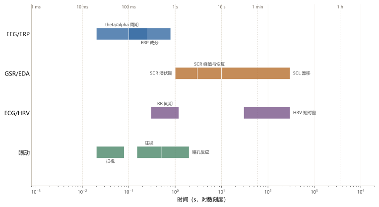
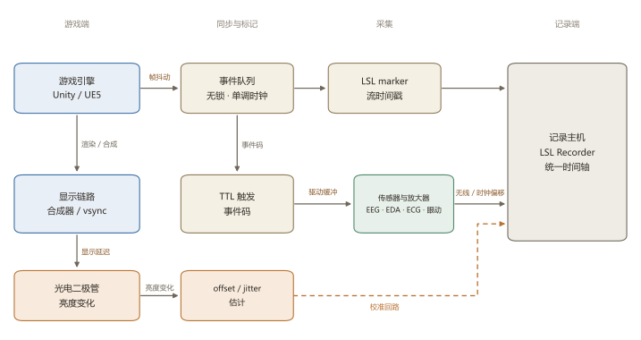
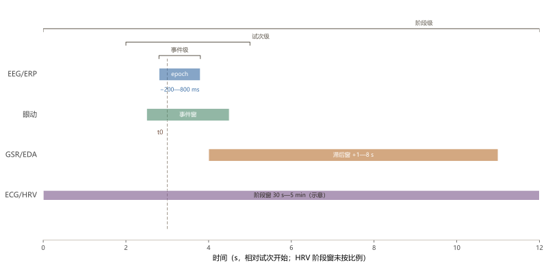
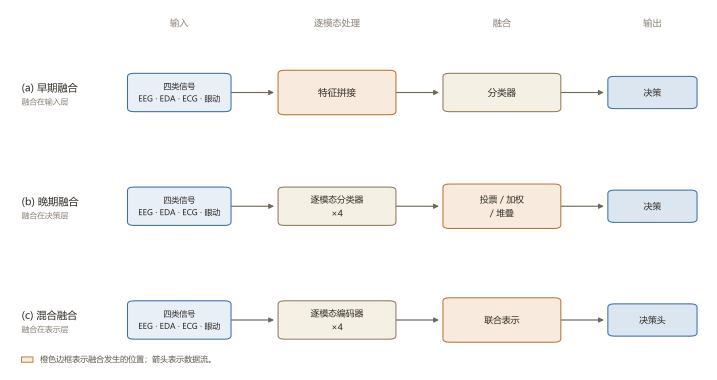

## 摘要

功能游戏将训练、康复与评估嵌入游戏循环，使脑电（electroencephalography, EEG）、皮肤电活动（electrodermal activity, EDA）、心电（electrocardiography, ECG）与眼动的同时记录成为常态。四类信号的特征时间尺度跨越数个数量级，事件相关电位（event-related potential, ERP）以毫秒计，EDA 时相反应以秒计，心率变异性（heart rate variability, HRV）以十秒至分钟计，眼动则跨越毫秒至秒。本文认为，功能游戏多模态研究的主要瓶颈并非传感器数量，而是时钟、时间尺度与事件定义三重不同步。围绕“同步—切窗—融合—指标—数据”这一方法学链条，本文梳理各环节的证据与工程路径，并区分直接证据、跨域外推与待检验的设计原则。方法上，本文主张以 Lab Streaming Layer（LSL）与 TTL 硬触发建立可验证的统一时间轴，以多分辨率窗口保留各模态的时间结构，以混合融合为主、晚期融合提供稳健性兜底。评估上，应将同步偏移与抖动、最佳单模态基线及融合增量列为必要报告项。据本文检索，功能游戏场景下同时具备四类信号、可追溯事件日志与认知负荷或参与度标签的公开数据仍然稀缺，相关结论需在游戏内数据中进一步检验。

**关键词**：功能游戏；多模态融合；脑电；皮肤电活动；眼动

## 1 引言

功能游戏（functional games）在本文中指以训练、康复、评估或教育等非娱乐目的为主导的游戏。这类游戏的效果评估长期依赖行为指标与自陈量表，其中行为指标记录分数、反应时与关卡完成情况，自陈量表记录主观负荷、动机与临场感。系统综述与元分析报告了正向的学习与健康结果，但效应量并不稳定，研究方法的质量也参差不齐 [@connolly2012systematic; @wouters2013meta]。以认知训练为例，一项被广泛引用的随机对照研究显示，定制视频游戏可改善老年人的执行功能，并在未训练任务上观察到迁移 [@anguera2013video]；以健康游戏为例，Re-Mission 在青少年癌症患者中改善了治疗依从性与自我效能 [@kato2008video]。上述结果说明功能游戏可以产生可测量的效应，却未说明效应在游戏过程中如何生成。分数上升可能来自策略变化、疲劳、动机或测量误差，单靠行为日志难以区分。游戏用户研究（games user research）已积累了一套行为、主观与生理证据并用的方法传统 [@drachen2018games]。

生理测量为此提供了另一条基于客观数据的研究范式。脑电（electroencephalography, EEG）、皮肤电活动（electrodermal activity, EDA）与心电图（electrocardiography, ECG）可以在游戏进行中连续记录，眼动仪则同时给出注意分配与瞳孔变化。生理计算（physiological computing）把这类实时信号视为可参与交互的状态变量 [@fairclough2009fundamentals]，游戏研究也已积累大量单模态测量经验 [@kivikangas2011review; @mandryk2006psychophysiological]。移动脑成像（mobile brain/body imaging, MoBI）的研究纲领主张把大脑、身体与环境放在同一时间轴上观察，才能理解自然行为中的认知过程 [@makeig2009linking; @gramann2014imaging]。游戏恰好能够提供“可控的自然任务”，其事件边界由引擎产生，难度可调，行为连续，且可以在同一会话内重复测量。这样的自然性也带来代价，运动、肌电、屏幕刷新、无线传输与个体差异都会进入信号，实验室里被控制掉的变量，在游戏里可能会变成真实存在的噪声。

四类信号的互补性常被概括为“EEG 反映中枢活动、GSR 反映情绪唤醒、ECG 反映自主神经调节、眼动反映注意分配”。这一概括在方向上具有合理性，却掩盖了两个层面的问题。第一，各模态的信息在时间尺度上并不同构，EEG 的 ERP 成分以百毫秒计，EDA 的时相反应以秒计，HRV 的指标以十秒至分钟计，眼动的注视与扫视则以毫秒至秒计。第二，各模态并非独立的信息源，EEG 与眼动均受注意与唤醒调制，EDA 与 ECG 均受自主神经调控，瞳孔与 EEG 的唤醒成分可能共享同一去甲肾上腺素通路 [@astonjones2005integrative]。因此，“多模态”并不等于“多证据”，若不在构念层面加以区分，融合只会导致相关误差的叠加。

本文的核心判断是，**多模态功能游戏研究的瓶颈并不在于传感器数量，而在于三个层面的不同步，即时钟不同步、尺度不同步与事件定义不同步**。时钟不同步使跨模态耦合受到延迟污染，尺度不同步使分析窗口将不同构念混为一体，事件定义不同步则使“同一试次”在不同模态上指向不同时刻。三者叠加，足以使统计上显著的结果在方法上失去意义。

据本文检索，功能游戏中的三组模态融合尚缺公认的基准与报告规范，现有证据多来自实验室任务、情感视频或单一模态的游戏研究。本文因此不追求覆盖所有游戏类型与生理模态，而是将“同步—切窗—融合—指标—数据”作为一条方法学链条，逐一说明其中哪些做法有直接证据、哪些仅能跨域外推、哪些仍属待检验的设计原则。@fig-timescales 提供全文的时间尺度参照，@tbl-modalities 汇总各模态的可观测尺度与噪声结构。

{#fig-timescales width=100% fig-alt="对数时间轴上的四条色带：EEG/ERP 覆盖毫秒至一秒，GSR/EDA 覆盖一秒至数十秒，ECG/HRV 覆盖十秒至五分钟，眼动覆盖毫秒至数秒；标注了 P300、SCR 潜伏期、RR 间期与注视时长等典型现象。"}

## 2 各模态的信号特性与时间尺度

融合的首要步骤并非选择模型，而是确认各通道在何种时间尺度上携带可解释的信息。将四类信号统一重采样至 10 Hz 后拼接，表面规整，实则损失 ERP 的高频结构，并将 EDA 的慢反应切割为碎片。

### 2.1 EEG/ERP 的毫秒级事件锁时

EEG 记录头皮电位，其瞬时值来自大量皮层锥体细胞突触后电位的总和，空间分辨率受容积传导限制，时间分辨率则由采样率与放大器带宽决定。研究级设备常见 250—1000 Hz 采样，消费级设备多在 128—500 Hz。事件相关电位（event-related potential, ERP）是对多试次 EEG 在事件锁时条件下平均所得的波形，P300、N400、晚期正电位（LPP）与反馈相关负波（FRN）分别与注意资源分配、语义整合、情绪与动机显著性以及结果评估相关 [@polich2007updating; @picton2000guidelines]。ERP 的信噪比随试次数平方根增长，单试次 ERP 的可靠性有限 [@luck2014introduction]；功能游戏中的事件往往重复少、间隔不规则，这一限制尤为突出。

频域指标提供了另一条路径。theta（4—8 Hz）与 alpha（8—13 Hz）功率、alpha 去同步以及 theta/alpha 比被广泛用于索引注意、记忆与负荷 [@klimesch1999eeg; @antonenko2010using]。Gevins 与 Smith 在人机交互任务中报告了 EEG 负荷指标对任务难度的敏感性 [@gevins2003neurophysiological]。然而这些指标并非“认知负荷”的直接读数，theta 功率同时受困倦、眼动与参考电极影响，alpha 功率受视觉输入与个体 alpha 峰值频率调制，theta/alpha 比在不同任务与个体间的可比性有限。据本文检索，单一 EEG 特征在跨被试、跨会话条件下的预测力通常明显低于被试内条件，这一落差本身即应作为结果报告，而非视为可被平均消除的噪声。EEG 分类器的跨被试、跨会话泛化仍是脑机接口研究的核心难题 [@lotte2018review]。

游戏场景还引入三类特殊问题。其一是运动与肌电伪迹，按键、头部转动、语音交流与 VR 中的身体运动都会污染低频与高频段，独立成分分析（independent component analysis, ICA）与伪迹子空间重建可去除部分眼电与肌电，但需要足够的数据与人工审查 [@jung2000removing; @delorme2004eeglab]。其二是无线与干电极，低成本无线干电极系统提高了生态效度，却带来更高的接触阻抗、运动敏感性与传输延迟 [@debener2012how]。其三是事件锁时点，视觉呈现、按键输入与游戏反馈是三个不同的时间点，选择哪一个作为锁时点取决于研究要问的是感知、准备还是结果评估，将三者混为一个“事件”，是 ERP 研究中最隐蔽的构念错误之一。

### 2.2 GSR/EDA 的秒级滞后与时相分解

皮肤电导受汗腺活动调制，汗腺主要受交感胆碱能纤维支配。EDA 通常分解为紧张性（tonic）皮肤电导水平（SCL）与时相性（phasic）皮肤电反应（SCR）[@boucsein2012electrodermal; @boucsein2012publication]。SCL 于数十秒至数分钟内呈缓慢漂移，SCR 表现为事件后约 1—3 s 起始、数秒后达峰、数秒至十余秒后恢复的瞬态。该时间结构构成 EDA 的核心限制，即 EDA 无法追踪毫秒级事件，亦不能将峰值时刻等同于刺激时刻。将 SCR 峰值对齐至游戏事件时，所得跨模态相关至少受到 1—3 s 生理潜伏期的污染。

常用指标包括 SCR 幅值、SCR 频率、SCL 均值与斜率，以及事件相关 SCR。上述指标对唤醒、应激、疼痛、运动与温度均敏感，构念特异性因而有限。“GSR 高”不能解释为“情绪积极”或“认知负荷高”，更宜理解为交感唤醒状态的改变。游戏事件密集时，相邻 SCR 重叠，单个峰值可对应多个事件；连续分解方法可将时相驱动估计为连续时间序列，从而支持滞后感知的对齐与反卷积 [@benedek2010decomposition]。采样率方面，4—32 Hz 已足以覆盖 EDA 的有效带宽，提高采样率并不增加信息量。

### 2.3 ECG/HRV 的 R 峰检测与窗口敏感性

ECG 记录心脏电活动，R 峰检测给出逐拍 RR 间期，心率变异性（heart rate variability, HRV）指标由此派生。时域指标包括 SDNN、RMSSD 与 pNN50，频域指标包括低频（LF，0.04—0.15 Hz）与高频（HF，0.15—0.4 Hz）。HF 主要反映呼吸性窦性心律不齐，LF 的解释则混合了压力反射、交感与副交感活动 [@taskforce1996heart; @shaffer2017overview]。HRV 各指标均为窗口统计量，30 s 窗口与 5 min 窗口给出的 LF/HF 可能不同，短窗的频域估计方差更大。Task Force 的经典建议是采用 5 min 短时程记录，超短窗（30 s 甚至更短）仅在部分指标上有条件可用，且需逐指标验证 [@taskforce1996heart; @shaffer2017overview]。

在游戏中，身体活动构成主要混淆，VR 中的站立、转身与控制器操作均会改变心率，缺少加速度计或行为日志时，难以区分心理负荷与体力活动。HRV 亦非认知负荷的直接指标，其更多索引自主神经调节状态与恢复能力 [@thayer2000model]。将 HRV 下降一律解释为“负荷上升”，忽略了情绪唤醒、姿势变化与呼吸节律的贡献。

### 2.4 眼动的事件检测与阶段切分

眼动仪输出注视、扫视、眨眼与瞳孔事件，采样率从 60 Hz 到 1200 Hz 不等。注视检测常用速度阈值（I-VT）或离散度阈值（I-DT），阈值需按任务与设备调整 [@salvucci2000identifying; @holmqvist2011eye]。核心指标包括首次注视时间、注视时长、注视次数、扫视幅度与速度、兴趣区（area of interest, AOI）转移以及瞳孔直径。瞳孔直径受光照反射、调节距离、眨眼与认知努力共同影响，任务诱发的瞳孔反应通常在事件后 0.5—2 s 达峰，需做基线校正与光照匹配 [@beatty1982task; @laeng2012pupillometry; @vanderwel2018pupil]。瞳孔与蓝斑—去甲肾上腺素系统的关系提供了机制解释，但将瞳孔直径直接读作“努力”仍显粗略 [@astonjones2005integrative]。

眼动的构念多义性较 EEG 更为明显，同一注视模式可能对应理解困难、兴趣缺失或界面引导等不同解释，AOI 的定义会改变结论，注视时长既可能索引加工深度，也可能索引搜索困难。VR 眼动还面临校准漂移、视场与渲染延迟等问题 [@clay2019eye]。因此，眼动指标须与任务阶段、界面布局和游戏日志联合解释，不宜单独作为注意的通用指标。

| 模态 | 典型采样率 | 特征时间尺度 | 核心指标 | 主要噪声 |
|---|---|---|---|---|
| EEG/ERP | 250—1000 Hz | 毫秒级；ERP 成分 100—1000 ms；theta/alpha 周期 80—250 ms | P300/N400/LPP/FRN 幅值与潜伏期；频带功率；theta/alpha 比 | 眼电、肌电、运动、参考电极、无线延迟 |
| GSR/EDA | 4—32 Hz | 秒级；SCR 起始 1—3 s，恢复 5—10 s；SCL 漂移数十秒至分钟 | SCL、SCR 幅值/频率、事件相关 SCR | 温度、湿度、接触、运动、个体差异 |
| ECG/HRV | 250—1000 Hz | 十秒至分钟；RR 间期 0.6—1.2 s；HRV 窗口 30 s—5 min | HR、RMSSD、SDNN、LF/HF | 运动、呼吸、心律失常、R 峰误检 |
| 眼动 | 60—1200 Hz | 毫秒至秒；注视 150—500 ms，扫视 20—80 ms，瞳孔反应 0.5—2 s | 注视/扫视、AOI、瞳孔直径、眨眼 | 校准漂移、头动、光照、屏幕反光 |

: 各模态的采样、时间尺度、核心指标与主要噪声 {#tbl-modalities}

## 3 同步与统一时间轴

多模态研究中最常见且易被低估的错误，是将“同一试次”等同于“同一时刻”。同一试次仅表明事件在逻辑上属于同一次任务。从引擎发出事件，到屏幕像素变化，再到传感器采样与数据写入磁盘，其间涉及帧调度、显示链路、驱动缓冲与网络传输。同步工作的任务在于测量并记录上述环节的延迟，并在分析中显式处理。

### 3.1 LSL 的机制与精度边界

Lab Streaming Layer（LSL）提供统一的流描述、时间戳、自动发现与时钟同步机制，Python、C++、C#、MATLAB 等均有客户端 [@kothe2025lab]。它将每个传感器封装为具有名义采样率的流，接收端按时间戳而非到达顺序重建样本序列。这一设计解决了“多设备数据如何汇入同一记录”的工程问题，但未解决“传感器何时真正响应”的物理问题。**LSL 统一的是记录端的时间轴，而非物理世界的同时性**。

LSL 的时间戳在采集端生成，接收端通过时钟偏移估计将不同主机的流映射到同一时间轴。在良好局域网与有线连接下，偏移可控制在毫秒级，但这仅代表记录时间的精度，并不代表传感器响应的精度。放大器内部缓冲、驱动批量传输、眼动仪内部处理与无线链路均会引入额外的端到端延迟，且这些延迟可能为常数，也可能表现为抖动。将 LSL 时间戳视为物理事件时间，是许多跨模态论文的隐含假设，也是同步误差的主要来源。

常数延迟与抖动的区分至关重要。常数延迟将所有事件整体平移，不改变条件间的相对比较，但会改变绝对潜伏期与跨模态滞后；抖动则会模糊事件锁时平均。设事件时间抖动服从零均值高斯分布、标准差为 $\sigma_t$，则事件锁时平均对频率 $f$ 的衰减近似为

$$
A(f) = \exp\left(-2\pi^2 f^2 \sigma_t^2\right).
$$ {#eq-jitter}

以 $\sigma_t=10$ ms 为例，10 Hz 成分保留约 82%，30 Hz 成分仅保留约 17%；抖动增至 20 ms 时，10 Hz 成分保留约 45%。这表明，即便同步在表面上未见异常，高频跨模态分析仍可能失效。报告同步质量时，至少应给出偏移（offset）与抖动（jitter）两个量并说明测量方法，仅报告“使用 LSL 同步”不足以支持毫秒级结论。

### 3.2 TTL 硬触发与光电二极管外部验证

TTL 硬触发将事件码写入并口、串口或采集卡，由放大器与 EEG 采样时钟同源记录。其时间确定性高于软件时间戳，但发送时刻仍受软件调度影响。若事件在游戏线程中排队，写入端口时已过去若干毫秒。TTL 的价值在于揭示事件发生与事件记录之间的软件不确定性，而非自动消除该不确定性。

光电二极管提供了另一端的验证。将光电二极管置于屏幕角落并检测画面亮度变化，可测量“逻辑事件—像素变化—放大器采样点”的端到端延迟。该延迟涵盖引擎渲染、合成器、显示面板与 vsync 的全部贡献，可作为视觉 ERP 研究中接近物理真值的参照。将软件时间戳、TTL 与光电二极管三者互验，方可将同步误差分解为可校正的常数偏移与不可校正的随机抖动。同步误差的主要来源与校准手段见 @tbl-sync。

| 误差源 | 典型量级 | 主要影响 | 校准手段 |
|---|---|---|---|
| 帧间隔与帧抖动 | 16.7 ms（60 fps）、8.3 ms（120 fps），抖动可达数毫秒 | 事件起点不确定 | 固定帧率、记录 frame index、光电二极管 |
| 显示与合成延迟 | 5—20 ms | 视觉事件晚于逻辑事件 | 光电二极管端到端标定 |
| 驱动与设备缓冲 | 10—100 ms | 传感器数据整体后移 | 厂商延迟说明、脉冲/闪光测试 |
| 无线传输 | 20—100 ms，抖动更大 | 丢包、乱序、时间戳漂移 | 有线优先、缓冲监控、LSL 时钟同步 |
| 时钟漂移 | 数十 ppm，分钟级累积至毫秒 | 长会话跨设备偏移 | LSL/NTP/PTP、周期性重同步 |
| 软件调度 | 1—50 ms | marker 发送延迟 | 独立线程、实时优先级、避免 GC |

: 同步误差的主要来源与校准手段 {#tbl-sync}

### 3.3 引擎端实现

Unity 平台已有社区维护的 LSL4Unity 封装，可在 C# 中创建 marker stream 并推送事件。工程实现的关键在于 marker 的发送时刻，而非能否发送。应在事件真正影响画面的那一帧发送 marker，记录 `frame index` 与单调时钟读数，避免在主线程执行网络 I/O，并将暂停、场景加载与帧率骤降写入日志。若以协程在渲染后发送，需明确其与 vsync 的相位关系；若以 `Time.time` 作为事件时间，则会在暂停与时间缩放时失真。

Unreal Engine 5 无官方 LSL 插件，通常需将 liblsl 编译为模块，以 `FRunnable` 创建独立线程，通过无锁队列接收游戏线程的事件，再由推送线程按固定频率发送。游戏线程仅负责记录事件与入队，不负责发送。推送线程以 `FPlatformTime::Seconds()` 或平台单调时钟生成时间戳。网络断开时需具备重连与丢弃策略，且不得阻塞游戏线程。跨引擎的共同原则包括，事件 ID 由注册表管理，marker 负载采用 JSON 或定长结构，磁盘日志与流数据共享同一时钟，崩溃后可从日志恢复事件序列。

**例 1｜一次游戏事件的跨设备时间戳**

```text
[14:32:10.417] engine  event=boss_spawn frame=18342 t_mono=412.417
[14:32:10.419] lsl     marker=boss_spawn t_lsl=412.419 offset=+2.1ms
[14:32:10.431] eeg     trigger=0x21 sample=103344 t_amp=412.430 offset=+13.0ms
[14:32:10.446] eye     event=boss_spawn t_eye=412.446 offset=+29.0ms
[14:32:11.902] gsr     scr_onset_est=413.900 offset=+1.48s
```

*前四行应在毫秒级相互验证。逻辑事件、LSL 时间戳、放大器触发与眼动事件之间 2—29 ms 的差异，主要源于帧调度、驱动缓冲与设备内部处理。最后一行的 1.48 s 并非同步误差，而是 SCR 的生理潜伏期。若将其视为“同步失败”加以校正，反而会破坏 EDA 的时间结构。*

### 3.4 多分辨率时间轴设计

统一时间轴不意味着把所有信号重采样到同一频率，而是保留原始时间戳，并在分析层定义对齐规则。一个可操作的 schema 至少包含五层：原始样本层（L0，毫秒级采样）、事件层（L1，marker 与时间戳）、窗口层（L2，秒级特征聚合）、阶段层（L3，关卡、任务或难度阶段）、会话层（L4，被试与实验条件）。每一层都保留 `session_id`、`event_id`、`t_event`、`t_sensor`、`modality`、`channel`、`value` 与 `quality` 字段，使任何一次融合都能追溯到原始时刻。

分层的意义在于，不同模态仅在不同层级上具备可比性。ERP 的意义体现在 L1 的事件锁时 epoch 上，SCR 体现在 L2 的滞后窗口上，HRV 体现在 L2 的长窗或 L3 的阶段统计上，眼动的 AOI 转移则可能跨越 L1 与 L3。若将四者强行压缩至同一张 `n_samples × n_channels` 表，尺度信息即告丧失。@fig-sync 给出同步链路与误差来源，@fig-windows 给出多分辨率窗口的示意。

{#fig-sync width=100% fig-alt="游戏引擎、LSL marker、TTL 触发、EEG/EDA/ECG 放大器、眼动仪与记录主机的数据流；下方标注帧抖动、显示延迟、驱动缓冲、无线传输与时钟漂移等误差源，以及光电二极管校准回路。"}

## 4 时间窗口与对齐策略

窗口是对“同一观测”的操作化定义，窗口设定失当，融合模型学到的将是错位相关。本节按模态说明切窗与基线处理，继而讨论跨模态软对齐。核心原则为，在事件层保留时间戳，在窗口层允许模态特异窗口，在模型层以掩码或注意力处理缺失与错位。

### 4.1 EEG 的事件锁时 epoch 与基线校正

ERP 分析通常围绕事件截取 `[-200, 800] ms` 的 epoch，并以事件前 `[-200, 0] ms` 的均值进行基线校正。基线窗口并非越宽越好，过宽的基线会引入前一事件的晚期成分或慢波漂移，过窄的基线则放大噪声。基线校正并非可选项，而是构念定义的一部分。报告 ERP 幅值时，须同时报告参考电极、基线窗口、滤波参数与伪迹拒绝标准 [@picton2000guidelines]。

锁时点的选择决定成分的解释。视觉呈现锁时适于研究早期感知与注意，按键锁时适于研究运动准备与执行，反馈锁时适于研究结果评估与学习。功能游戏中三者往往相隔数百毫秒，若将反馈锁时的 FRN 作为视觉锁时的 P300 解释，结论即出现错位。单试次分析还面临低信噪比问题，事件重复少的游戏中平均波形可能仅有数十个试次，ERP 潜伏期估计误差不可忽略 [@luck2014introduction]。

重叠 epoch 会导致数据泄漏。同一试次的相邻 epoch 与同一关卡内的连续事件，若在交叉验证中被随机划分至训练集与测试集，模型将记忆被试与试次，而非学习可泛化的模式。正确做法是按试次或按阶段分组切分，并在报告中说明分组单位。

### 4.2 GSR 的滞后感知滑窗

由于 SCR 的起始潜伏期约为 1—3 s，事件相关 EDA 的窗口应相对事件后移，不宜以事件为中心对称截取。常用做法是取 `[t0+1, t0+8] s` 作为时相窗口，以 `[t0-3, t0] s` 或更长的时段作为基线。窗口长度取 8—30 s，取决于事件密度与恢复时间。若事件间隔小于 10 s，相邻 SCR 将发生重叠，此时应采用连续分解或反卷积，而非简单取峰值。

常用的 SCR 冲激响应模型为双指数（Bateman）函数：

$$
r(t)=k\left[\exp\left(-\frac{t-t_0}{\tau_d}\right)-\exp\left(-\frac{t-t_0}{\tau_r}\right)\right],\quad t\ge t_0,
$$ {#eq-scr}

其中 $t_0$ 为起始潜伏期，$\tau_r<\tau_d$ 分别为上升与衰减时间常数，$k$ 为增益。@eq-scr 将反应形状与事件时刻分离，使反卷积能够在事件密集时估计各事件的贡献 [@benedek2010decomposition]，亦为说明峰值时刻不宜等同于事件时刻提供了最简模型。

**例 2｜Boss 出现与皮电峰值的时间错位**

```text
t=10.0s  boss_spawn（引擎事件）
t=10.0s  玩家开始连续按键（行为日志）
t=11.8s  玩家点击“闪避”按钮（行为日志）
t=12.5s  GSR 达到局部峰值
```

*若以 12.5 s 的峰值反推“Boss 出现引起唤醒”，则会把 11.8 s 的闪避动作一并归入同一反应。若以 10.0 s 为中心取 ±2 s 窗口，窗口于 12.0 s 结束，恰会错过该峰值。滞后感知窗口应覆盖 11—18 s，并将 11.8 s 的动作作为竞争解释纳入模型，而非事后排除。*

### 4.3 ECG 的 R 峰后 HRV 窗口

HRV 的分析单位是窗口，而非单次心跳。R 峰检测后，需先剔除误检与异位搏动，再在至少 30 s、稳妥条件下取 5 min 的窗口内计算时域指标。频域指标对窗口长度更为敏感，30 s 窗口的 LF/HF 估计方差较大，不宜与 5 min 窗口的结果直接比较 [@taskforce1996heart; @shaffer2017overview]。若研究问题要求事件级关联，应将 HRV 窗口作为阶段级变量，与事件级 EEG/眼动特征分层建模，而非将 5 min 的 HRV 值直接赋给每个事件。

RMSSD 是常用的短时程迷走神经指标之一：

$$
\mathrm{RMSSD}=\sqrt{\frac{1}{N-1}\sum_{i=1}^{N-1}\left(RR_{i+1}-RR_i\right)^2}.
$$ {#eq-rmssd}

@eq-rmssd 对窗口内的逐拍变化敏感，因而更易受运动与呼吸影响。游戏中的身体活动、语音交流与姿势变化均需在日志中标注。若缺少这些协变量，则难以将 HRV 的“负荷效应”与体力活动区分开。

### 4.4 眼动的事件检测与任务阶段切分

眼动分析的切分单位通常是任务阶段，如关卡开始、谜题出现、UI 切换与失败重试。分析时先用 I-VT 或 I-DT 检测注视与扫视，再将注视序列映射至 AOI，最后依据游戏日志切分阶段 [@salvucci2000identifying; @holmqvist2011eye]。瞳孔分析需要更细的基线，可取事件前 200—500 ms 的均值，扣除眨眼与缺失段，必要时按亮度做回归校正。若同一阶段内光照变化较大，应将亮度作为协变量，而非假设瞳孔仅反映认知努力 [@beatty1982task; @vanderwel2018pupil]。

采样率与精度必须报告。60 Hz 眼动仪的时间分辨率约为 16.7 ms，难以可靠检测短扫视，120 Hz 以上才适合分析扫视动力学。校准精度、空间精度与数据丢失率应与结果一并报告，而非仅报告设备型号。AOI 的定义亦应预先注册，同一画面在不同分辨率与视场下，AOI 边界会改变注视归属。

### 4.5 跨模态软对齐

硬对齐将四类信号重采样至同一网格后按行拼接。该做法在工程上简单，却带来三项代价，即高采样率模态被降采样而损失高频信息，低采样率模态被插值而产生并不存在的样本，不同延迟被同一窗口强行平均而使跨模态相关被稀释。更合理的做法是软对齐，即每个模态保留自身的窗口与编码器，仅在事件级 token 上对齐，并允许模型学习模态间的滞后。

形式化地，对事件 $t_0$ 与模态 $m$，定义模态特异窗口

$$
W_m(t_0)=\left[t_0-a_m,\ t_0+b_m\right],\qquad \rho_m=\frac{a_m+b_m}{\tau_{\mathrm{event}}},
$$ {#eq-window}

其中 $a_m,b_m$ 由该模态的生理潜伏期与设备延迟决定，$\tau_{\mathrm{event}}$ 是事件的特征持续时间。$\rho_m\gg 1$ 时，窗口内应做聚合（如 SCR 的均值或峰值）；$\rho_m\approx 1$ 时，窗口内可提取事件级特征；$\rho_m<1$ 时，该模态在事件尺度上信息不足，应显式标记为缺失，不能强行插值。Soft-DTW 等可微对齐方法可以在事件边界不确定时学习时间扭曲，但需要足够的样本与正则，否则会把噪声对齐成虚假的耦合 [@cuturi2017soft]。

**软对齐的目标是使各模态在其自身的时间尺度上提供信息，再由模型决定合并方式**。@fig-windows 给出事件级、试次级与阶段级窗口的嵌套关系。同一事件在四类信号上采用不同长度的窗口，GSR 窗口相对事件后移，HRV 窗口则跨越整个阶段。

{#fig-windows width=100% fig-alt="以事件时刻为零点的嵌套窗口：EEG 事件锁时 epoch、眼动事件窗、GSR 滞后窗、ECG/HRV 阶段窗；下方标出事件级、试次级与阶段级三个层级。"}

## 5 融合层面

融合的关键在于确定在哪个层级允许模态交互。多模态机器学习通常区分早期、中期与晚期融合 [@baltrusaitis2019multimodal]，数据融合研究则从特征、决策与混合层级给出分类 [@lahat2015multimodal]。早期融合使原始特征直接交互，晚期融合先由各模态独立预测再行集成，混合融合则在模态特异编码之后建立联合表示。三者的区别不仅在于网络结构，更在于对异构性与缺失所设定的不同假设。

### 5.1 早期融合

早期融合把各模态特征拼接为一个向量，再送入统一模型：

$$
\mathbf{x}=\left[\mathbf{x}_{\mathrm{EEG}};\mathbf{x}_{\mathrm{EDA}};\mathbf{x}_{\mathrm{ECG}};\mathbf{x}_{\mathrm{ET}}\right],\qquad \hat{y}=f(\mathbf{x}).
$$ {#eq-early}

其优点在于实现简单、保留跨模态交互且仅需单一模型，缺点则在于依赖同一时间网格与同一试次定义，缺失模态难以处理，特征维度随模态数增长，小样本下易过拟合。早期融合适合同步良好、模态同质且样本量充足的任务，例如实验室中的多通道情感识别 [@koelstra2012deap]。在功能游戏中，上述前提很少同时成立，EDA 的窗口以秒计，ERP 的窗口以百毫秒计，眼动事件又具异步性。将三者压缩至同一数据表，相当于以最慢模态定义所有模态的时间分辨率。

### 5.2 晚期融合

晚期融合先由每个模态独立训练分类器或回归器，再于决策层集成。最简单的集成方式为投票与平均，较复杂的方式为堆叠（stacking），即以元学习器学习各模态预测的权重。可靠性加权构成晚期融合中一个可解释的特例。

$$
p(y\mid \mathbf{x})\propto\prod_{m=1}^{M}p_m(y\mid \mathbf{x}_m)^{w_m},\qquad w_m=\frac{1/\sigma_m^2}{\sum_{j=1}^{M}1/\sigma_j^2},
$$ {#eq-late}

其中 $\sigma_m^2$ 为模态 $m$ 的预测方差或验证误差。该方案的优点在于对缺失模态友好、模块化、可解释且易部署，缺点在于忽略跨模态交互，当各模态误差相关时集成增益有限。晚期融合适用于异步、小样本且需实时降级的场景，例如眼动仪掉线或 EEG 接触不良时，系统仍可依据剩余模态给出保守判断。

混合融合先以模态特异编码器保留各自的归纳偏置，再于联合表示层建立交互。EEG 可采用一维卷积或 Transformer 编码时序与通道关系，EDA/ECG 可采用因果卷积或门控循环单元编码慢变动态，眼动可采用序列模型编码注视与 AOI 转移。编码后的 token 通过跨模态注意力或门控融合合并，最后由决策头输出。训练中可引入单模态重建、模态对比学习与模态 dropout 等辅助损失，以提升模型在缺失条件下的稳健性。

该路线适合功能游戏，因其同时应对三个问题，异构采样率由各自编码器吸收，异步延迟由事件级 token 与可学习滞后吸收，缺失模态由掩码与 dropout 吸收。其代价在于参数多、训练难、可解释性弱，小样本下易过拟合。**较为务实的策略是先以晚期融合建立基线，再逐步增加联合层，并通过消融实验检验联合层带来的增量**。若增量不显著，则保留晚期融合更为稳妥。@fig-fusion 给出三种结构的对比。

{#fig-fusion width=100% fig-alt="三行四列的流程对照图：输入为 EEG、EDA、ECG、眼动四类信号；早期融合在输入层直接拼接特征再分类；晚期融合先逐模态分类再投票或堆叠；混合融合先逐模态编码再在联合表示层融合；橙色边框表示融合发生的位置。"}

### 5.4 三方案对比

三种方案的比较见 @tbl-fusion。

| 方案 | 做法 | 优点 | 缺点 | 适用场景 |
|---|---|---|---|---|
| 早期融合 | 特征拼接后统一建模 | 保留跨模态交互；实现简单 | 依赖同一时间网格；缺失模态难处理；维度高 | 同步良好、样本充足、模态同质 |
| 晚期融合 | 各模态独立预测后集成 | 缺失模态友好；模块化；易解释 | 忽略跨模态交互；误差相关时增益有限 | 异步、小样本、实时降级 |
| 混合融合 | 模态特异编码器+联合表示+决策头 | 兼顾异构性与交互；可处理缺失 | 参数多、训练难、可解释性弱 | 多模态、事件级对齐、有预训练 |

: 早期、晚期与混合融合的比较 {#tbl-fusion}

## 6 核心指标与评价体系

指标并非标签的附属品，选择何种指标，等价于声明研究意图测量什么。功能游戏的多模态评估至少涉及四类构念，即认知负荷、参与度与唤醒、任务绩效，以及模型层面的分类与泛化。四者既不能互相替代，也不能简单相加。评估维度与常见陷阱见 @tbl-eval。

### 6.1 认知负荷

认知负荷包含任务难度、努力投入与资源占用等不同成分，单一指标难以覆盖全部。常用操作化包括主观量表（如 NASA-TLX、Paas 量表）、行为绩效、EEG 的 theta/alpha 指标与瞳孔直径 [@antonenko2010using; @beatty1982task; @vanderwel2018pupil]。这些指标各有明确边界，主观量表反映被试对负荷的知觉，绩效反映任务完成结果，EEG 反映神经振荡，瞳孔反映努力与唤醒的混合。若将其统称为“认知负荷”，构念效度将难以检验。

据本文检索，单一模态的预测力在跨被试条件下通常有限。多模态融合研究常报告总体准确率的提升，却较少报告相对最佳单模态的增量，而后者才是融合是否值得的直接证据。一种可操作的做法是以最佳单模态为基线，报告融合的 ΔAUC、ΔF1 与校准改善，并通过消融实验说明各模态的边际贡献。若融合增益主要来自样本量更大的模态，所谓多模态融合仅相当于以更高成本重复单模态分析。

### 6.2 参与度与唤醒度

参与度（engagement）与唤醒（arousal）常被混用。唤醒指生理激活水平，可由 SCR、心率、瞳孔与 EEG 的 beta/gamma 活动索引。参与度指任务投入程度，还包含行为、情感与认知三个维度。EDA 对唤醒敏感，却不能区分效价，高唤醒可能是兴奋，也可能是焦虑或愤怒。将 GSR 峰值直接解释为玩家投入程度，相当于将二维情绪空间压缩为一维。

游戏事件为唤醒分析提供了天然标记，包括奖励、失败、难度跃迁与社交互动。分析时应将事件类型作为因子，而非合并所有事件，同时控制身体活动与语音，二者均会改变自主神经信号。参与度的行为指标，如停留时间、重试次数与主动探索，应与生理指标并列报告，而非仅作为标签使用。

### 6.3 任务绩效

任务绩效属于行为层因变量，而非生理层的真值。分数、反应时、正确率、关卡完成时间与死亡次数均可从游戏日志中提取，且天然带有时间戳。它们适合与事件级生理特征对齐，也适合作为融合模型的辅助输出。绩效与生理的分离属常见现象，高绩效可能伴随高负荷，即熟练但费力，低绩效亦可能伴随低负荷，如放弃或走神。因此，绩效不能单独定义认知负荷，生理也不能单独定义学习效果。

学习效应需要更长的观察窗。单次会话内的变化可能反映策略调整，跨会话的变化才更接近学习 [@siegler1991microgenetic; @newell2001time]。功能游戏的训练效果通常在多次会话后显现，而生理指标在单次会话内波动较大。将两者置于同一时间尺度上比较，会低估学习效应的滞后性。

### 6.4 分类与泛化性能

分类任务应报告准确率、平衡准确率、F1 与 AUC，并说明类别分布与阈值选择。划分方式则更为关键，包括被试内（within-subject）、跨被试（leave-one-subject-out, LOSO）、跨会话与跨游戏。重叠窗口、同一试次的相邻 epoch 以及同一关卡内的连续事件均会造成数据泄漏。**若随机按样本切分，测试集中将出现训练集的“近邻”样本，导致准确率被系统性高估**。

跨被试泛化差距可以定义为

$$
\Delta_{\mathrm{LOSO}}=\mathrm{Acc}_{\mathrm{within}}-\mathrm{Acc}_{\mathrm{LOSO}}.
$$ {#eq-loso}

报告时应给出折间均值、标准差与置信区间；样本量较小时，还应给出置换检验或贝叶斯区间。若 $\Delta_{\mathrm{LOSO}}$ 较大，说明模型学到的更多是被试特异模式，而非任务相关模式，此时多模态融合未必能够弥补该差距，个性化校准或域适应可能更为有效。重测信度与评分者一致性可采用组内相关系数（intraclass correlation, ICC）评估 [@shrout1979intraclass]，两种测量之间的一致性可采用 Bland—Altman 方法描述 [@bland1986statistical]。

### 6.5 综合指数与可解释性

综合指数将多个指标归纳为单一分数，便于比较与决策，但也易掩盖构念差异。加权求和要求各指标同尺度、同方向且可补偿，跨尺度直接相加缺乏方法学依据，例如将毫秒级的 ERP 幅值与分钟级的 HRV 相加。更合理的做法是分层建模，先在模态内进行特征约简，再在模态间进行加权或因子分析，最后以贝叶斯层次模型估计个体与群体差异。

可解释性分析应区分模型解释与机制解释。SHAP、排列重要性与模态消融可说明模型依赖哪些特征，却不足以证明这些特征构成因果机制 [@lundberg2017unified]。当特征高度相关时，重要性会在相关特征之间分摊，仅依据排名可能产生误导。较为稳妥的报告组合包括单模态基线、逐模态消融、融合增量、关键特征的时序可视化，以及失败案例的定性分析。

| 维度 | 指标 | 常见陷阱 |
|---|---|---|
| 认知负荷 | 主观量表、theta/alpha、瞳孔、绩效 | 把唤醒当负荷；量表与生理指标构念不对应 |
| 参与度/唤醒 | SCR、HR、HRV、瞳孔、行为 | 从 GSR 推断效价；忽略运动混淆 |
| 任务绩效 | 分数、反应时、正确率、关卡完成 | 把绩效当生理标签的 ground truth |
| 分类/泛化 | 准确率、F1、AUC、LOSO、跨会话 | 重叠窗口泄漏；只报最优折 |
| 综合指数 | 加权融合、因子模型、层次模型 | 跨尺度相加；权重不可解释 |

: 评估维度、指标与常见陷阱 {#tbl-eval}

## 7 公开数据集现状

公开数据集在很大程度上决定方法可复现的程度。就本文关注的问题而言，理想数据集应同时满足四项条件，即具备游戏情境、包含 EEG/EDA/ECG/眼动四类信号、提供认知负荷或参与度标签，并具备可追溯的事件日志。据本文检索，同时满足四项条件的公开数据集仍然稀缺，现有数据多在其中两项上较强，而在其余两项上有所折衷。相关数据集汇总于 @tbl-datasets。

| 数据集 | 模态 | 任务与标签 | 对功能游戏的可用性 |
|---|---|---|---|
| DEAP [@koelstra2012deap] | EEG、GSR、ECG、呼吸等 | 音乐视频诱发情绪；valence/arousal | 情绪标签可用，但非游戏、非认知负荷 |
| STEW [@stew2018] | EEG | SIMKAP 多任务；工作负荷 | 适合负荷建模基线，缺眼动与自主神经 |
| ZuCo [@zuco2018] | EEG、眼动 | 自然句子阅读 | 同步质量好，但任务为阅读 |
| CLARE [@clare2025] | EEG、EDA、ECG、眼动 | 认知负荷实时评估 | 四类信号与负荷标签最接近，任务非游戏 |
| MOCAS [@mocas2024] | EEG、ECG、GSR、眼动 | 同时任务的工作负荷 | 多任务负荷，场景为监视任务 |
| BIRAFFE2 [@biraffe2] | GSR、ECG、面部等 | 游戏化情感诱导 | 游戏化接近，标签为情绪而非负荷 |
| VR 多模态平台 [@tufts2025] | 多模态 | VR 认知状态 | 生态效度较高，游戏机制不一定具备 |

: 与功能游戏多模态研究相关的公开数据集 {#tbl-datasets}

DEAP 是情感计算领域最常被引用的公开数据集之一，包含 EEG 与多种外周生理信号，标签为效价与唤醒 [@koelstra2012deap]。其优势在于规模与可复现性，局限在于刺激为音乐视频、任务并非游戏，且标签为情绪而非认知负荷。STEW 提供了多任务条件下的 EEG 工作负荷数据，适合作为负荷分类的基线，但缺少眼动与自主神经信号 [@stew2018]。ZuCo 同时记录 EEG 与眼动，同步质量较好，适合验证跨模态对齐方法，但任务为自然阅读，缺少游戏事件与交互 [@zuco2018]。

CLARE 与 MOCAS 更接近本文的目标。CLARE 面向实时认知负荷评估，包含 EEG、EDA、ECG 与眼动四类信号，标签为认知负荷 [@clare2025]。MOCAS 面向同时任务的认知负荷，包含 EEG、ECG、GSR 与眼动 [@mocas2024]。两者的局限亦相似，即任务并非功能游戏，事件密度与交互方式不同于游戏，且公开数据规模不足以支撑深度混合融合的训练。BIRAFFE2 提供了游戏化的情感诱导与多模态记录，但标签为情绪而非认知负荷 [@biraffe2]。面向 VR 认知状态的采集平台在生态效度上更进一步，却未必包含游戏机制 [@tufts2025]。

上述数据集的共同缺口可归纳为四点。第一，游戏情境缺失，多数任务为被动刺激或实验室认知任务，缺少目标、规则、反馈与难度调节。第二，事件日志不完整，外部研究者难以重建事件与生理信号之间的对齐。第三，标签单一，情绪、负荷与绩效往往仅取其一，缺少同一批被试的多标签数据。第四，跨被试样本量不足，深度模型所需的数据量远大于多数公开数据集的规模。

较为务实的研究策略为“公开数据预训练、游戏内数据验证”。先以 CLARE、MOCAS 等数据验证同步、切窗与融合管线，再以自建功能游戏数据检验生态效度。自建数据至少应包含 20—30 名被试、2—3 个难度条件、完整的事件日志以及主观负荷与绩效标签。数据发布时，事件 schema、同步误差预算与预处理脚本应与原始数据受到同等重视。

## 8 开放挑战与未来方向

### 8.1 时间尺度异构建模

当前多数融合模型仍假设样本在时间上对齐，并通过重采样将异构信号压缩为同构张量。更合适的方向是多速率建模，即为每个模态保留原生采样率，采用分层状态空间模型或事件驱动的 token 化方法，在多个时间分辨率上同时建模。其挑战在于标签稀疏，事件级标签较易获取，阶段级标签稀少，而多速率模型需要对多个层级同时施加监督。

### 8.2 同步精度工程验证

同步不应仅在方法部分以“使用 LSL”一句带过。端到端标定应成为标准流程，即光电二极管测量显示延迟，TTL 测量采集链路，LSL 测量时钟偏移，三者互验并报告 offset 与 jitter。对长会话还应定期重同步并记录时钟漂移。其挑战在于设备异构，不同厂商的放大器、眼动仪与游戏引擎对延迟的定义并不一致，需要一套跨设备的测试协议。

### 8.3 跨被试泛化

EEG 的跨被试差异、EDA 的个体基线差异与眼动的生理差异，使 LOSO 性能显著低于被试内性能。域适应、黎曼对齐与个性化校准为可行路径 [@rodrigues2019riemannian]，但均需目标被试的少量数据，且校准成本随模态数增加。其挑战在于校准预算，游戏场景中玩家通常不愿中断游戏进行 20 分钟校准，如何在游戏过程中实现被动校准，是工程与方法共同面临的问题。

### 8.4 轻量化实时部署

功能游戏的自适应难度调整要求实时推断，而混合融合的参数量往往超出边缘设备的计算预算。模型压缩、知识蒸馏、流式推理与事件驱动计算可降低延迟，但压缩后的模型可能损失跨模态交互能力。其挑战在于延迟预算，在一帧 16.7 ms 的预算内，模型推理、特征提取与数据传输须共同分配，不能仅优化模型本身。

### 8.5 可解释性与基准建设

可解释性不仅是模型问题，也是基准问题。缺乏统一评估协议时，不同研究报告的融合提升无法比较。建议建立面向功能游戏的开放基准，统一事件 schema、同步误差报告、LOSO 划分与单模态基线。其挑战在于数据共享，生理数据涉及隐私，游戏数据涉及商业利益，完全开放并不现实，联邦学习与受控访问可作为折中方案。

### 8.6 伦理与治理

生理数据较行为日志更为敏感，EEG 可能泄露认知状态，眼动可能泄露注意与偏好，GSR 可能泄露情绪反应。神经数据权利、知情同意与未成年人保护须在研究设计阶段纳入，而非在数据发布时补签 [@ienca2017towards]。功能游戏还具有说服性，同一套生理信号既可用于个性化难度，也可用于操纵参与度，治理规则应区分支持自主与利用脆弱性。

## 9 结论

功能游戏中的三组模态融合，本质上是一个跨尺度对齐问题。EEG/ERP 提供毫秒级的神经动力学，GSR/EDA 提供秒级的交感唤醒，ECG/HRV 提供十秒至分钟的自主神经调节，眼动提供毫秒至秒的注意与瞳孔变化。四者互补，却不能简单相加。本文的主线是以 LSL/TTL 建立统一时间轴，以多分辨率窗口保留各模态的时间结构，以混合融合为主、晚期融合作为稳健性后备，并将同步误差与单模态基线纳入评估报告。

同步应做到可验证，即软件时间戳、TTL 与光电二极管三者互验，并报告 offset 与 jitter；仅注明“使用 LSL”并不充分。切窗应模态特异，ERP 采用事件锁时 epoch，SCR 采用滞后窗口，HRV 采用阶段窗口，眼动依据任务阶段切分。将所有信号重采样至同一频率后拼接，会损失各模态的时间结构。融合则应设置基线，先报告最佳单模态结果，再报告融合增量；若混合融合的增量不显著，晚期融合的稳健性更值得保留。

同时应避免三种做法。其一，以单一窗口定义所有模态的“同一时刻”。其二，以分类准确率宣称构念效度。其三，在未标定同步的情况下报告跨模态耦合。上述问题不解决，多模态功能游戏研究仍将停留于传感器数量的叠加，难以形成可复现的测量。

## 作者与版权

**作者**：Ye Yixiang（四川大学计算机科学与技术）  
**邮箱**：[yeyixiang@stu.scu.edu.cn](mailto:yeyixiang@stu.scu.edu.cn)  
**版权**：© 2026 Ye Yixiang。本文版权归作者所有，转载请注明作者与原文链接。
