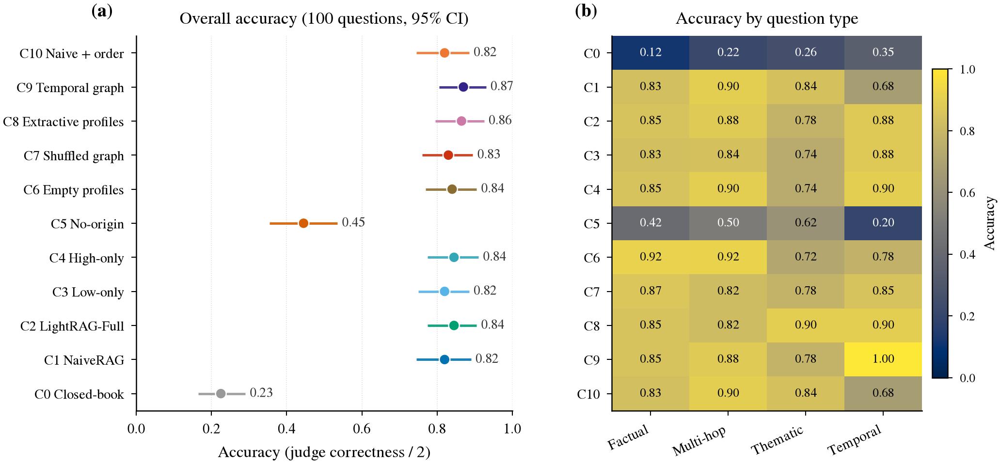
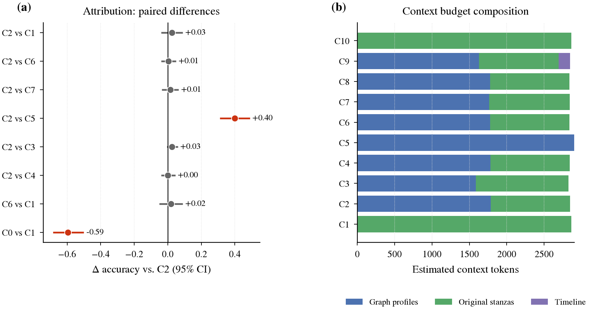
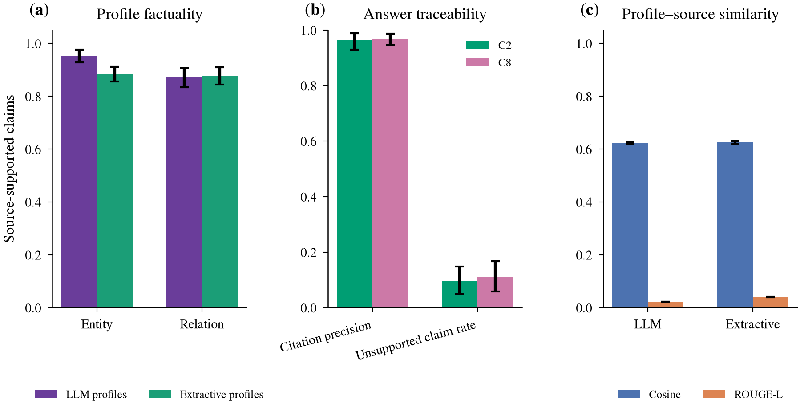
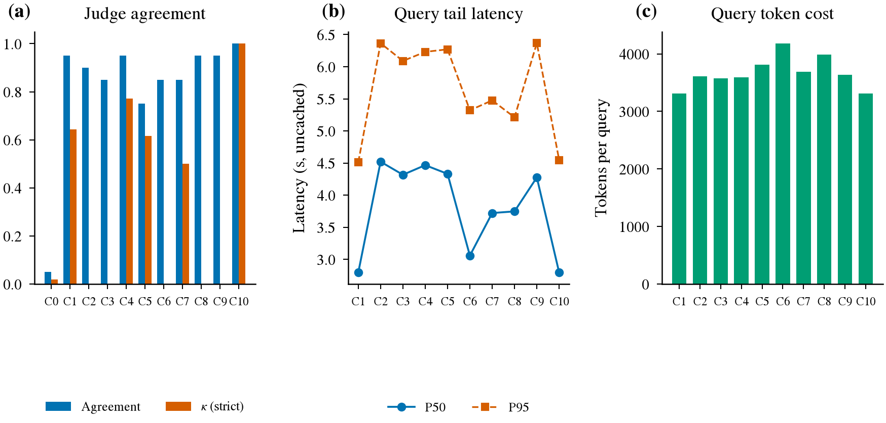
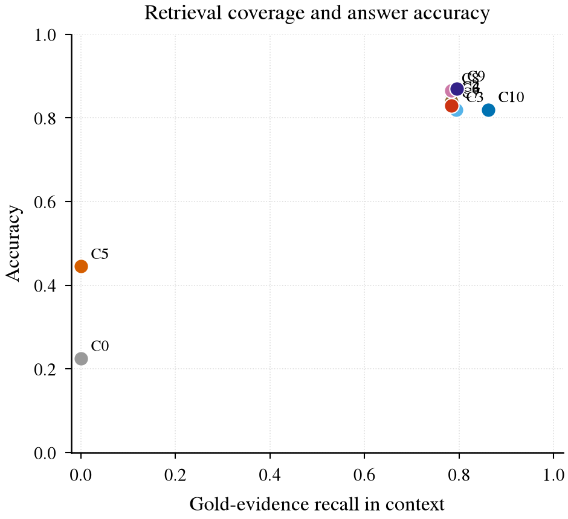

> **全文 PDF**：[下载论文 PDF](paper.pdf) · **数据与代码**：[lightrag-atlas 仓库](https://github.com/yeyixiang07/lightrag-atlas) · **前篇**：[LightRAG 的技术路线与证据边界](/blog/posts/2026-11-06-lightrag-dual-level-retrieval/)

## 摘要

针对 LightRAG 的四类批评（图结构增益未与 LLM 画像分离、改写事实偏差、隐含时序表示、评测与全生命周期成本证据），本文在 Shelley 叙事长诗《阿特拉斯的女巫》上构建 100 题、带诗节级证据的评测集，以 11 个同环境消融条件配合配对 bootstrap、McNemar 检验、双评判模型与 44 条人工盲审逐项检验。结果：NaiveRAG 已达 0.820，完整 LightRAG 为 0.845（+0.025，$p=0.515$）；抽空画像或打乱图结构无显著下降，移除原始 chunk 则损失 0.400（$p<0.001$），增益主要取决于原文检索。归因与评测批评得到支持，改写偏差、时序表示仅部分支持；结论限定于单一文学语料与 7B 模型。

**关键词**：检索增强生成；LightRAG；消融实验；事实性；时序推理；可复现性

## 1 引言

检索增强生成（Retrieval-Augmented Generation, RAG）把外部语料引入生成过程，以缓解大语言模型的参数知识过时与幻觉问题 [@lewis2020rag]。传统 RAG 把文档切成扁平 chunk，按向量相似度取 top-$k$ 拼接后生成，跨 chunk 的实体关系因此被切断，复杂问题容易得到碎片化答案。LightRAG [@guo2024lightrag] 用 LLM 从每个 chunk 抽取实体与关系，为节点和边生成文本画像（profile），查询时以“低层关键词匹配实体、高层关键词匹配关系”的双层检索并加入一跳邻居。该论文报告了在 Agriculture、CS、Legal、Mix 四个 UltraDomain 数据集上相对 NaiveRAG、RQ-RAG、HyDE 与 GraphRAG 的胜率，并强调检索阶段只需不到 100 token、一次 API 调用，增量更新无需重建社区摘要。

上述结论建立在单一 LLM 评判模型给出的四维胜率之上，即 Comprehensiveness、Diversity、Empowerment 与 Overall。批评文章 [@blog2026lightrag]（即本博客 2026 年 11 月 6 日发布的 LightRAG 技术路线核验）指出，该评测协议留下四个关键问题。

1. **归因问题。** 原文的消融只去掉高层、低层或原文，未把“图结构”与“LLM 生成的画像文本”分开，“图结构单独产生该量级增益”仍是一个待检验假设。
2. **改写偏差。** 实体与关系画像均由 LLM 生成，改写可能引入事实偏差；原文未报告事实正确性、引文可回溯性或与原文的字面一致性。
3. **时序表示。** 节点—边结构可能不足以表示隐含时序条件，原文没有直接的时序实验。
4. **评测与部署。** 原文缺少人工标注、事实校验与置信区间，检索阶段的 token 与调用数估算也不覆盖索引、存储、去重维护和查询尾延迟构成的全生命周期成本（full lifecycle cost）。

本文没有选择在 UltraDomain 的百万 token 语料上重复原文规模，而是选择了一个可完全人工核对、兼具实体关系密度与时序线索的文学文本，把四个问题拆成可证伪的实验。选择 *The Witch of Atlas* [@shelley1824witch] 基于三点考虑。第一，全诗仅 84 节、29,026 字符，所有 gold 证据都能回到具体诗节，可避免仅凭表面合理程度给分。第二，诗中女巫、Hermaphroditus、船、阿特拉斯山、尼罗河、诸神与 nymphs 等实体密集，足以形成一张可检查的图。第三，诗中同时含显式时序（“first…then…then…then”）、时长（“ten times”“three hours”“three days”）与叙述顺序（P1$\to$P78），可区分“显式时间线索”与“隐含叙述顺序”。

本文的贡献如下。

- 在一个可完全追溯的语料上，用 5 个条件分离 LightRAG 的“结构效应”与“画像文本效应”，并给出配对置信区间。
- 建立“画像层—答案层”的事实性证据链，既审计实体与关系画像是否得到源诗节支持，也审计答案的引用精确率与 unsupported claim rate。
- 用时序图（C9）与仅含时序元数据的 NaiveRAG（C10）作对照，直接检验图结构能否表示时序。
- 报告全生命周期成本，涵盖索引调用数、token 与时间，查询 P50/P95，上下文构成、存储量及增量更新节省比例。
- 用双评判模型与 44 条盲审评估评判结果的稳健性，并给出全部主指标的 bootstrap 置信区间。

本文不预设批评一定成立。第 5 节按预先定义的判定规则，逐项报告哪些批评在该语料与该模型上得到支持、哪些只得到部分支持、哪些未被复现。语料、评测集、代码与全部实验结果见 [lightrag-atlas 仓库](https://github.com/yeyixiang07/lightrag-atlas)。

## 2 相关工作

### 2.1 扁平 RAG 与查询改写

NaiveRAG 把文档切块、向量化并按相似度取 top-$k$ [@gao2023survey]。RQ-RAG 用 LLM 重写、分解与消歧查询 [@chan2024rqrag]，HyDE 先生成假设文档再检索 [@gao2022hyde]。这些方法改善了查询—文档匹配，未显式建模实体之间的关系。

### 2.2 图增强 RAG

GraphRAG 用 LLM 抽取实体关系、构建社区并生成社区摘要，查询时遍历社区 [@edge2024graphrag]。LightRAG 以实体与关系为检索单元，用双层关键词与一跳邻居降低检索开销，并支持增量更新 [@guo2024lightrag]。Think-on-Graph 把图遍历交给 LLM 逐步决策 [@sun2023thinkongraph]，GraphRAG-R1 用过程约束的强化学习训练检索策略 [@yu2025graphragr1]。这些工作共同面对一个归因问题，即图的收益来自结构还是来自 LLM 在索引阶段写入的文本。本文的 C6 与 C7 条件对该问题作直接操作化。

### 2.3 事实性与评测

LLM 评判模型（LLM-as-a-judge）已成为 RAG 评测的常用手段 [@zheng2023judge]，该评判方式存在位置、长度与提示偏差，长上下文中的相关信息也容易被忽略 [@liu2023lost]。本文用双评判模型、紧凑证据上下文与人工盲审量化这些风险，不把单次 LLM 打分当作 ground truth。

### 2.4 时序知识图谱

时序知识图谱通常用带时间戳的四元组或事件节点表示时间 [@cai2022temporal]。LightRAG 的节点—边结构没有原生时间维度。本文的 C9 用事件节点与 `before` 边补上时间维度，C10 只加入按诗节序排列的元数据，以区分时序图与时序排序各自的贡献。

## 3 实验设计

### 3.1 研究问题与可证伪假设

**H1（图结构归因）。** 在画像文本与原始 chunk 相同的前提下，完整 LightRAG（C2）应高于结构被打乱的 C7（H1a）；在图结构与 chunk 相同的前提下，C2 应高于画像被抽空的 C6（H1b）；C2 应高于 NaiveRAG（C1，H1c）；闭卷 C0 应低于所有检索条件（H1d）。若 H1b 显著而 H1a 不显著，则增益主要来自 LLM 画像文本，归因质疑得到支持；若两者都显著，则结构与文本均有贡献，原文确实未作分离；若两者都不显著，则本语料上未复现图结构增益。

**H2（改写偏差）。** LLM 画像中“源诗节不支持”的断言比例应高于抽取式画像（H2a）；C2 的引用精确率应低于 C8，unsupported claim rate 应高于 C8（H2b）；C2 画像与源诗节的字面与语义相似度应低于 C8（H2c）。H2a 与 H2b 同时成立才判为“支持批评”；只有 H2a 成立则判为“索引层潜在风险”。

**H3（时序表示）。** C2 在时序题上的正确率应低于其在非时序题上的正确率（H3a）；时序图 C9 应高于 C2（H3b）；C9 应高于“NaiveRAG + 时序重排”的 C10（H3c），以说明增益来自时序结构而非单纯扩大上下文。

**H4（评测与部署）。** 两个不同评判模型的排名若在相当比例的题对上翻转，或评判模型与人工的一致性偏低，则单一 LLM 评判模型不足（H4a）；全生命周期成本若显著高于论文只报的“检索阶段 <100 token/1 次调用”，则部署证据不足（H4b）；所有主指标应给出 bootstrap 95% CI，二元指标另做 McNemar（H4c）。

### 3.2 语料与任务集

语料为 Project Gutenberg 第 4696 号电子书，保留献诗 D1–D6 与正文 P1–P78。Gutenberg 正文编号从 77 跳至 80，本文按出现顺序重编号为 P1–P78，并保留 `source_label`。语料共 84 节、29,026 字符，约合 7,256 token。chunk 按诗节边界累积，目标 1,200 字符、重叠 1 节，实际得到 28 个 chunk，长度在 1,086 至 1,473 字符之间。所有条件共享同一份 chunk 与 embedding。

标准评测集（gold set）共 100 题，其中事实细节 30 题、多跳 25 题、主题 25 题、时序 20 题。每题附带 `gold_answer`、`aliases`、`evidence`（诗节 ID），主题题另有 `key_points`，时序题另有 `order_pairs`。构建流程为 LLM 生成候选、逐题人工核对、固定后不再根据结果修改。该 gold set 由单标注者标注，第 7 节对此明确披露。

### 3.3 条件矩阵

@tbl-conditions 列出 11 个条件。C7 的索引与 C2 完全相同，画像、chunk 及匹配到的实体与关系均不变，仅把一跳邻居换成同规模随机节点；C6 的节点名、边、关键词与 chunk 均不变，仅把实体与关系描述替换为名称或占位文本。两个条件分别隔离结构与 LLM 画像文本。

| 条件 | 名称 | S | T | O | 作用 |
|---|---|---|---|---|---|
| C0 | Closed-book | — | — | — | 参数记忆基线 |
| C1 | NaiveRAG | — | — | ✓ | 扁平 chunk 检索 |
| C2 | LightRAG-Full | ✓ | LLM | ✓ | 完整方法 |
| C3 | Low-only | ✓ | LLM | ✓ | 去掉高层关键词/关系匹配 |
| C4 | High-only | ✓ | LLM | ✓ | 去掉低层实体匹配 |
| C5 | No-origin | ✓ | LLM | — | 论文的 -Origin |
| C6 | Empty profiles | ✓ | 空/占位 | ✓ | 隔离 LLM 画像文本 |
| C7 | Shuffled graph | 打乱 | LLM | ✓ | 隔离图结构 |
| C8 | Extractive profiles | ✓ | 逐字句子 | ✓ | 改写偏差的缓解对照 |
| C9 | Temporal graph | ✓+时序 | LLM | ✓ | 时序表示处理 |
| C10 | Naive + order | — | — | ✓ | 只加时序元数据 |

: 实验条件。S 表示一跳结构，T 表示 LLM 画像文本，O 表示原始 chunk。C7 只随机化一跳邻居，不改变索引本身；C9 只在 20 道时序题上启用时间线与事件边；C10 只在 20 道时序题上按诗节序重排并扩展相邻 chunk {#tbl-conditions}

### 3.4 评测指标

正确性使用 EM、Token F1、语义余弦与评判模型 correctness（0/1/2，主指标归一化为 0/0.5/1）；严格正确为 2，宽松正确 $\ge 1$。事实性与可回溯性使用 citation precision、citation recall、unsupported claim rate、has-citation rate 与 evidence recall（gold 证据诗节是否进入上下文）。画像事实性对实体与关系画像抽样，判断每条原子断言是否被源诗节支持；字面漂移用字符相似度、ROUGE-L 与 embedding 余弦。时序使用 pairwise order accuracy、全序正确率与 duration 正确率；主题使用 key-point coverage（只对主题题定义）。成本记录索引调用/token/时间、查询 P50/P95、上下文构成、存储字节与增量更新节省比例。

### 3.5 统计方案

以问题为单位做配对 bootstrap（paired bootstrap，10,000 次重采样）得到条件均值差的 95% CI，对二元严格正确率做 McNemar 精确检验，每个假设族内做 Holm–Bonferroni 校正，并报告效应量与样本量。对时序题单独分层，在 C2 内部比较时序题与非时序题。

## 4 系统实现

### 4.1 索引

对每个 chunk，用 Qwen2.5-7B-Instruct 执行实体与关系抽取（JSON 输出，最多 24 个实体、24 条关系），并要求描述尽量标注来源诗节。随后按名称归一化合并实体，按 `(source, target, keywords)` 合并关系；实体名使用一套在实验前写好的别名表（Witch、Hermaphroditus、boat、Nile、Atlas、Atlantides、cameleopard、lioness 等）。索引结果为 207 个实体、142 条关系，28/28 chunk 解析成功。索引阶段 LLM 调用墙钟合计 195.8 秒，整轮构建实测 181.03 秒，两项口径见 `results/cost_summary.json`。

### 4.2 画像

LLM 画像使用抽取阶段生成的实体与关系描述；空画像只保留 `Entity: 名称 (type)` 与 `source --[keywords]--> target`；抽取式画像从源诗节中逐字截取包含实体名或关系关键词的句子，每个实体最多 3 句、每条关系最多 2 句。三种画像共享同一张图，只替换描述文本。

### 4.3 双层检索与上下文

查询时用 LLM 抽取高层与低层关键词，并作确定性的专名补全，即把问题中的大写专名加入低层关键词，因为 7B 抽取器常漏掉 “Witch” 这类主实体。低层关键词与实体名及别名作向量匹配，高层关键词与关系关键词作向量匹配，各取 top-8，再加入一跳邻居（上限 30 个图元素）。原始 chunk 按问题向量相似度加词重叠取 top-8。上下文统一上限为 3,000 token（按字符数除以 4 估算）；含原始文本的条件最多预留 1,200 token 给 chunk，图画像使用剩余预算；C5 不含 chunk，图画像可用满 3,000 token；C9 在时序题上先放入时间线，再放入图画像与 chunk。

### 4.4 生成与评判

统一系统提示要求只使用上下文、逐条事实标注 `[Pxx]`、先通读全文再决定是否拒答，答案不超过 180 词。解码参数为 temperature 0、top_p 1、repeat_penalty 1.05、seed 42、num_ctx 6144、num_predict 300。评判模型接收问题、题型、gold answer、主题题 key points、时序题 order pairs、紧凑证据上下文（时间线、原文 chunk 与被引用诗节全文）及候选答案，输出结构化 JSON，字段包括 correctness、key_point_coverage、claims、citation_precision、order_results、sequence_correct 与 duration_correct。

### 4.5 运行环境

GPU 为 NVIDIA GeForce RTX 5060 Laptop GPU（8GB 显存，实际可用约 7.2GB）；生成与第一评判模型为 Qwen2.5-7B-Instruct Q4_K_M（Ollama 本地推理），第二评判模型为 Llama-3.1-8B-Instruct Q4_K_M，embedding 为 nomic-embed-text v1.5 F16（768 维）。CPU 为 32 核，内存 30GB，磁盘为 NVMe。所有模型调用、prompt、token 与耗时写入 `results/llm_calls.jsonl`，逐题答案写入 `results/answers_*.json`。

## 5 结果

### 5.1 主结果

@tbl-main 与 @fig-main 汇总 11 个条件。闭卷 C0 的归一化正确率为 0.225（严格正确 7%），说明该 gold set 基本无法依靠 7B 模型的参数记忆回答。加入检索后，NaiveRAG（C1）达到 0.820，完整 LightRAG（C2）为 0.845；C2 相对 C1 的配对差为 $+0.025$（95% CI $[-0.040,0.090]$，$p=0.515$），在 100 题上不构成显著差异。C8（抽取式画像）与 C9（时序图）分别为 0.865 与 0.870，C4（仅高层）为 0.845，C3（仅低层）为 0.820。最低的检索条件是 C5（去原文），正确率为 0.445，相对 C2 低 0.400（95% CI $[0.310,0.490]$，$p<0.001$），拒答率升至 47%。@tbl-types 给出分题型细分。

{#fig-main width=100% fig-alt="11 个实验条件的总体正确率及其 bootstrap 置信区间、分题型正确率热图"}

| Condition | $n$ | Accuracy [95% CI] | Strict | Lenient | F1 | Cite-P | Cite-R | Refusal | Evid-R | Ctx |
|---|---|---|---|---|---|---|---|---|---|---|
| C0 | 100 | 0.23 [0.17, 0.29] | 0.07 | 0.38 | 0.06 | — | 0.00 | 0.00 | 0.00 | — |
| C1 | 100 | 0.82 [0.74, 0.89] | 0.79 | 0.85 | 0.20 | 0.98 | 0.54 | 0.12 | 0.86 | 2862 |
| C2 | 100 | 0.84 [0.78, 0.91] | 0.81 | 0.88 | 0.19 | 0.96 | 0.61 | 0.10 | 0.78 | 2853 |
| C3 | 100 | 0.82 [0.75, 0.89] | 0.78 | 0.86 | 0.19 | 0.95 | 0.60 | 0.10 | 0.79 | 2830 |
| C4 | 100 | 0.84 [0.78, 0.91] | 0.82 | 0.87 | 0.18 | 0.98 | 0.58 | 0.12 | 0.78 | 2849 |
| C5 | 100 | 0.45 [0.35, 0.54] | 0.39 | 0.50 | 0.09 | 0.89 | 0.34 | 0.47 | 0.00 | 2900 |
| C6 | 100 | 0.84 [0.77, 0.91] | 0.80 | 0.88 | 0.19 | 0.99 | 0.61 | 0.11 | 0.78 | 2846 |
| C7 | 100 | 0.83 [0.76, 0.90] | 0.79 | 0.87 | 0.18 | 0.95 | 0.60 | 0.09 | 0.78 | 2849 |
| C8 | 100 | 0.86 [0.80, 0.93] | 0.84 | 0.89 | 0.20 | 0.97 | 0.57 | 0.05 | 0.78 | 2845 |
| C9 | 100 | 0.87 [0.81, 0.93] | 0.84 | 0.90 | 0.21 | 0.97 | 0.64 | 0.08 | 0.80 | 2854 |
| C10 | 100 | 0.82 [0.74, 0.89] | 0.79 | 0.85 | 0.21 | 0.98 | 0.56 | 0.12 | 0.86 | 2862 |

: 总体结果（100 题，均值与 95% bootstrap CI）。正确率为 judge correctness / 2，Strict 为 2，Lenient 为 $\ge 1$，Cite-P/R 为引用精确率/召回率，Refusal 为回答“上下文不足”的比例，Evid-R 为 gold 证据诗节进入上下文的比例，Ctx 为估计上下文 token；C0–C10 定义见第 3.3 节 {#tbl-main}

| Condition | Factual (30) | Multi-hop (25) | Thematic (25) | Temporal (20) |
|---|---|---|---|---|
| C0 | 0.12 | 0.22 | 0.26 | 0.35 |
| C1 | 0.83 | 0.90 | 0.84 | 0.68 |
| C2 | 0.85 | 0.88 | 0.78 | 0.88 |
| C3 | 0.83 | 0.84 | 0.74 | 0.88 |
| C4 | 0.85 | 0.90 | 0.74 | 0.90 |
| C5 | 0.42 | 0.50 | 0.62 | 0.20 |
| C6 | 0.92 | 0.92 | 0.72 | 0.78 |
| C7 | 0.87 | 0.82 | 0.78 | 0.85 |
| C8 | 0.85 | 0.82 | 0.90 | 0.90 |
| C9 | 0.85 | 0.88 | 0.78 | 1.00 |
| C10 | 0.83 | 0.90 | 0.84 | 0.68 |

: 分题型正确率（judge correctness / 2）。数值为均值，95% CI 见总体正确率图（b）热图与补充表 {#tbl-types}

### 5.2 H1 图结构还是 LLM 画像文本

@fig-attribution（a）与 @tbl-paired 给出 H1 的配对比较。四个关键对照均无显著差异。

- C2 相对 C6（置空 LLM 画像）为 $+0.005$，95% CI $[-0.040,0.050]$，$p=0.908$；
- C2 相对 C7（打乱一跳结构）为 $+0.015$，95% CI $[-0.035,0.065]$，$p=0.638$；
- C6 相对 C1（图结构但无 LLM 画像）为 $+0.020$，95% CI $[-0.050,0.090]$，$p=0.614$；
- C2 相对 C1 为 $+0.025$，95% CI $[-0.040,0.090]$，$p=0.515$。

C2 相对 C5（去除原始 chunk）高 0.400，95% CI $[0.310,0.490]$，$p<0.001$；C0 相对 C1 低 0.595，95% CI $[-0.685,-0.500]$，$p<0.001$。C3 与 C4 的差异也不显著（C2−C3 $+0.025$，$p=0.148$；C2−C4 $0.000$，$p=1.000$）。

{#fig-attribution width=100% fig-alt="相对完整 LightRAG 条件的配对正确率差与置信区间，以及估计的上下文 token 构成"}

| Family | Comparison | Scope | $\Delta$ accuracy | 95% CI | $p$ | $p_{\mathrm{Holm}}$ | $n$ |
|---|---|---|---|---|---|---|---|
| H1 | C2 − C1 | All | 0.025 | [-0.040, 0.090] | 0.5154 | 1.0000 | 100 |
| H1 | C2 − C6 | All | 0.005 | [-0.040, 0.050] | 0.9084 | 1.0000 | 100 |
| H1 | C2 − C7 | All | 0.015 | [-0.035, 0.065] | 0.6376 | 1.0000 | 100 |
| H1 | C2 − C5 | All | 0.400 | [0.310, 0.490] | 0.0000 | 0.0000 | 100 |
| H1 | C2 − C3 | All | 0.025 | [-0.005, 0.060] | 0.1484 | 0.8904 | 100 |
| H1 | C2 − C4 | All | 0.000 | [-0.040, 0.045] | 1.0000 | 1.0000 | 100 |
| H1 | C6 − C1 | All | 0.020 | [-0.050, 0.090] | 0.6138 | 1.0000 | 100 |
| H1 | C0 − C1 | All | -0.595 | [-0.685, -0.500] | 0.0000 | 0.0000 | 100 |
| H2 | C2 − C8 | Accuracy | -0.020 | [-0.085, 0.045] | 0.5874 | 1.0000 | 100 |
| H2 | C2 − C8 | Cite-P | -0.002 | [-0.034, 0.026] | 0.9082 | 1.0000 | 81 |
| H2 | C2 − C8 | Unsupported | -0.015 | [-0.072, 0.039] | 0.5936 | 1.0000 | 92 |
| H3 | C9 − C2 | Temporal | 0.125 | [0.000, 0.275] | 0.0768 | 0.1536 | 20 |
| H3 | C9 − C10 | Temporal | 0.325 | [0.150, 0.525] | 0.0000 | 0.0000 | 20 |
| H3 | C10 − C1 | Temporal | 0.000 | [-0.150, 0.150] | 1.0000 | 1.0000 | 20 |
| H3 | C2 − C1 | Temporal | 0.200 | [0.050, 0.375] | 0.0050 | 0.0150 | 20 |

: 相对完整 LightRAG（C2）的配对差异、95% CI 与 Holm 校正 $p$ 值。正的 $\Delta$ 表示前一个条件更准确；H1 检验图与画像的归因，H2 检验改写偏差，H3 检验时序表示；C9/C10 的比较只用 20 道时序题 {#tbl-paired}

该结果直接回应了该博客的第一项批评。在该语料上，去掉 LLM 画像文本（C6）或打乱图结构（C7）均未使正确率显著下降，图结构也未让 C2 显著高于 NaiveRAG。条件差异主要与原始 chunk 是否进入上下文相关。C5 去掉原文后，正确率由 0.845 降至 0.445，拒答率由 10% 升至 47%，citation recall 由 0.61 降至 0.34。图画像文本未能替代原始 chunk，反而在上下文预算中占用部分原文空间。C2 的 gold 证据召回为 0.78，低于 C1 的 0.86；C2 的上下文由约 1,784 token 图画像与 1,064 token 原文组成，C1 的 2,862 token 几乎全是原文。图结构带来的 citation recall 提升确实存在（C2 0.61 对 C1 0.54），但未转化为正确率。

### 5.3 H2 改写偏差与可回溯性

H2 的结果为部分成立，方向与该博客的强版本判断不同。对画像事实性的审计（@tbl-profiles、@fig-factuality（a））显示，LLM 画像的实体支持率为 0.952（SD 0.130），高于抽取式画像的 0.883（SD 0.150）；关系支持率分别为 0.871（SD 0.195）与 0.877（SD 0.181）。答案层亦未出现 LLM 画像导致引用精确率下降的现象。C2 的 citation precision 为 0.963，C8 为 0.969；unsupported claim rate 分别为 0.094 与 0.109；C2−C8 在正确率、citation precision、unsupported claim rate 上的配对差分别为 $-0.020$（$p=0.587$）、$-0.002$（$p=0.912$）、$-0.015$（$p=0.594$）。

{#fig-factuality width=100% fig-alt="画像事实性支持率、答案引用精确率与 unsupported claim rate、画像与源诗节的字面和语义相似度"}

| Profile | Graph element | $n$ | Support rate | SD |
|---|---|---|---|---|
| LLM | Entity | 30 | 0.95 | 0.13 |
| LLM | Relation | 29 | 0.87 | 0.20 |
| Extractive | Entity | 29 | 0.88 | 0.15 |
| Extractive | Relation | 30 | 0.88 | 0.18 |

: 画像事实性审计，被源诗节支持的原子断言比例（每格 30 条）。画像从 C2（LLM）与 C8（抽取式）随机抽样，评判模型将每条画像拆成至多 6 条原子断言，并逐条对照引用诗节 {#tbl-profiles}

字面一致性确实下降。LLM 画像与源诗节的 ROUGE-L 在实体上为 0.020、关系上为 0.026，抽取式画像为 0.030 与 0.055；字符相似度为 0.012/0.018 对 0.035/0.071；embedding cosine 两组接近（约 0.60–0.68）。这说明 LLM 画像更多为改写，较少逐字复用原文；自动审计未显示其事实支持率更低。一个具体的反例是 Hermaphroditus 的画像，即 “A figure known for their androgynous nature, though not explicitly mentioned in the text.” 诗中明确写了 Hermaphroditus，该描述却声称“文中未明确提及”，属于改写型错误。它说明自动审计的高支持率不能替代逐条人工核查；在 30 条抽样中，这类错误未形成统计上可检出的比例。

因此，H2a 与 H2b 在本语料上未获支持，H2c（字面一致性下降）成立，整体判定为部分支持。主题题上出现一个描述性信号，C2 为 0.78，C8 为 0.90，抽取式画像在主题题上更好；该差异未作预先显著性检验，不能作为验证性证据（confirmatory evidence）。

### 5.4 H3 时序表示

时序题上，C2 并未表现更弱，正确率为 0.880（pairwise order 0.94，full-sequence 0.86），高于其主题题 0.78，也不低于事实与多跳题。因此 H3a（“标准图在时序题上显著更差”）不成立。图相对无图仍有收益，C2 比 C1 的时序题高 0.200（95% CI $[0.050,0.375]$，$p=0.005$，Holm $p=0.015$），说明图结构对时序题有定向收益，尽管总体正确率不显著。

时序图 C9 的时序题正确率达到 1.000（20/20），比 C2 高 0.125（95% CI $[0.000,0.275]$，$p=0.077$，Holm $p=0.154$），在 20 题上属于边缘显著。C9 相对“只加时序排序”的 C10（0.680）高 0.325（95% CI $[0.150,0.525]$，$p<0.001$），H3c 成立。C10 相对 C1 的差为 0.000，说明把 chunk 按诗节序重排本身不产生收益，须有事件节点、`before` 边与时间线等时序结构。@tbl-temporal 与 @fig-temporal 给出细分。C9 的 full-sequence 分数为 0.75，低于其 pairwise order 1.00，原因是评判模型对“多写额外事件”的序列回答较严格，正确率与序列指标并不等价。

{#fig-temporal width=100% fig-alt="20 道时序题上各条件的正确率、pairwise order 与 full-sequence 正确率对比"}

| Condition | $n$ | Accuracy | Pairwise order | Full sequence | Duration |
|---|---|---|---|---|---|
| C0 | 20 | 0.35 | 0.46 | 0.22 | 0.00 |
| C1 | 20 | 0.68 | 0.68 | 0.50 | 0.67 |
| C2 | 20 | 0.88 | 0.94 | 0.86 | 1.00 |
| C3 | 20 | 0.88 | 0.94 | 0.83 | 1.00 |
| C4 | 20 | 0.90 | 1.00 | 1.00 | 1.00 |
| C5 | 20 | 0.20 | 0.35 | 0.18 | 0.00 |
| C6 | 20 | 0.78 | 0.75 | 0.64 | 1.00 |
| C7 | 20 | 0.85 | 1.00 | 0.82 | 1.00 |
| C8 | 20 | 0.90 | 0.88 | 0.79 | 1.00 |
| C9 | 20 | 1.00 | 1.00 | 0.75 | 1.00 |
| C10 | 20 | 0.68 | 0.69 | 0.62 | 0.67 |

: 时序题（20 题）的正确率、pairwise 顺序、全序与时长正确率。pairwise 与全序分数由评判模型的 `order_results` 计算，标注为 `unclear` 的事件对不计入 pairwise 分母；Duration 为 Q18–Q20 三道时长题的正确率 {#tbl-temporal}

需要强调，C9 的时间线是按诗节人工整理的事件序列（55 个事件、54 条 `before` 边），与时序 gold 的判断来自同一首诗、同一标注者。C9 的 1.00 应理解为“有时序表示时的性能上限”，而非“自动时序抽取已经解决”。H3 的总体判定为部分支持，标准图并非在时序题上普遍更弱；显式时序结构能把时序题从 0.88 提高到 1.00，仅靠排序元数据（C10）则无效。

### 5.5 H4 评测稳健性与部署成本

人工盲审（44 条，条件标签隐藏）与第一评判模型的一致率为 0.727，二次加权 Cohen's $\kappa=0.797$ [@cohen1960kappa]，严格二分类 $\kappa=0.535$，Spearman $\rho=0.845$。评判模型的平均 correctness 为 1.57，人工为 1.30，评判模型系统性偏宽松，在闭卷 C0（人工 0.0，评判模型 0.5）与空画像 C6（人工 1.25，评判模型 2.0）上最明显。绝对正确率因此应谨慎解读；条件间排序大体保留（$\rho=0.845$），且本文所有主指标都给出 bootstrap CI 与配对检验。第二评判模型（Llama-3.1-8B）在 220 条分层子集上与第一评判模型的总体一致率为 0.823，二次加权 $\kappa=0.531$，严格 $\kappa=0.438$，Spearman $\rho=0.570$。分条件看，C1/C4/C10 的 $\kappa$ 分别为 0.881/0.898/1.000，C5/C7 为 0.706/0.732；闭卷 C0 的 $\kappa$ 只有 0.047（Qwen 判 13 个 0、6 个 1、1 个 2；Llama 判 17 个 2、3 个 1），C2/C3/C6/C8/C9 在一个评判模型上出现常量评分（$\kappa$ 退化为 0，原始一致率仍为 0.85–0.95）。评判模型一致性在低质量答案上最脆弱，单评判模型的绝对分数不能视为稳定的 ground truth。@fig-cost 将一致率、尾延迟与每 query token 并列呈现；@tbl-judge 与 @tbl-cost 分别给出双评判一致性与查询成本明细。

{#fig-cost width=100% fig-alt="双评判模型一致率与严格 kappa、查询 P50/P95 尾延迟、每 query token 成本"}

| Condition | $n$ | Agreement | $\kappa$ (quadratic) | $\kappa$ (strict) | Spearman $\rho$ |
|---|---|---|---|---|---|
| C0 | 20 | 0.05 | 0.05 | 0.02 | 0.30 |
| C1 | 20 | 0.95 | 0.88 | 0.64 | 0.73 |
| C2 | 20 | 0.90 | 0.00 | 0.00 | — |
| C3 | 20 | 0.85 | 0.00 | 0.00 | — |
| C4 | 20 | 0.95 | 0.90 | 0.77 | 0.82 |
| C5 | 20 | 0.75 | 0.71 | 0.62 | 0.73 |
| C6 | 20 | 0.85 | 0.00 | 0.00 | — |
| C7 | 20 | 0.85 | 0.73 | 0.50 | 0.63 |
| C8 | 20 | 0.95 | 0.00 | 0.00 | — |
| C9 | 20 | 0.95 | 0.00 | 0.00 | — |
| C10 | 20 | 1.00 | 1.00 | 1.00 | 1.00 |

: 双评判模型一致性（Qwen2.5-7B 与 Llama-3.1-8B）。一致率为 0/1/2 标签完全相同的比例；若某个评判模型在该子集上为常量，$\kappa$ 退化为 0，Spearman 无法定义，表中以 — 表示 {#tbl-judge}

| Condition | $n$ | LLM calls | Prompt tok. | Completion tok. | Total tok. | P50 (s) | P95 (s) | Ctx tok. |
|---|---|---|---|---|---|---|---|---|
| C0 | 100 | 1 | 100 | 99 | 199 | 2.05 | 2.91 | — |
| C1 | 100 | 1 | 3248 | 63 | 3312 | 2.79 | 4.51 | 2862 |
| C2 | 100 | 2 | 3340 | 65 | 3614 | 4.52 | 6.37 | 2853 |
| C3 | 100 | 2 | 3299 | 68 | 3576 | 4.32 | 6.09 | 2830 |
| C4 | 100 | 2 | 3316 | 66 | 3590 | 4.47 | 6.23 | 2849 |
| C5 | 100 | 2 | 3557 | 50 | 3815 | 4.33 | 6.27 | 2900 |
| C6 | 100 | 2 | 3896 | 72 | 4176 | 3.06 | 5.32 | 2846 |
| C7 | 100 | 2 | 3404 | 74 | 3686 | 3.72 | 5.48 | 2849 |
| C8 | 99 | 2 | 3705 | 70 | 3983 | 3.75 | 5.21 | 2845 |
| C9 | 99 | 2 | 3366 | 63 | 3637 | 4.28 | 6.37 | 2854 |
| C10 | 100 | 1 | 3248 | 65 | 3313 | 2.79 | 4.55 | 2862 |

: 查询成本与延迟（未命中缓存；本地 RTX 5060，8GB）。token 为每 query 均值，延迟包含关键词抽取、检索与生成；C0 为闭卷（一次调用），C1/C10 一次，图条件两次（关键词与答案） {#tbl-cost}

全生命周期成本远高于原论文仅报告的“检索阶段 <100 token、一次调用”。索引阶段 28 次 LLM 调用、19,067 prompt token 与 13,410 completion token，合计 32,477 token，调用墙钟合计 195.8 秒；查询阶段 C2 平均约 3,614 token、P50 4.52 秒、P95 6.37 秒，C1 为 3,312 token、2.79/4.51 秒。图条件每 query 需要两次 LLM 调用（关键词与答案），NaiveRAG 一次。增量更新（前 14 chunk 已索引，追加后 14 chunk）只需 15,949 token，相对全量 32,477 token 节省 50.9%。存储为图 JSON 166 KB、时序图 222 KB、C2 画像 195 KB、C8 画像 189 KB、embedding 约 10.4 MB。H4 的判定为支持；单一 LLM 评判模型偏宽松、缺少 CI 的评测，以及仅计检索阶段 token 的成本口径，都会高估方法质量并低估部署成本。

### 5.6 判定汇总

@tbl-verdict 按预先定义的判定规则汇总四个批评点在该语料与该模型上的检验结果。

| 假设 | 关键证据 | 判定 |
|---|---|---|
| H1 | C2−C1 $+0.025$ ($p=0.515$)；C2−C6 $+0.005$；C2−C7 $+0.015$；C2−C5 $+0.400$ ($p<0.001$) | 支持（图与画像无显著增益；原文是关键） |
| H2 | LLM 画像支持率 0.952/0.871 对抽取式 0.883/0.877；C2−C8 三项均不显著；ROUGE-L 0.020/0.026 对 0.030/0.055 | 部分支持（字面漂移成立，事实偏差未证实） |
| H3 | C2 时序 0.88 不低于非时序；C2−C1 时序 $+0.200$ ($p=0.005$)；C9−C2 $+0.125$ ($p=0.077$)；C9−C10 $+0.325$ ($p<0.001$) | 部分支持（时序结构有效，但标准图并非普遍失效） |
| H4 | 人工 $\kappa_3=0.797$、严格 $\kappa=0.535$；评判模型均值 1.57 对人工 1.30；C2 每 query 3.6k token、P50 4.5 s | 支持（单评判模型偏宽松；全生命周期成本更高） |

: 四个批评点的判定汇总 {#tbl-verdict}

## 6 讨论

### 6.1 增益来源

本文一项最稳定的结果是，在这首 29k 字符的叙事诗上，答案正确率主要取决于原始诗节的召回，而非图结构或 LLM 画像。C1（纯 chunk 检索）已达 0.820，C2 仅高 0.025；去掉原文的 C5 降至 0.445，拒答率 47%。C2 的 gold 证据召回率为 0.78，反而低于 C1 的 0.86，因为图画像占用了约 1,784 token 的上下文预算，原文仅剩约 1,064 token，而 C1 的 2,862 token 几乎全为原文。图结构确实提高了 citation recall（C2 0.61 对 C1 0.54），使更多可引用关系进入上下文，但这些关系未转化为答案正确率。@fig-evidence 把各条件的证据召回与正确率并列，可见高正确率条件集中于高证据召回一侧。

{#fig-evidence width=100% fig-alt="各实验条件 gold 证据召回率与答案正确率的散点图"}

这与 LightRAG 原文的动机并不矛盾。原文面向百万 token 的技术或法律语料，chunk 检索容易碎片化；本文语料只有 28 个 chunk，top-8 已覆盖 86% 的 gold 证据，图的一跳扩展（one-hop expansion）很难再提供边际信息。就此而言，在本语料规模上，图结构与纯 chunk 检索不可区分，并非无效。C7（打乱一跳结构）与 C2 的正确率几乎一致，可用同一机制解释。当匹配到的实体已覆盖全部相关节点时，邻居是否随机化对答案影响很小。

### 6.2 结构与画像文本的归因

H1 的四个关键对照（C2−C6、C2−C7、C6−C1、C2−C1）均不显著，仅 C2−C5 显著。这是一个清晰的负结果，没有证据表明 LLM 画像文本或图结构单独贡献了可检出的正确率增益。C6（空画像）与 C2 的差仅 0.005，C7（打乱结构）与 C2 的差仅 0.015，C6 相对 C1 也仅 0.020；C5 去掉原文后损失 0.400。LightRAG 的增益主要来自检索到原文，而非将原文改写为图。

该结论支持该博客的第一项批评，但需限定范围。它支持的是“在该语料上，图结构单独产生该量级增益仍是一个未被证实的假设”，而非“图结构在任何语料上都没有用”。本文未重复 UltraDomain 的百万 token 规模，不能外推；但至少说明，原文条件的胜率不能直接归因于图结构，须将原文、画像文本与结构三者分开。

### 6.3 字面漂移成立与事实偏差未证实

H2 的结果比该博客中的强版本判断更复杂。自动审计显示，LLM 画像的实体支持率为 0.952，高于抽取式画像的 0.883；关系支持率相当（0.871 对 0.877）；答案层的 citation precision、unsupported rate 与正确率均无显著差异。这与“LLM 改写一定引入更多事实错误”的预期不符。

字面一致性确实下降。LLM 画像的 ROUGE-L 为 0.020/0.026（实体/关系），抽取式画像为 0.030/0.055；字符相似度为 0.012/0.018 对 0.035/0.071。Hermaphroditus 的画像还提供了一个具体改写错误，即 “though not explicitly mentioned in the text”，而诗中明确写有 Hermaphroditus。这说明自动审计的高支持率不能替代逐条人工核查，30 条抽样可能漏掉低频但严重的错误。H2 的合理结论是字面漂移成立、事实偏差未获统计证实、个案风险存在，而非“改写一定更差”。

### 6.4 标准图不弱与时序结构的定向收益

H3a 不成立。C2 的时序题正确率（0.88）不低于其主题题（0.78），也不低于事实与多跳题，标准图并未在时序题上普遍失效。图相对无图有时序定向收益，C2 比 C1 高 0.200（$p=0.005$），说明图结构将分散在各诗节的时间线索关联起来。进一步加入事件节点与 `before` 边（C9）使时序题正确率达到 1.000，相对 C2 仅边缘显著（$p=0.077$，Holm $p=0.154$），相对只做排序的 C10（0.680）则显著（$p<0.001$）。关键在于时序结构，而非按序排列 chunk。

C9 的 1.000 需谨慎解读。时间线由人工整理，包含 55 个事件、54 条边，与时序 gold 的判断同源；它反映表示能力上限，并非自动抽取结果。C10 的失败（0.680）也说明，仅将 chunk 按诗节序重排并不能让模型理解事件顺序；时序图的价值在于显式事件与边，而非排序本身。

### 6.5 评测与部署

H4 得到支持。人工盲审与第一评判模型的二次加权 $\kappa$（quadratic weighted $\kappa$）为 0.797，严格二分类 $\kappa$ 为 0.535；评判模型平均 1.57，人工为 1.30，系统性偏宽松，在闭卷 C0 与空画像 C6 上最明显。若只看 LLM 评判模型的绝对分数，会高估方法质量；条件排序大体保留（Spearman 0.845），小样本、单评判模型的结论仍需 CI 与人工校准。本文所有主指标均带 bootstrap CI，并对 H1–H3 做 Holm 校正，较只报四维胜率更保守。

成本上，索引 28 次调用、32.5k token、调用墙钟合计 195.8 秒；C2 每 query 约 3.6k token、P50 4.5 秒、P95 6.4 秒；图条件每 query 两次 LLM 调用。原文的“检索阶段 <100 token、一次调用”只覆盖关键词抽取与匹配，不覆盖答案上下文，全生命周期成本要高一个量级。增量更新节省 50.9% token，是 LightRAG 的真实优势；在这类小语料上，索引的绝对成本不高，节省的绝对量也有限。

### 6.6 对实践的启示

1. 在小语料上，先建立 chunk 检索基线；若 top-$k$ 已覆盖大部分 gold 证据，图结构的边际收益可能不可检出，不宜默认图结构更优。
2. 若使用图，应为原文保留固定预算。本文预留 1,200 token 原文是必要的；否则 LLM 画像会占用原文所需的上下文预算，C2 证据召回低于 C1 即为一例。
3. 画像优先用抽取式或可追溯的摘要。LLM 画像的平均支持率不一定低，字面漂移与个案错误仍需逐条审计；至少保留逐字来源。
4. 时序任务需要显式事件与边，而不是仅按诗节序排列 chunk；时序标注成本高，宜作为必要时的增强，而非默认组件。
5. 评测要报告 CI、人工校准与全生命周期成本；单评判模型的绝对分数会偏宽松，在拒答与部分正确的边界上尤其如此。

## 7 效度威胁

1. **单一语料、单一文体。** 该语料为 29k 字符的叙事诗，实体边界模糊、隐喻多；结论不能直接外推到论文的百万 token 技术/法律语料。本文报告的是“在该语料上，四类问题是否可复现”，而不是对 LightRAG 的全盘否定。
2. **7B 本地模型。** Qwen2.5-7B-Instruct Q4_K_M 的抽取、生成与评判能力都弱于 GPT-4o-mini；绝对分数不可与原文对比，只有同环境下的条件差异可比较。7B 评判模型也可能有位置/长度/格式偏差，本文用双评判模型与人工审计校准。
3. **单标注者。** gold set 与 44 条盲审均由同一实验者完成；没有多人独立标注，无法报告标注者间一致性。本文披露这一点，并把评判模型与人工的 $\kappa$ 作为辅助证据。
4. **时序标注的循环性。** C9 的时间线与时序 gold 都来自同一首诗、同一标注者；时间线是“表示能力”的处理，不是自动抽取结果。C9 的优势应理解为“有时序表示时的性能上限”，而不是“自动时序抽取已经解决”。
5. **上下文预算与提示词敏感。** 3,000 token 预算、1,200 token 原文预留、答案提示词都会影响绝对分数；本文固定这些变量并披露执行期修订。不同预算下条件排序可能变化。
6. **图抽取错误。** 207 个实体、142 条关系中存在重复、类型错误与不准确描述（例如 Hermaphroditus 被描述为 “text 未明确提及”）。这些错误本身是 H2 的研究对象，同时也会降低所有图条件的上限。
7. **成本口径。** 本地 RTX 5060 的墙钟延迟不等于 API 延迟；token 数可迁移，秒数不可直接迁移。增量更新节省比例是在 28 个 chunk 的小语料上测得，规模更大时合并/去重成本会上升。
8. **多重比较。** 每个假设族内做了 Holm 校正，不同指标之间仍有相关性，$p$ 值应结合 CI 与效应量阅读。

## 8 结论

本文在 Shelley 叙事长诗 *The Witch of Atlas* 上，用 100 题、带诗节级证据的 gold set 和 11 个同环境条件，检验了针对 LightRAG 的四个批评。四项判定并不一致。

- **归因（H1）得到支持。** 在 28 个 chunk 的语料上，完整 LightRAG（0.845）相对 NaiveRAG（0.820）只高 0.025（$p=0.515$）；抽空 LLM 画像（0.840）或打乱一跳结构（0.830）也没有显著下降；去掉原始 chunk（0.445）则损失 0.400。正确率的主要来源是原文检索，而不是图结构或 LLM 改写。
- **改写偏差（H2）只得到部分支持。** LLM 画像的自动支持率并不低于抽取式画像（0.952/0.871 对 0.883/0.877），答案层的引用精确率与 unsupported rate 也无显著差异；LLM 画像与原文的 ROUGE-L 更低（0.020/0.026 对 0.030/0.055），并存在 Hermaphroditus 这样的个案错误。“字面漂移”成立，“事实偏差”未被统计证实。
- **时序（H3）只得到部分支持。** 标准图在时序题上并不弱（0.88），“图普遍无法表示时序”不成立；图相对无图有时序定向收益（0.88 对 0.68，$p=0.005$），时序图在 20 题上达到 1.00（相对 C2 仅边缘显著，$p=0.077$），仅按时序重排 chunk（0.68）无效。时序结构有效，其上限依赖人工事件标注。
- **评测与部署（H4）得到支持。** 44 条人工盲审与评判模型的二次加权 $\kappa=0.797$，严格 $\kappa=0.535$；评判模型平均 1.57 对人工 1.30，系统性偏宽松。全生命周期成本为索引 32.5k token/195.8 秒、查询约 3.6k token/4.5 秒 P50，远高于“检索阶段 <100 token、一次调用”的口径；增量更新节省 50.9%。

本文并不主张 LightRAG 无效。在小规模且原文可完整检索的语料上，图结构与 LLM 画像文本未表现出独立于原文的可检出增益；时序图存在方向一致但依赖标注的收益；评测与成本口径会显著影响结论。对实践者而言，先建立 chunk 基线、为原文保留充足预算、优先采用可追溯画像，并在时序任务中显式建模事件，比默认采用图结构更为稳妥。

本文的局限包括使用单一文学语料、7B 本地模型、单标注者、20 题时序子集与人工时间线等。未来工作应在百万 token 级的技术或法律语料上重复同一套 2$\times$2 归因设计，采用多标注者校准 judge，并将时序事件抽取自动化，以检验 C9 在真实部署场景中的性能上限。

## 附录 A 提示词

以下为实验中实际使用的系统提示词（英文原文）。所有条件共享同一答案提示骨架与同一评判规则，条件差异只体现在检索上下文。

### A.1 实体与关系抽取系统提示

```text
You are a knowledge-graph specialist. Extract entities and explicit relationships from a chunk of Shelley's narrative poem "The Witch of Atlas".

Rules:
1. Only use information stated in the input text. Do not use outside knowledge.
2. Entity types must be one of: Person, Deity, Creature, Place, Object, Concept, Event, Group, Work, Other.
3. Entity names must be short noun phrases taken from the text (e.g. "the Witch", "Hermaphroditus", "the Nile"). Do not use pronouns as entity names.
4. A relationship must be explicitly stated or directly implied by the text, with a source entity and a target entity that both appear in the entities list.
5. Each description must be 1-2 sentences and must end with the source stanza IDs in parentheses, e.g. "(P6)" or "(P6, P7)". The input text marks every stanza as [P6].
6. Relationship keywords are 2-5 short thematic keywords, comma-separated.
7. Output valid JSON only, with this exact shape:
{"entities":[{"name":"...","type":"...","description":"..."}],"relations":[{"source":"...","target":"...","keywords":"...","description":"..."}]}
8. At most 24 entities and 24 relations. Prefer important, recurring entities over trivial ones.
9. If there are no relations, return an empty list. Never invent an entity that is not in the text.
```

### A.2 关键词抽取系统提示

```text
You extract retrieval keywords from a user question about Shelley's poem "The Witch of Atlas".

Return valid JSON only:
{"high_level_keywords": ["..."], "low_level_keywords": ["..."]}

- high_level_keywords: 2-5 themes, concepts, or question intents (e.g. "mortality", "the Witch's power", "narrative order").
- low_level_keywords: 2-6 specific entities, objects, places, or actions mentioned in the question (e.g. "Hermaphroditus", "Nile", "veil").
- Use only words grounded in the question. Do not answer the question. Do not add entities that are not in the question.
```

### A.3 答案生成系统提示

```text
You are a careful literary scholar answering questions about Percy Bysshe Shelley's poem "The Witch of Atlas".

Use ONLY the provided context. Do not use outside knowledge and do not invent details.
The context is a retrieval result: some retrieved entities, relationships, or stanzas may be irrelevant. Read the whole context, including the original stanzas, before deciding. Do not refuse merely because the context is long or because some retrieved items are irrelevant. If any part of the context states or directly supports an answer, give that answer.
Cite the supporting stanza ID in square brackets after each factual claim, for example: "The Witch lives on Atlas' mountain [P1]."
If a claim is supported by several stanzas, cite them like [P6, P7].
Only if no part of the context supports an answer, say: "The provided context does not establish this."
Keep the answer under 180 words and write in clear English.
```

### A.4 LLM 评判模型系统提示

```text
You are a strict evaluation judge for a literary question-answering experiment. You will see a question, the gold answer (and key points or order pairs), the retrieved context (if any), and a candidate answer.

Judge only against the poem "The Witch of Atlas" and the gold answer. Do not reward fluent but unsupported prose.

Return valid JSON only with this exact shape:
{
  "correctness": 0,
  "correctness_reason": "...",
  "key_point_coverage": null,
  "claims": [{"text": "...", "supported": true, "evidence": ["P6"]}],
  "citation_precision": null,
  "order_results": [],
  "sequence_correct": null,
  "duration_correct": null,
  "notes": "..."
}

Scoring rules:
- correctness: 0 = wrong, contradicts the poem, or refuses when the answer is available; 1 = partially correct (some key content right, but an important detail wrong or missing); 2 = correct and complete enough for the question. Do not penalise an answer for adding extra correct details that the question did not explicitly ask for; penalise wrong or unsupported details instead.
- key_point_coverage: only for thematic questions; fraction (0-1) of the gold key points that the answer covers. Otherwise null.
- claims: for answers with citations, split the answer into atomic factual claims (max 8). Mark each claim supported=true only if the cited stanza(s) or the provided context entail it; otherwise false. If the answer has no citations, use supported=null and evidence=[]. If the answer contains at least one [Pxx] citation, claims must be a non-empty list.
- citation_precision: if the answer contains at least one stanza citation, you MUST return a numeric value between 0 and 1: the fraction of cited stanzas that actually support the claim they are attached to. Do not return null when citations are present. Return null only when there are no citations at all.
- order_results: only for temporal questions with order_pairs; for each pair [A, B], return {"pair": [A, B], "result": "correct" | "wrong" | "unclear"} where "correct" means the answer says A happens before B. If the answer states A before B, mark correct even if it also mentions other events or extra correct details. Use "unclear" only when the answer does not state the pair's order at all. Otherwise [].
- sequence_correct: for temporal sequence questions, true if the answer gives the full order correctly; false if wrong; null if not a sequence question or unclear.
- duration_correct: for temporal duration questions, true/false; null otherwise.
- Do not give credit for an answer that contradicts the poem, even if it is well written.
```

### A.5 画像事实性审计系统提示

```text
You are auditing an automatically generated knowledge-graph profile against the source poem.

Return valid JSON only:
{"claims":[{"text":"...","supported":true,"evidence":["P6"]}],"support_rate":0.0,"unsupported_facts":["..."],"notes":"..."}

Split the profile into atomic claims (max 6). A claim is supported only if the source stanzas explicitly state or directly entail it. Do not use outside knowledge. support_rate is the fraction of supported claims (0-1). unsupported_facts lists any invented names, events, or relations.
```

## 附录 B Gold set 示例

完整 100 题见 `data/gold_qa.json`。每题包含问题、gold answer、aliases 与诗节证据，主题题另有 key points，时序题另有 order pairs。以下按题型各举数例。

**F01｜Who was the mother of the Witch?**

- **Gold**：One of the Atlantides.
- **Evidence**：`P2`

**M01｜How are Vulcan, Apollo, and the Witch connected through the boat?**

- **Gold**：Vulcan made the boat for Venus; it was too feeble, so it was sold, and Apollo bought it and gave it to the Witch.
- **Evidence**：`P31`

**T01｜What is the Witch's relationship to mortality and immortality?**

- **Gold**：She is deathless while nymphs and mortals perish; she watches generations pass, grants undecaying life to the beautiful, and remains serene and detached.
- **Evidence**：`P23, P24, P63, P68, P69, P71, P77`
- **Key points**：She cannot die while nymphs and mortal things perish (P23-P24).；She observes mortal generations and their sleep with detachment (P63, P68, P71).；She grants a kind of undecaying life or deathless sleep to the beautiful (P69-P71).；She reunites lovers and friends, intervening in mortal time (P77).

**Q01｜In what order did the Witch's mother change form?**

- **Gold**：Vapour, then cloud, then meteor, then a mysterious star.
- **Evidence**：`P3`
- **Order pairs**：vapour $\to$ cloud；cloud $\to$ meteor；meteor $\to$ star

**F07｜How many times had the Mother of the Months bent her bow before the Witch took shape?**

- **Gold**：Ten times.
- **Evidence**：`P4`

**M06｜How is Hermaphroditus created, and what is its role on the boat?**

- **Gold**：The Witch kneads fire and snow with liquid love into a living Shape; it sits at the prow and its wings oar the boat.
- **Evidence**：`P35, P36, P37, P43, P44, P45`

**T06｜How does the poem treat dreams and sleep?**

- **Gold**：Sleep is a threshold: the Witch lies in trance, observes sleeping mortals, enters their dreams, and uses dreams to reform priests, kings, soldiers and lovers.
- **Evidence**：`P28, P60, P61, P62, P72, P73, P74, P75, P76`
- **Key points**：The Witch herself lies in a nightly trance in the fountain (P28).；She watches mortals in all shapes of sleep (P60-P61).；She sees troubled dreams and the 'strife' of human life (P62).；She writes dreams that transform priests, kings, soldiers and lovers (P72-P77).

**Q11｜Which happened first: the Witch restoring the body or throwing the coffin into the ditch?**

- **Gold**：She restored the body first, then threw the coffin into the ditch.
- **Evidence**：`P70`
- **Order pairs**：Witch restores body $\to$ Witch throws coffin into ditch

**F20｜How old was the first-born Love when he leaped from his cradle?**

- **Gold**：Three hours old.
- **Evidence**：`P32`

**T12｜How does the poem use classical mythology?**

- **Gold**：It layers Greek and Egyptian myth: Atlas and the Atlantides, Pan and Silenus, Vulcan/Apollo/Venus, Hermaphroditus, Aurora/Tithon, Venus/Adonis, Diana/Endymion, and the Nile.
- **Evidence**：`P1, P2, P8, P9, P10, P31, P43, P57, P67, P68`
- **Key points**：Atlas and the Atlantides frame the Witch's origin (P1-P2).；Pan, Silenus, Dryope, Faunus, Priapus and nymphs people her cave (P8-P11).；Vulcan, Apollo and Venus explain the boat (P31).；Aurora/Tithon, Venus/Adonis and Diana/Endymion measure her charm (P67-P68).

## 附录 C 运行环境与复现命令

### C.1 环境

- 操作系统为 Ubuntu / Linux 7.0，GPU 为 NVIDIA RTX 5060 Laptop GPU（8GB，实际可用约 7.2GB），驱动 595.99.02 / CUDA 13.2。
- 生成与第一评判模型为 Qwen2.5-7B-Instruct Q4_K_M，Ollama 0.40.15 本地推理。
- 第二评判模型为 Llama-3.1-8B-Instruct Q4_K_M。
- Embedding 为 nomic-embed-text v1.5 F16，768 维。
- 解码参数为 temperature 0、top_p 1、repeat_penalty 1.05、seed 42、num_ctx 6144、num_predict 300（答案）/ 1600（抽取）/ 620（judge）。

### C.2 主要命令

```text
python scripts/prepare_corpus.py
python scripts/build_gold.py

python src/run_index.py --out graph_c2.json

LLM_COOLDOWN=0.5 python src/run_queries.py

python src/evaluate.py --mode judge1
python src/evaluate.py --mode profiles
python src/evaluate.py --mode drift

python src/evaluate.py --mode judge2 \
  --judge-model llama31:8b-instruct-q4_K_M \
  --qids F01,F07,F14,F22,F28,M01,M07,M14,M21,M25,T01,T06,T12,T19,T25,Q01,Q06,Q12,Q17,Q20

python src/analyze.py
python src/make_latex_tables.py
python src/make_figures_paper.py
latexmk -xelatex -interaction=nonstopmode paper.tex
```

## 作者与版权

**作者**：Ye Yixiang（四川大学计算机科学与技术）  
**邮箱**：[yeyixiang@stu.scu.edu.cn](mailto:yeyixiang@stu.scu.edu.cn)  
**版权**：© 2026 Ye Yixiang。本文版权归作者所有，转载请注明作者与原文链接。
