## 摘要

本文以四篇代表性论文为对象，比较知识图谱补全（knowledge graph completion, KGC）的技术路线。四篇论文分别把知识组织为自然语言序列、离散量化码与图结构路径，或完全置于上下文之外而只作用于训练信号。本文先按统一结构拆解四者的核心思路、关键步骤与适用条件，再沿表示形式与压缩率、误差传播、决策时点三个维度展开比较，并以三项数据作为经验基础。SSQR 把每个实体的上下文开销固定为 16 个 token，常规提示在 FB15k-237 上采样 20% 二跳邻居即需约 3 000 token。SSQR 移除结构分支后，MRR 在 FB15k-237 下降 14.40%，在 WN18RR 仅下降 0.83%。DHNS 移除生成分支的相对降幅最高为 22.9%，相对最强基线的净增益只有 1.05 至 1.85 个 MRR 点。据此，本文提出三条经验观察，并指出三个维度交叉后尚未被现有工作占据的组合。

**关键词**　知识图谱补全；表示形式；误差传播；决策时点；可追溯性

## 1 引言

### 1.1 现有综述的分类方式及其局限

知识图谱补全的综述工作通常按三种方式组织。Ji 等的综述 @ji2021survey 依据信息来源，把方法分为仅用三元组结构、仅用文本描述与两者混用三类。Wang 等的综述 @wang2017kgembedding 依据打分函数，把嵌入模型分为平移距离模型与语义匹配模型。第三种常见方式依据任务，区分链接预测、三元组分类与关系预测。

三种方式都属枚举式分类。它们能判断某一方法归入哪一类，却无法说明两类方法在开销、误差来源或可修正性上的差别。KG-LLM 与 SSQR 都用大语言模型处理 KGC，按信息来源会被归入同一类，而两者每实体的上下文开销相差约两个数量级，主要误差类型也不同。**分类停留在方法层面时，这类差别无法体现。**

@fig-lineage 按时间顺序列出 2013 至 2025 年的相关方法，泳道按知识干预的位置划分。本文讨论的四篇以深色标出，分布在三条泳道上。同一时期的方法在干预位置上已经分化，既有分类没有刻画这种分化。

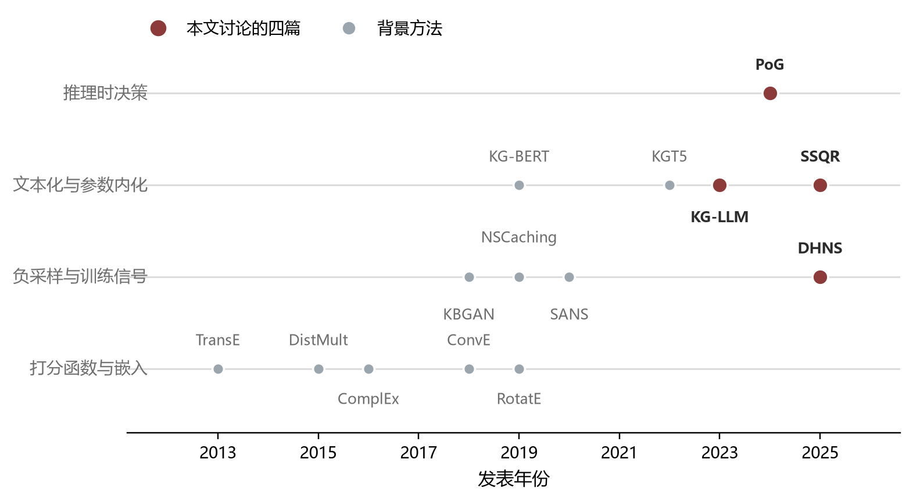{#fig-lineage}

### 1.2 本文提出的三个分析维度

本文设置三个分析维度。维度一考察表示形式（representation format）与压缩率（compression ratio），即知识以何种载体进入模型计算，该载体的开销随图谱规模如何增长，属静态的表示属性。维度二考察误差传播（error propagation），把方法拆成表示、选择、推理与监督四个处理阶段，看误差在哪里产生、能否被现有指标观测，属动态的过程属性。维度三考察决策时点，借用急切学习（eager learning）与惰性学习（lazy learning）的区分 @aha1997lazy，看知识在训练时还是推理时被固定下来，属干预属性。

三个维度逐层收窄。维度一确定知识的入口，维度二追踪误差沿处理流程的去向，维度三解释某些差异为何无法靠改进后续环节消除。@fig-framework 给出三者的层次关系。三个维度自左至右排列，列内自上而下为各级子维度，虚线箭头标注维度之间的推导关系，箭头上的标注分别为描述与解释。

```{mermaid}
%%| label: fig-framework
%%| fig-cap: "三个分析维度的层次关系。三个维度自左至右排列，列内自上而下为各级子维度，虚线箭头标注维度之间的推导关系。"
flowchart LR
  subgraph D1["维度一 表示形式"]
    direction TB
    A1["一级 载体形式"] --> A2["二级 开销增长关系"]
    A2 --> A3["压缩率"]
    A3 --> A4["可追溯性"]
  end
  subgraph D2["维度二 误差传播"]
    direction TB
    B1["一级 处理阶段"] --> B2["二级 误差类型"]
    B2 --> B3["三级 可观测性"]
  end
  subgraph D3["维度三 决策时点"]
    direction TB
    C1["训练时固化"] --> C2["误差不可修正"]
    C3["推理时决策"] --> C4["误差可修正"]
  end
  D1 -. 描述 .-> D2
  D2 -. 解释 .-> D3
```

### 1.3 论文选取与任务边界

四篇论文按技术路线的代表性选取。KG-LLM（@yao2025kgllm，ICASSP 2025）通过指令微调让大语言模型直接完成三元组分类、关系预测与链接预测。SSQR（@lin2025ssqr）用向量量化（vector quantization）把实体压缩成离散码，再注入词表。PoG（@tan2025pog，WWW 2025）在知识图谱上执行多跳路径搜索，以路径支撑自然语言问答。DHNS（@niu2025dhns，DASFAA 2025）用条件扩散模型生成负样本嵌入。四者分别作用于推理、表示、选择与监督四个环节，恰好覆盖 4.1 节划分的全部处理阶段。

PoG 的任务归属需要先说明。该文的任务是知识图谱问答（knowledge graph question answering, KGQA），指标为精确匹配（exact match），对缺失链路的补全发生在推理过程中，与链接预测意义上的补全并不相同。因此第 6 节的指标比较不纳入 PoG，该文只参与维度一、维度二与成本报告的比较。

四篇的方法细节分散在各自的实验章节，直接进入维度比较容易失去具体性。第 2 节结合原文配图逐篇梳理四者的方法流程与关键环节，并说明设计取舍，作为后续三章的事实基础。

## 2 四篇论文的方法拆解

本节结合原文配图逐篇梳理四篇论文的方法流程，重点说明图中容易忽略的实现细节与设计取舍。四篇同处一条处理流水线（见 4.1 节），分别占据推理、表示、选择与监督四个位置，方法之间不构成直接替代关系。本节所引图片均出自原论文，版权归原论文作者所有，其中 @tan2025pog 以 CC BY 4.0 许可发布，其余三篇按学术惯例注明出处引用。

### 2.1 KG-LLM 把补全改写为序列生成

KG-LLM 的方法建立在一个任务改写之上。三元组可以写成自然语言序列，判断其真伪、预测缺失的关系或实体都能表述为文本到文本的生成问题，模型无需学习嵌入，只需学会按模板作答。@fig-kgllm 给出三类子任务的模板。三元组分类把整条三元组嵌入疑问句，模型输出真伪判定。关系预测在提示（prompt）中列出候选关系，把排序问题化为多选一。实体预测的写法最值得注意，图中显示它同时使用两个方向的提示，"Steve Jobs founded" 由头实体与关系推尾实体，"What/Who/When/Where/Why founded Apple Inc.?" 由尾实体反推头实体，两个方向的输出得分取平均后合并为最终事实。

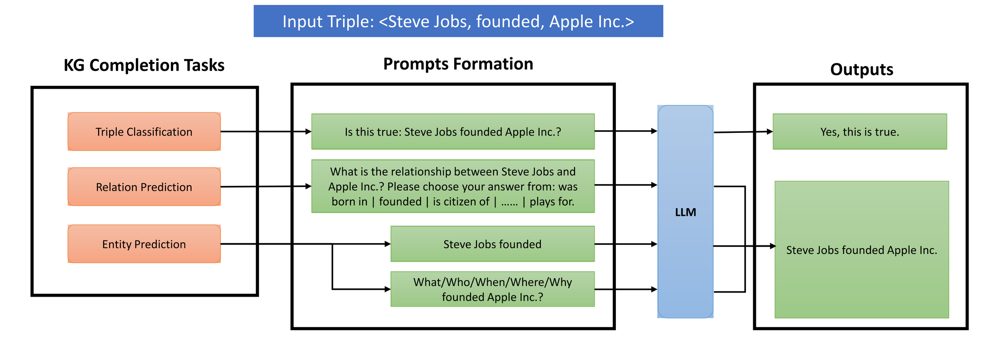{#fig-kgllm}

双方向设计在图中只是两行提示文本，作用却不止于补充信息。生成式模型对提示措辞高度敏感，单一方向必然偏向某一类实体槽位，wh 疑问词把缺失槽位的类型约束在疑问词限定的范围内，反向提示补足另一方向的条件，**头尾取平均相当于对两个条件分布做集成**。这一细节同时划定了方法的边界。实体预测的答案空间没有显式约束，全实体排序退化为生成加字符串匹配，YAGO3-10 上链接预测 Hits@1 仅 0.133 的结果（@yao2025kgllm）由此而来。关系预测的候选列表把答案空间限制在提示长度之内，Hits@1 达 0.7028 并超过该文测得的 GPT-4 结果 0.56，两类任务的表现差距可以在模板差异中找到来源。

实现上还有两处取舍。判定采用字符串匹配而非解析结构化输出，模型因此没有输出概率可供校准，收益是避免结构化输出在微调数据分布之外不稳定。提示附加 5 个采样的邻居实体作为结构信息，这一行补充使 WN18RR 上实体预测 Hits@1 从 0.2682 升至 0.3151（@yao2025kgllm Table IV），说明改写路线并未放弃结构信息，只是把它压缩到提示中的一个列表。方法的适用条件随之明确，候选集封闭且规模有限，描述文本质量有保障；换图谱需要重新微调，描述文本中的错误会经微调进入参数。

### 2.2 SSQR 两阶段的量化表示

SSQR 的流程分两个阶段，@fig-ssqr 给出完整图景。第一阶段先由两层 GCN 按 CompGCN 的组合方式在多跳邻域上传播消息，得到实体的结构向量，向量经前馈网络展开后与规模为 2 048 的码本（codebook）做量化对齐，每个实体输出一个固定长度的码索引序列。图中把量化画成查表过程，示例序列 3、10、8、9、8、7 中同一索引出现两次，码序列不能按位置解读语义。训练同时优化三项损失，量化损失约束编码输出与码本的距离，结构重建以 ConvE 对实体与邻居构成的三元组打分并施加 BCE 损失，语义蒸馏把量化前的向量对齐到文本嵌入。

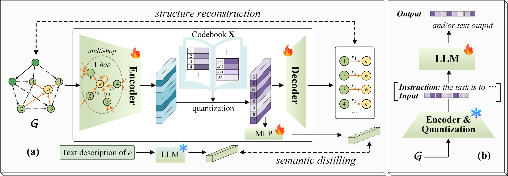{#fig-ssqr}

两处设计取舍藏在图的图标里。语义蒸馏的教师端带雪花，即教师是一支冻结的文本嵌入模型，原文使用 text-embedding-3-large 的 3 072 维向量 @lin2025ssqr，可训练的只有量化支路上的 MLP，蒸馏因此不会把教师参数引入训练过程。结构重建的对象是邻居三元组的真伪判别而非邻接矩阵重建，这一选择把表示学习的目标直接挂在链接预测任务上，**码本质量由下游打分函数检验，而不是由重建误差检验**。两项选择共同使第一阶段与下游任务对齐，代价是码本与任务绑定，更换任务需要重训。

第二阶段把码序列作为新增 token 并入分词器，微调 LLaMA2-7B 与 LLaMA3.1-8B，对 AdaProp 提供的每条查询 20 个候选学习排序。图中右栏标示编码与量化模块在第二阶段冻结，只有语言模型更新，两个阶段因此解耦，推理时的开销固定为每实体 16 个 token，与图谱规模无关，这解释了 3.2 节的常数开销曲线。局限随之而来，码本按图谱整体训练，训练时未出现的实体无法编码，码序列不可人工解读，量化损失没有对应指标，训练投入为四张 H100。

### 2.3 PoG 训练无关的图上搜索

PoG 不改动任何模型参数，把补全的位置移到推理时的图上搜索。@fig-pog 以双实体问题 "What country bordering France contains an airport that serves Nijmegen?" 展示完整流程。初始化阶段由 LLM 识别主题实体并经 BERT 语义相似度对齐到图谱，扩展 $D_{max}$ 跳子图并以双向 BFS 压缩。图中初始化框内列出的三项输出容易忽略，即问题分解、指示词与有序实体列表，一次 LLM 调用同时完成问题拆解与推理深度预测，后续探索的轮数由该预测值起算而不是固定常数，这是推理成本可控的前提。

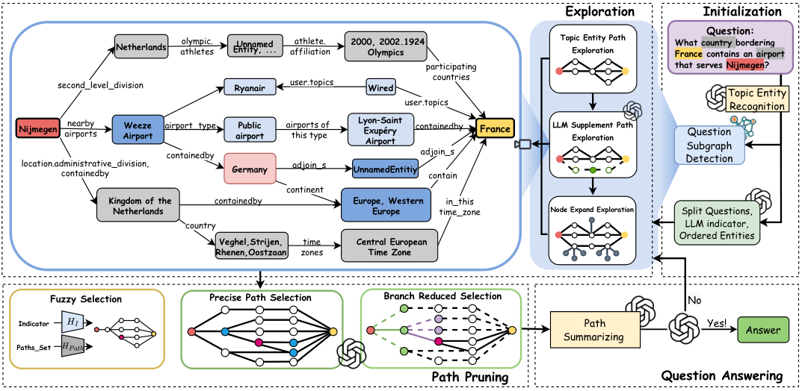{#fig-pog}

探索阶段在子图上分三步展开，先沿主题实体路径搜索，再由 LLM 补充路径，最后扩展一跳邻居。剪枝阶段在图中画为三级漏斗，模糊选择以 SBERT 余弦相似度把候选路径粗筛至 80 个，精确选择由 LLM 精排至 3 个，分支缩减按前 $D$ 步的前缀交集合并同源分支。三级顺序按单位成本承担的过滤量递减排列，最便宜的相似度计算承担最大过滤量，最昂贵的 LLM 调用只处理少量候选，**调用次数低于 ToG（CWQ 上 9.1 对 21.3 次，@tan2025pog）主要源于这一排序**。作答前先对路径中的三元组做摘要，再判断证据是否充分，图中回答节点的 Yes 与 No 两支构成回路，No 返回探索阶段继续加深，深度逐轮递增。整个流程没有训练环节，代价全部落在推理侧，CWQ 上单题 118.9 s。图中子图保留 Unnamed Entity 一类节点，对应 Freebase 的复合值类型（compound value type），这类节点如何参与剪枝与作答，是复现时需要对照代码确认的细节。

### 2.4 DHNS 条件扩散生成负样本

DHNS 不改动 KGE 模型结构，只替换训练时负样本的来源。@fig-dhns 左半部分给出一条信息层级，高层为图谱拓扑，中层为实体的文本描述，低层为视觉外观，三条支路分别经嵌入层、文本编码器与视觉编码器提取特征，各自进入条件扩散过程。这一层级排序本身是一个设计判断，原文未对其做消融验证，而三模态在打分时取的是无权重平均，层级排序与打分权重之间的关系被留作隐含假设。

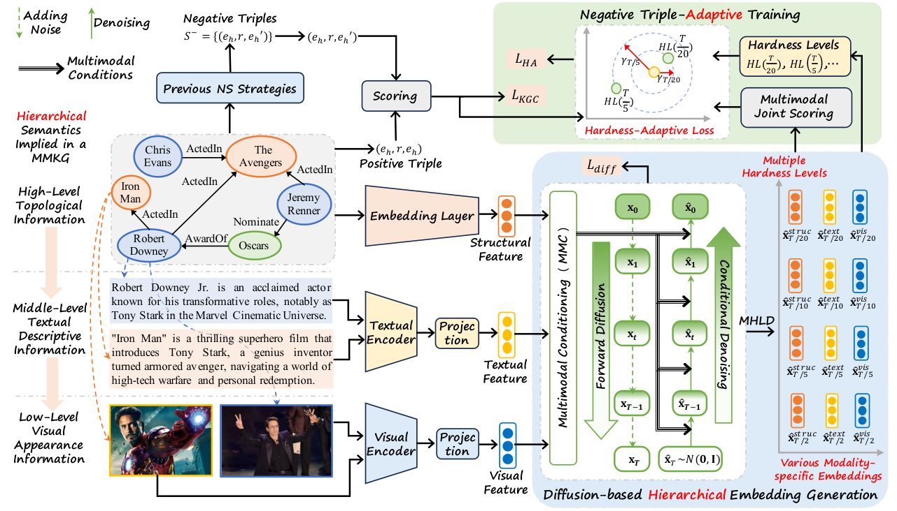{#fig-dhns}

扩散过程在图中画为上下两条链，前向链把正样本嵌入 $x_0$ 逐步加噪至 $x_T$，反向链从噪声出发去噪至 $\hat{x}_0$，两条链共享同一组条件，扩散损失 $L_{diff}$ 只作用于反向链。前向链终点标注 $x_T \sim \mathcal{N}(0,1)$，这一端点承担了硬度刻度的角色。去噪在 $T/20$、$T/10$、$T/5$、$T/2$ 四个时间步提前停止，各输出一组模态相关的负样本嵌入 $\hat{x}^{\text{struc}}$、$\hat{x}^{\text{text}}$ 与 $\hat{x}^{\text{vis}}$，对应图右的 Multiple Hardness Levels 一栏。去噪越不充分，生成嵌入越接近条件向量给出的最可能尾实体，负样本越难。去噪至纯噪声端，负样本退化为与条件无关的随机嵌入，最易区分。**硬度分层因此不引入任何额外模块，只是对反向链的停止位置取样，时间步这一处超参同时充当难度控制器。**

图的右上部分说明了该方法的插件性质。负样本有两个来源，Previous NS Strategies 一栏仍产出传统采样的负三元组，进入 $L_{KGC}$，DHNS 生成的嵌入经 Multimodal Joint Scoring 参与 $L_{HA}$。两项损失并存，生成分支是增强而非替换，这是它无需改动下游模型的原因。$L_{HA}$ 面板把间隔 $\gamma$ 画为随硬度层级变化的圆半径，靠近 $HL(T/20)$ 的样本间隔最小，靠近 $HL(T/5)$ 的样本间隔最大，困难负样本因此不做过度排斥。实现上的主要代价在计算量，三条模态支路乘四个停止位置，负样本生成次数是传统采样的数倍，原文未报告训练时间与显存占用。合成嵌入在实体表中没有对应对象，分布偏移没有对应指标，这两点构成 4.2 节与 4.3 节的分析基础。

### 2.5 对比与小结

@tbl-method 汇总四篇在范式、开销与误差上的差异。

| 项 | KG-LLM | SSQR | PoG | DHNS |
|---|---|---|---|---|
| 学习范式 | 参数高效微调 | 两阶段训练 | 训练无关 | 训练阶段插入 |
| 贡献类型 | 证明改写可行 | 证明改写可行 | 组合方式与剪枝设计 | 训练信号设计 |
| 作用环节 | 推理 | 表示 | 选择 | 监督 |
| 每实体上下文开销 | 5 邻居加描述，线性 | 16 token，常数 | 若干路径，按查询计 | 0 |
| 更换图谱的代价 | 重新微调 | 完整重训两阶段 | 无 | 重新训练 |
| 输出可核查性 | 提示保留原文 | 码不可读 | 路径可对照查询 | 不产生可读证据 |
| 主要误差 | 候选截断 | 量化损失 | 剪枝假阴性 | 分布偏移 |
| 主要验证方式 | 微调前后对照、人工抽样 | 分支消融、跨数据集对比 | 与 ToG 等横向对比、剪枝消融 | 模块消融、固定 backbone 对照 |

: 四篇论文的方法要素对比 {#tbl-method}

验证方式随贡献类型变化，这一点先于性能比较。KG-LLM 与 SSQR 都把 KGC 改写为另一种任务形式，前者改写为序列生成，后者改写为词表扩展，贡献在于证明改写可行，证据以微调前后的对照为主。PoG 由既有组件组合而成，路径搜索、语义相似度打分与 LLM 判断在 ToG 一类工作中已分别出现，贡献在于组合方式与剪枝设计，证据以与 ToG 的横向对比为主。DHNS 不改动模型结构，只替换训练信号的来源，证据以模块消融与固定 backbone 的对照为主。**贡献类型不同，可比范围也不同，跨类型直接比较性能数字意义有限。**

三条横向观察可以收束本节。其一，四篇占据同一条流水线的不同位置，KG-LLM 与 SSQR 同样依赖微调，前者投入小，上限受候选截断限制，后者以两阶段训练换取与图规模无关的常数开销。其二，成本结构分为三种类型，KG-LLM 与 SSQR 一次性重投入而推理便宜，PoG 零训练而推理昂贵，DHNS 训练开销增加而推理零增量，三种曲线对应不同的部署场景。其三，四篇存在两项共性短板，均未报告置信区间，SSQR 与 DHNS 的核心误差均不可观测，这两点分别在第 6 节与 4.3 节展开。

## 3 维度一 表示形式与压缩率

### 3.1 知识进入模型计算的形式

本文按载体把知识进入模型计算的形式分为五层，@tbl-representation 列出各层的形式、计量单位与代表工作。分类依据是载体的计量单位，与模型结构无关。L0 指知识不进入上下文，只通过参数更新或训练数据分布起作用，DHNS 属于此类。L1 至 L3 都进入上下文，计量单位分别是 token、离散码与路径。L4 为连续向量，即 KGE（knowledge graph embedding）方法的表示形式，不直接进入语言模型输入。

五层的排序依据是单位的可计数性。token 数由分词器决定，码数由码长决定，路径数由搜索宽度决定，三者都能直接计数并换算为开销。跨方法的比较因此可以停在开销层面，不必深入到模型结构。

| 层次 | 表示形式 | 计量单位 | 代表工作 |
|---|---|---|---|
| L0 | 不进入上下文，仅改参数或数据分布 | 无 | @niu2025dhns |
| L1 | 自然语言序列 | token | @yao2025kgllm |
| L2 | 离散符号 | 码 | @lin2025ssqr |
| L3 | 图结构路径 | 路径 | @tan2025pog |
| L4 | 连续向量 | 维度 | KGE 全体 |

: 知识进入模型计算的五种形式 {#tbl-representation}

### 3.2 开销随图规模的增长关系

第二层维度考察每实体开销随图谱规模的增长关系，可分为线性增长、常数与不进入上下文三类。常规提示方法从图中采样邻居并展开为文本，开销随邻居数量线性上升。SSQR 的实测值标定了这条曲线 @lin2025ssqr。WN18RR 按 50% 比例采样邻居时，每实体约 186 token，全量采样约 1 493 token。FB15k-237 采样 20% 二跳邻居，已达约 3 000 token。SSQR 把每个实体编码为 16 个离散码，开销与图谱规模无关。

@fig-allocation 在对数坐标下对比两类曲线。常数开销的收益与代价出自同一个设定。16 个码足以承载实体在两个数据集上的主要信息，SSQR 因此在 WN18RR 与 FB15k-237 上分别取得 0.598 与 0.459 的 MRR，与这一设定相符（6.2 节）。代价是截断，码长固定后无法按需补充细节，损失也无法逐项检查。线性开销保留采样范围内的全部信息，代价是长上下文与截断风险。两类开销的差别构成后文误差分析的起点。

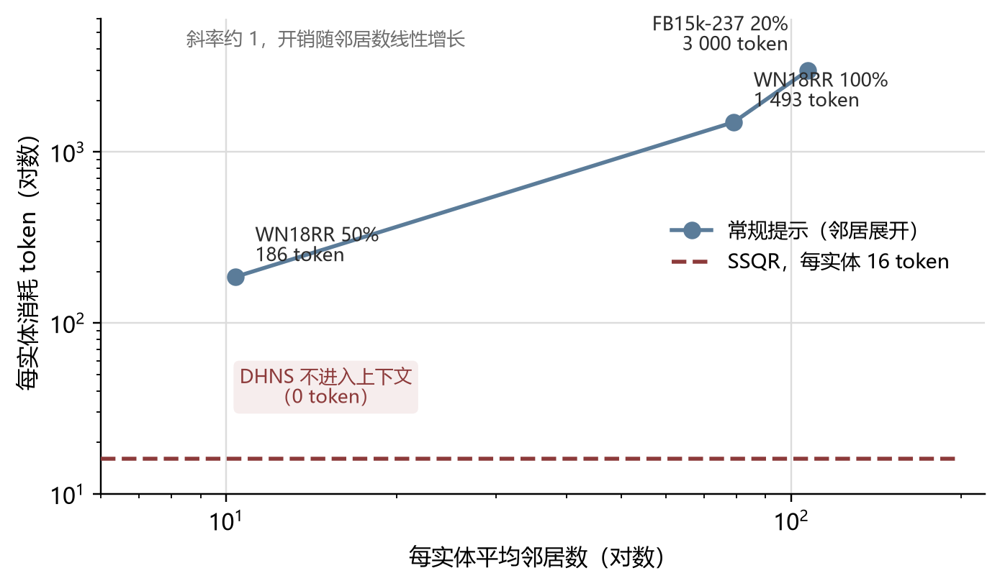{#fig-allocation}

### 3.3 压缩率与任务性能

压缩率与任务性能之间没有单调关系，两组证据支持这一判断。其一，极少量结构信息即可改变结果。KG-LLM 在实体预测的提示中加入 5 个邻居实体，Hits@1 在 WN18RR 上从 0.2682 升至 0.3151，在 YAGO3-10 上从 0.0949 升至 0.1330，相对提升 17.5% 与 40.1%（@yao2025kgllm Table IV）。数十个 token 即带来这一幅度，说明**上下文中有无结构信息比信息总量更关键**。

其二，完全不进入上下文的方法也有增益。DHNS 不向任何模型输入知识，只改变 KGE 训练时负样本的生成方式，在多模态链接预测上比最强基线高 1.05 至 1.85 个 MRR 点。这一结果与其余三篇不可直接比较，任务与协议都不同，此处只用于表明上下文带宽不是增益的唯一来源。

本节讨论的是链接预测与多模态链接预测，不涉及文本生成类任务。

### 3.4 压缩率与可追溯性

可追溯性（traceability）在本文按三条可判定的标准衡量。其一，表示能否反推至原始三元组或原文片段。其二，是否存在可执行的校验程序，让第三方核对断言与证据的对应关系。其三，校验成本是否随图谱规模增长。

按这三条，PoG 的路径表示全部满足。路径由显式三元组构成，可与数据集的标准查询逐条对照，校验成本与路径数量成正比。KG-LLM 的提示保留原文，可人工核对，成本随上下文长度上升。SSQR 的离散码三条均不满足，码序列无法由人工解读，原文也未报告码的重建质量 @lin2025ssqr，损失无法估计。DHNS 的合成嵌入同样不可追溯，负样本嵌入在实体表中找不到对应对象。

**可追溯性与压缩率在此分离。**SSQR 压缩最彻底，可追溯性最低。PoG 几乎不压缩，可追溯性最高。二者不是同一属性的两端，本文分别处理。

## 4 维度二 误差传播

### 4.1 处理阶段的划分

本文把四篇论文的处理流程拆成表示、选择、推理与监督四个阶段。表示阶段将原始图谱转换为模型可用的形式，选择阶段从候选集中筛去大部分对象，推理阶段在剩余候选上作出判断，监督阶段为训练提供正负样本与损失信号。阶段的先后顺序决定误差传播的方向。前一阶段的输出是后一阶段的输入，前一阶段引入的误差会进入后续所有环节。

四篇论文各自主攻一个阶段。SSQR 的重心在表示，PoG 在选择，KG-LLM 在推理，DHNS 在监督。这一分工为逐阶段比较误差提供了结构。

### 4.2 各阶段的误差类型

@tbl-error 列出四个阶段的误差类型、来源工作与指标覆盖情况。表示阶段的误差来自有损编码。SSQR 的量化不可逆，码本规模固定，训练时未出现的实体无法编码，两类损失都没有对应指标。选择阶段的误差来自搜索过程。PoG 的实体链接可能定位错误，深度上限（$D_{max}=3$）会漏掉更深的路径，剪枝可能提前移除正确分支。前两者可由召回统计观测，剪枝造成的假阴性难以直接测量。推理阶段的误差来自候选截断。KG-LLM 在 YAGO3-10 上的链接预测 Hits@1 只有 0.133，候选空间扩大时生成式判定随之受限，这类误差可由标准指标测量。监督阶段的误差来自合成数据的分布偏移。DHNS 生成的负样本嵌入不对应任何真实实体，模型可能依据真实嵌入与合成嵌入的分布差异而非语义差异作出区分，这一偏移没有对应指标。

| 阶段 | 误差类型 | 来源工作 | 有无对应指标 |
|---|---|---|---|
| 表示 | 量化误差、封闭码本未登录实体 | @lin2025ssqr | 无 |
| 选择 | 实体链接误差、深度上限漏检、剪枝假阴性 | @tan2025pog | 有 |
| 推理 | 候选空间截断 | @yao2025kgllm | 有 |
| 监督 | 合成样本的分布偏移 | @niu2025dhns | 无 |

: 四个处理阶段的误差类型与可观测性 {#tbl-error}

### 4.3 误差的可观测性

误差能否被现有指标测到，决定它能否成为后续研究的改进对象。四篇论文的报告完整度在这里分出层次。PoG 报告每题的调用次数、token 消耗与运行时间，还比较了不同剪枝策略的 token 与精度权衡，选择阶段的误差因此可以定位，也可以估计。SSQR 与 DHNS 的核心误差落在表示与监督阶段，两篇都没有提供观测这类误差的指标。KG-LLM 的误差落在推理阶段，标准指标能测，论文却只给了 100 条人工抽样，未报置信区间。

报告完整度与可观测性相关，两者并不等同，完整报告是可观测性的必要条件。四篇中报告最完整的一篇，恰好也是误差最可测的一篇，@tbl-report 列出这一对应关系。

### 4.4 误差的转移与累积

**四篇论文都在转移误差，没有一篇消除误差。**SSQR 取消邻居检索，选择阶段的检索误差随之归零，量化误差与未登录实体问题全部集中到表示阶段。PoG 不压缩表示，量化误差不存在，剪枝带来的假阴性风险留在选择阶段。KG-LLM 不做表示学习，表示误差不存在，候选截断的误差出现在推理阶段。DHNS 不改动任何阶段的模型结构，它在监督阶段引入的分布偏移会作用到全部下游环节。

@fig-propagation 按阶段与论文排列误差的分布，色块区分可观测与不可观测。不可观测的色块集中在 SSQR 与 DHNS 两行。这两篇论文的核心误差目前无法证伪，也难以被后续工作针对性改进。

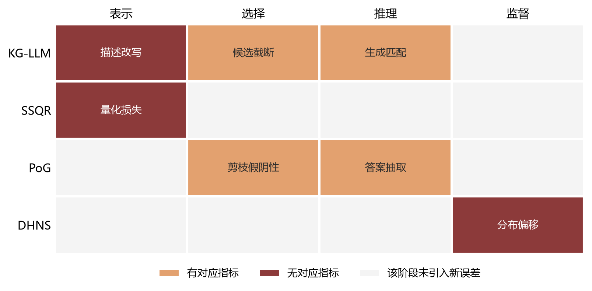{#fig-propagation}

## 5 维度三 决策时点

### 5.1 急切学习与惰性学习的划分

机器学习按参数何时确定，区分急切学习（eager learning）与惰性学习（lazy learning）@aha1997lazy。前者在训练时完成计算，把结果固化在参数中。后者把计算推迟到查询发生时。四篇论文的决策时点可用这一区分定位。SSQR 的码本与微调后的参数在训练时确定，DHNS 的生成分布与损失函数在训练时确定，两者都在急切一侧。PoG 的决策全部发生在推理时，路径搜索、剪枝与作答都针对当前查询完成，属惰性一侧。KG-LLM 的参数经微调固化，提示内容在推理时组装，处在两者之间。

### 5.2 决策时点与可修正性

决策时点决定误差能否被修正。训练时固化的表示，后续环节无法纠正。SSQR 更换图谱或图谱更新时需要重训码本，码中的错误随之固化。DHNS 的生成分布同样绑定在训练时的条件设置上。推理时决策的方法没有这个问题。PoG 的每次查询独立执行，图谱更新后路径随之更新，一次查询走错的路径不影响下一次。KG-LLM 的提示在推理时组装，输入层的错误可以即时修正，参数内化的错误不能。

### 5.3 三个维度的层次关系

**维度一与维度二描述现象，维度三解释这些现象为何稳定存在。**表示形式决定误差的类型，处理阶段决定误差的位置，决策时点决定误差能否被修正。三者连成一条解释链，任何改进建议都可以按这条链定位作用点。第 8 节据此检查三个维度交叉后仍未被占据的组合。

## 6 关键数据的横向比较

### 6.1 数据来源与可比性处理

本章数字全部取自四篇论文正文表格，来源与表号写在图注中，汇总数据见随文文件 figures/data.py。四篇的任务与指标不同，MRR 与精确匹配不可直接比较，跨行比较一律在任务内部进行，每篇以自身最强的基线为参照。

三点口径先说明。第一，DHNS 的主表（Table 2 与 Table 3）没有控制 backbone，各基线沿用原论文设置，DHNS 一行使用 RotatE backbone，主表数字只作参考，控制 backbone 后的比较放在 6.4 节。第二，消融的相对降幅以移除后的模型为分母，与 DHNS 原文的百分比口径一致。第三，PoG 的 token 数字是测试集总量，不能除以题数当作单题均值。

### 6.2 主要结果与跨数据集稳定性

@tbl-main 汇总四篇的主结果。KG-LLM 在三元组分类上取得 WN11 96.6 与 FB13 90.7 的准确率，关系预测 Hits@1 为 0.7028，高于同一论文测得的 GPT-4 结果 0.56，链接预测在 YAGO3-10 上只有 0.133。SSQR 在 WN18RR 与 FB15k-237 上取得 0.598 与 0.459 的 MRR，比最强基线高 5.8% 与 10.6%。DHNS 在三个多模态数据集上的 MRR 为 34.36、35.68 与 39.11。PoG 在 GPT-3.5 下相对 ToG 提升 15.8 至 27.3 个百分点，GPT-4 下为 11.9 至 26.7 个百分点，覆盖五个问答数据集。

@fig-generalization 检验方法排名在数据集之间是否稳定。两个面板分别以 MKG-W 与 MKG-Y 的 MRR 对 DB15K 作图，相关系数为 0.62 与 0.61。多数方法贴近对角线，OTKGE 偏离明显，DB15K 上为 23.86，MKG-Y 上为 35.51。方法与数据集之间存在交互，单数据集的排名不足以支撑方法选型。

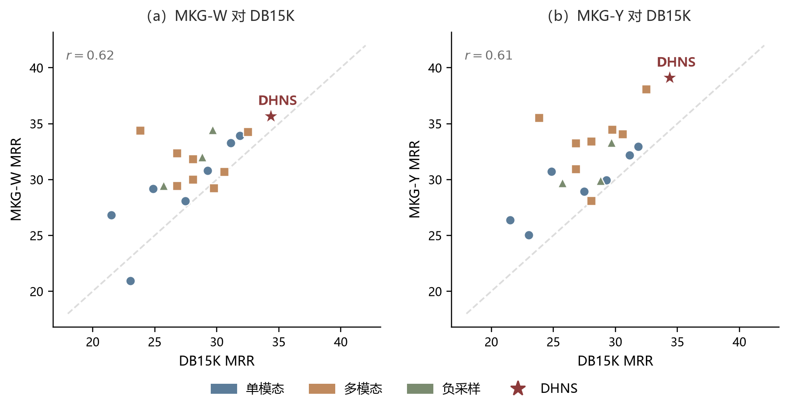{#fig-generalization}

| 项目 | KG-LLM | SSQR | PoG | DHNS |
|---|---|---|---|---|
| 任务 | KGC | KGC | KGQA | MMKGC |
| 指标 | Acc, Hits@1 | MRR | Hits@1 | MRR, Hits@K |
| 数据集（实体数） | WN11 38.7k, FB13 75.0k, YAGO3-10 123.2k | WN18RR 40.9k, FB15k-237 14.5k | Freebase 系五个问答集 | DB15K 12.8k, MKG-W 15.0k, MKG-Y 15.0k |
| 主结果 | WN11 96.6, FB13 90.7, YAGO3-10 链接预测 0.133 | WN18RR 0.598, FB15k-237 0.459 | CWQ 74.7, WebQSP 93.9, GrailQA 91.6 | DB15K 34.36, MKG-W 35.68, MKG-Y 39.11 |
| 相对参照 | 三元组分类 +3.1（对 KG-BERT） | +5.8% 与 +10.6% | 较 ToG 提升 15.8 至 27.3（GPT-3.5） | +1.85, +1.21, +1.05 |

: 四篇论文的任务、指标与主结果。数字均取自各论文正文，跨行不可直接比较，理由见 6.1 {#tbl-main}

### 6.3 消融实验的证据强度

@tbl-ablation 把消融幅度与净增益并列。DHNS 的降幅在数据集之间差异明显。移除生成分支后，相对降幅在 MKG-W 为 22.9%，在 DB15K 与 MKG-Y 分别为 11.2% 与 10.2%。移除多模态条件化与移除硬度分层，降幅同样以 MKG-W 最高。

消融幅度与净增益的落差更大。以 DB15K 为例，移除生成分支的相对降幅为 11.2%，相对最强基线 AdaMF 的净增益为 1.85 个 MRR 点，两者相差约一个数量级。**消融回答的是该模块在系统内部是否必要，净增益回答的是系统整体是否优于外部替代方案，两个问题不可相互替代。**SSQR 的消融呈现另一种形态，数值与解释放在 7.1 节。

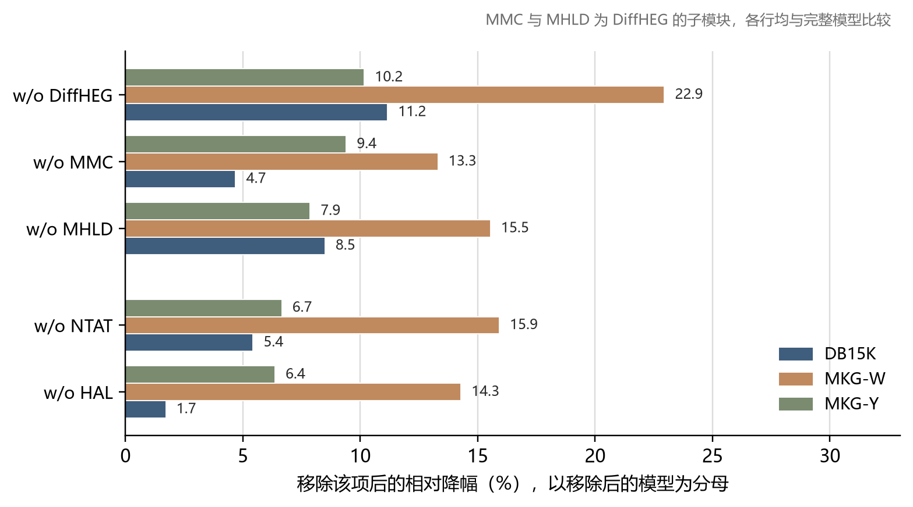{#fig-ablation}

| 工作 | 消融项 | 相对降幅（%） | 相对最强基线的净增益 |
|---|---|---|---|
| DHNS | 移除生成分支 | 11.2 / 22.9 / 10.2 | 1.85, 1.21, 1.05 |
| DHNS | 移除多模态条件 | 4.7 / 13.3 / 9.4 | 1.85, 1.21, 1.05 |
| DHNS | 移除硬度分层 | 8.5 / 15.5 / 7.9 | 1.85, 1.21, 1.05 |
| DHNS | 移除自适应训练 | 5.4 / 15.9 / 6.7 | 1.85, 1.21, 1.05 |
| DHNS | 移除硬度自适应损失 | 1.7 / 14.3 / 6.4 | 1.85, 1.21, 1.05 |
| SSQR | 移除结构分支 | 0.83 / 14.40 | 0.033 与 0.044 |
| SSQR | 移除语义分支 | 7.45 / 3.88 | 0.033 与 0.044 |

: 消融幅度与净增益的对比。相对降幅一列，DHNS 按 DB15K、MKG-W、MKG-Y 的顺序列出，SSQR 按 WN18RR、FB15k-237 的顺序列出。DHNS 的降幅以移除后的模型为分母，SSQR 的降幅口径与原文一致 {#tbl-ablation}

### 6.4 负采样策略与 backbone 的交互

DHNS 主表没有控制 backbone，方法贡献与 backbone 贡献混杂。Table 4 在固定 backbone 的条件下比较七种负采样策略，@fig-nsbackbone 把各策略相对同条件最强基线的 MRR 差画成热图。九个条件里 DHNS 七正两负，为负的两处是 TransE 的 DB15K（−0.4）与 DistMult 的 MKG-W（−0.1）。增益集中在 RotatE backbone，三个数据集分别为 +3.8、+1.5 与 +3.2。MKG-Y 一列三种 backbone 全为正（+1.9、+4.2、+3.2），说明除几何因素外还有独立的数据集效应，单一解释无法覆盖，详见 7.3 节。该表只覆盖 MRR，Hits 系列指标未纳入。

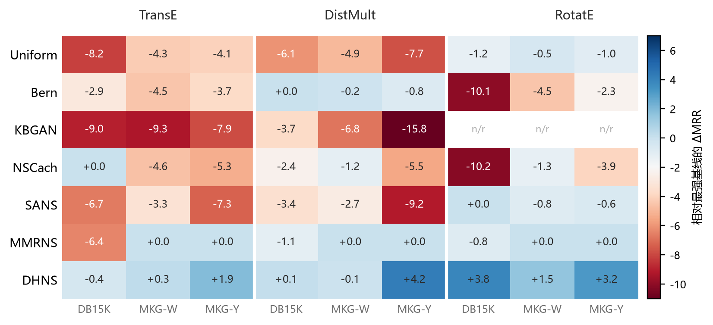{#fig-nsbackbone}

### 6.5 报告完整度

@tbl-report 用五项条目比较四篇的报告完整度。四篇都没有报告置信区间或显著性检验。训练成本方面，SSQR 报告使用四张 H100，DHNS 报告使用单张 RTX 4090，KG-LLM 未报硬件。推理成本方面，PoG 报告每题调用次数、token 与延迟，其余三篇不适用或未报。PoG 的成本数据有一处值得注意，调用次数低于 ToG，CWQ 上 9.1 对 21.3 次，单题运行时间反而更长，CWQ 上 118.9 s 对 78.7 s，GrailQA 上 21.4 s 对 14.8 s，成本从调用次数转移到单次上下文长度。报告完整度的差别与 4.3 节的可观测性判断一致。

| 项目 | KG-LLM | SSQR | PoG | DHNS |
|---|---|---|---|---|
| 置信区间或显著性检验 | 无 | 无 | 无 | 无 |
| 训练硬件与规模 | 未报告 | 4×H100 | 不适用（training-free） | 单张 RTX 4090 |
| 推理成本（调用、token、延迟） | 未报告 | 未报告 | 有 | 不适用 |
| 失败案例或误差分析 | 人工抽样 100 条 | 无 | 有 | 无 |
| 成本与精度的权衡分析 | 无 | 无 | 有 | 无 |

: 四篇论文的报告完整度。不适用指该文不涉及相应环节 {#tbl-report}

## 7 由数据得到的经验观察

### 7.1 结构信息的贡献依赖语料

SSQR 的消融提供了同协议同指标下的直接证据。移除结构分支后，MRR 相对降幅在 FB15k-237 为 14.40%，在 WN18RR 为 0.83%。移除语义分支后方向相反，WN18RR 下降 7.45%，FB15k-237 下降 3.88%（@lin2025ssqr Table 2）。@fig-ssqrcorpus 对比这两组结果，**同一分支在两个数据集上的降幅相差 17 倍以上**。

一种解释落在两个数据集的结构差异上。FB15k-237 有 237 种关系，类型多样，结构分支承担主要的区分任务。WN18RR 只有 11 种关系，层级深、关系少，实体的区分更多依赖语义。这一解释与消融方向一致，是否成立还需要在关系规模居中的数据集上检验。本条观察限于 SSQR 的量化表示设定，不外推到其他方法。

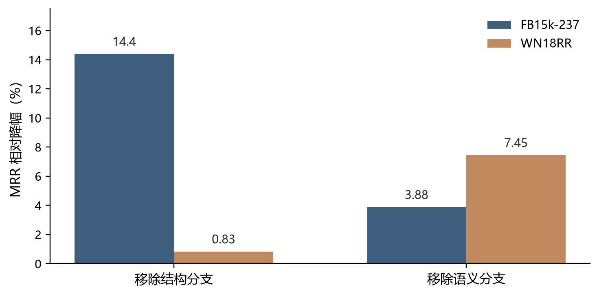{#fig-ssqrcorpus}

### 7.2 消融基线与比较基线的区分

DHNS 的两组数字反映出基线选择的混淆。消融显示生成分支的贡献更大，主表显示净增益有限，原因在于两组比较用了不同的基线。消融的基线是移除该模块后的自身模型，主表的基线是各自原论文设置下的其他方法，其中混有不同 backbone。DHNS 使用 RotatE，对照的 AdaMF、MMRNS 等各有自己的模型结构，跨 backbone 并列，方法贡献与 backbone 贡献无法分离。6.4 节的同 backbone 比较显示，DHNS 的增益集中在 RotatE，在 TransE 与 DistMult 的部分条件为负，与上述判断一致。该案例说明，**报告消融幅度时应当同时报告与外部最强基线的净增益，两者的落差本身包含信息**。

### 7.3 条件化方式与打分函数的几何匹配

6.4 节中增益集中于 RotatE 的现象，可由条件化方式与打分函数的几何结构来解释。DHNS 用头实体与关系嵌入的 Hadamard 积构造扩散过程的条件向量，RotatE 的打分函数基于复数旋转，两者在运算形式上一致。TransE 基于平移，DistMult 基于双线性乘法，条件构造与打分几何错位，生成负样本的针对性可能因此减弱。这一解释属待检验假设，原文没有做几何层面的分析 @niu2025dhns。MKG-Y 上三种 backbone 均为正，提示数据集特征（例如只有 28 种关系）独立于几何影响增益，几何匹配解释不了全部现象。

## 8 尚未覆盖的问题

### 8.1 三个维度交叉后的空缺

把可追溯性（维度一）与可修正性（维度三）交叉，得到四种组合。**可见且可修正的组合为空。**本文考察的四篇中，没有一篇能在定位自身错误的同时保留已训练的知识。PoG 可见且可修正，代价是不做表示学习。SSQR 与 DHNS 的核心误差不可见，表示又在训练时固化，不可修正。KG-LLM 输入层的错误可修正，参数内化的错误既不可见也不可修正。这一判断限于这四篇，不构成对领域现状的穷尽性断言。

### 8.2 对应的研究问题

上述空缺对应两个可操作的研究问题。其一，离散码的增量更新。SSQR 的码本按图谱整体训练，如果能为新增或更新的实体增量分配码而不重训码本，不可修正的问题即可部分缓解，该问题对应量化表示的持续学习（continual learning）设定。其二，合成监督信号的校验。DHNS 的负样本嵌入无法对照真实实体检验，若在生成时加入与最近真实实体的距离约束，或对生成样本做事后统计检验，监督阶段的分布偏移就能从不可观测变为可观测。

## 9 结论

本文沿表示形式与压缩率、误差传播、决策时点三个维度比较了四篇知识图谱补全论文。方法拆解先行，后续比较由此获得具体性。三条经验观察如下。结构信息的贡献随语料变化，FB15k-237 上移除结构分支的相对降幅为 WN18RR 的 17 倍以上。消融幅度与净增益的落差可达一个数量级，只报其中一个会误导方法评估。负采样方法的增益集中在与条件化方式几何一致的 backbone，该解释尚待检验。三个维度交叉后，可见且可修正的组合在现有工作中缺位，对应码本增量更新与合成监督校验两个研究问题。全部判断限于所考察的四篇论文及其报告的任务范围。

## 附录 A 文献脉络

文献 @ji2021survey 与 @wang2017kgembedding 分别代表按信息来源与按打分函数的两种枚举式分类，是 1.1 节讨论的参照。@tbl-lineage 按奠基、改进、转向三组列出相关工作的关系。AdaMF、MMRNS、OTKGE 等多模态基线经 @niu2025dhns Table 2 引用，KICGPT、MKGL、MA-GNN、AdaProp 经 @lin2025ssqr Table 3 引用，ToG 经 @tan2025pog Table 1 引用，上述工作的发表信息未逐一独立核实。

| 组别 | 工作 | 年份 | 与本文的关系 |
|---|---|---|---|
| 奠基 | TransE @bordes2013transe | 2013 | 平移打分范式，DHNS 的 backbone 之一 |
| 奠基 | ConvE @dettmers2018conve | 2018 | SSQR 结构重建损失采用的打分函数 |
| 奠基 | RotatE @sun2019rotate | 2019 | 旋转几何，DHNS 增益集中的 backbone |
| 改进（负采样） | KBGAN @cai2018kbgan | 2018 | 生成式负采样，DHNS Table 4 的对照策略 |
| 改进（负采样） | NSCaching @zhang2019nscaching | 2019 | 缓存式难例采样，同上 |
| 改进（负采样） | SANS @ahrabian2020sans | 2020 | 结构感知采样，同上 |
| 转向（推理阶段） | KG-LLM @yao2025kgllm | 2025 | 锚点，指令微调使 LLM 直接完成 KGC |
| 转向（表示阶段） | SSQR @lin2025ssqr | 2025 | 锚点，量化码注入词表 |
| 转向（选择阶段） | PoG @tan2025pog | 2025 | 锚点，推理时的路径搜索 |
| 转向（监督阶段） | DHNS @niu2025dhns | 2025 | 锚点，扩散生成负样本 |

: 相关工作的关系脉络 {#tbl-lineage}

## 附录 B 术语对照

| 术语 | 英文 | 首次出现 |
|---|---|---|
| 表示形式 | representation format | 1.2 |
| 压缩率 | compression ratio | 1.2 |
| 误差传播 | error propagation | 1.2 |
| 急切学习 | eager learning | 1.2 |
| 惰性学习 | lazy learning | 5.1 |
| 向量量化 | vector quantization | 1.3 |
| 知识图谱问答 | knowledge graph question answering | 1.3 |
| 可追溯性 | traceability | 3.4 |
| 构造效度 | construct validity | 9 |

: 中英文术语对照 {#tbl-terms}

## 作者与版权

**作者**：Ye Yixiang（四川大学计算机科学与技术）  
**邮箱**：[yeyixiang@stu.scu.edu.cn](mailto:yeyixiang@stu.scu.edu.cn)  
**版权**：© 2026 Ye Yixiang。本文版权归作者所有，转载请注明作者与原文链接。
