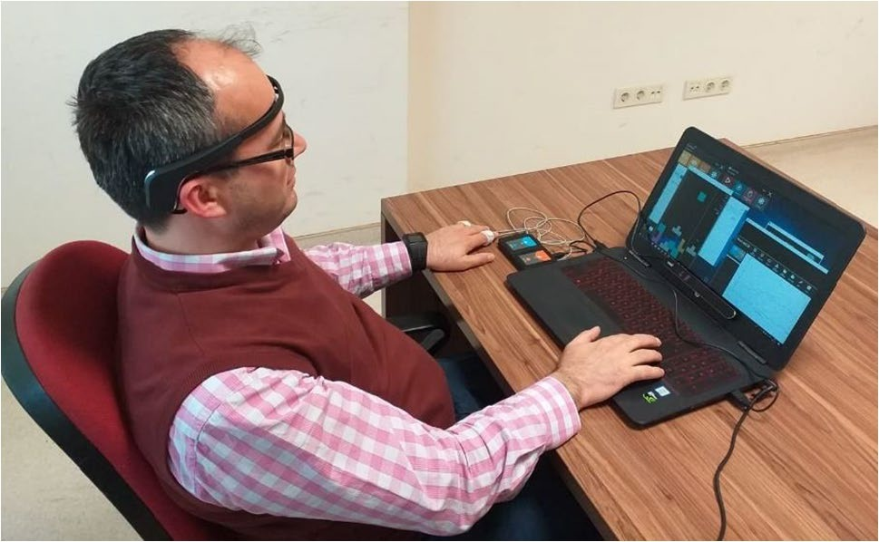
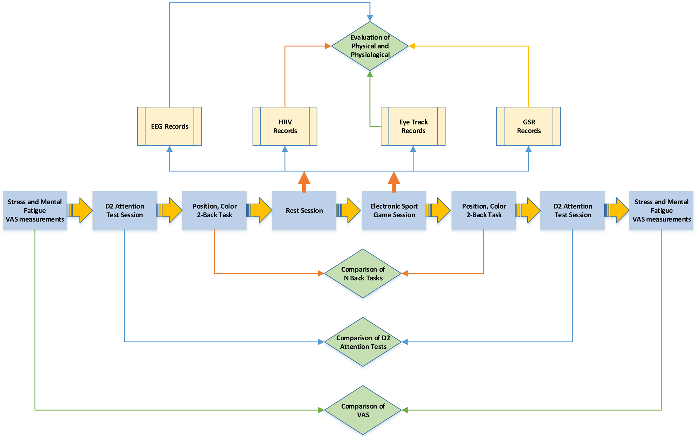
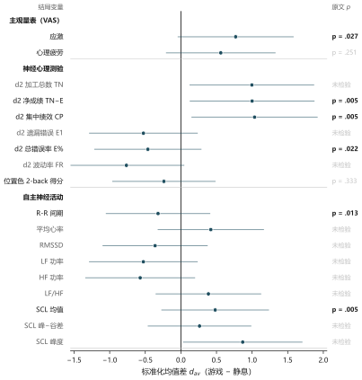
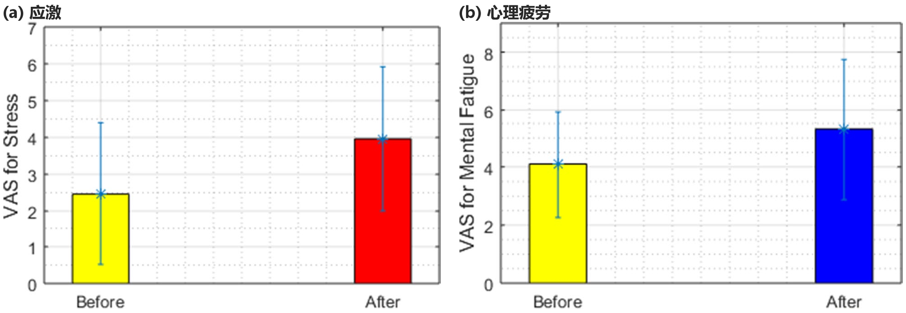
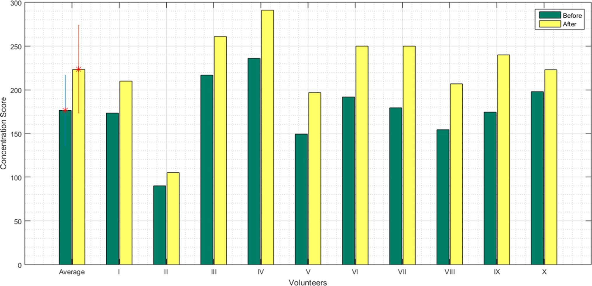
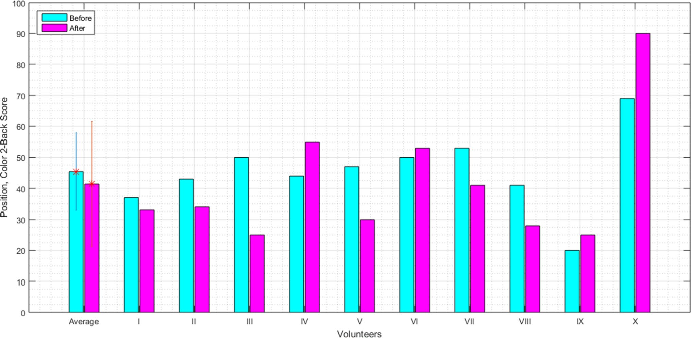
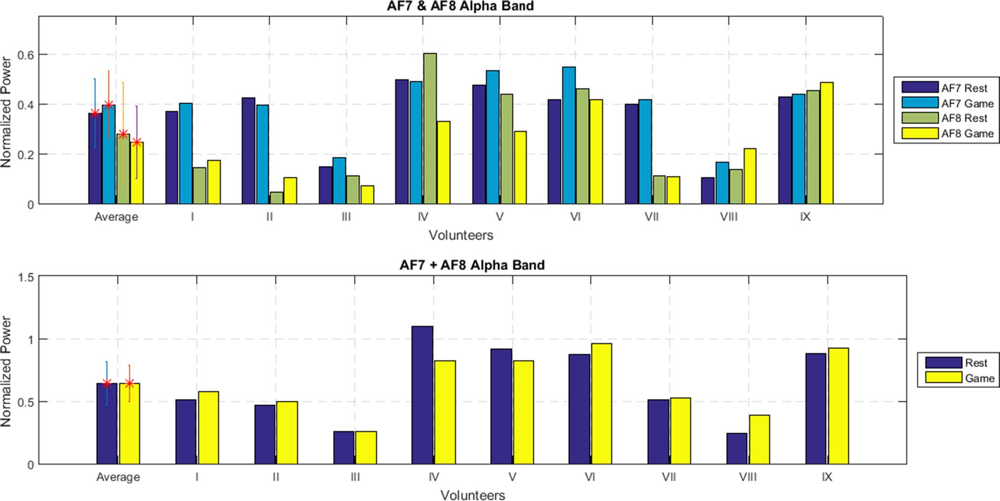
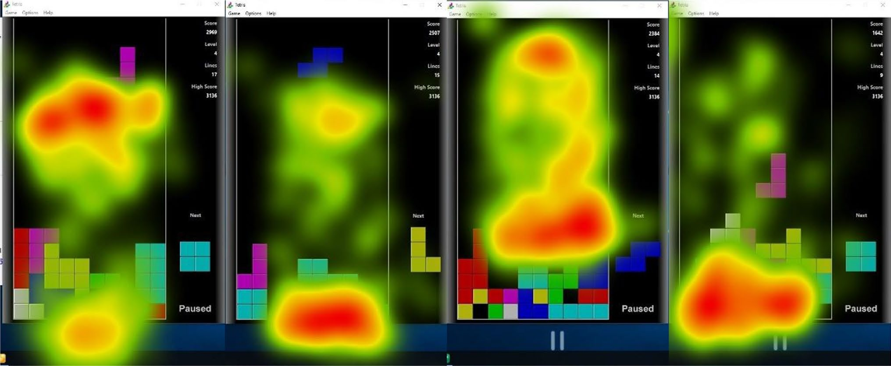
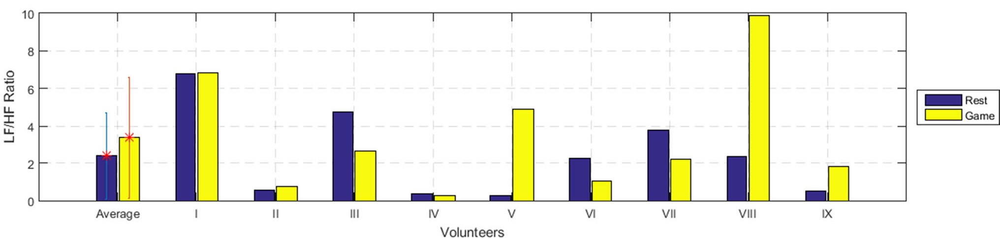
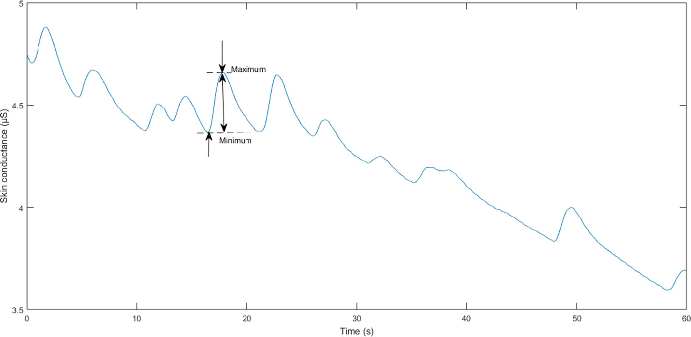

## 摘要

游戏过程中的应激与认知负荷能否由生理信号可靠测出，取决于设计能否把任务效应与练习、运动、时间进程分开。Gündoğdu 等让 10 名被试完成 2 min Tetris，同步记录脑电、心电、皮电与眼动，并以量表、d2 与 2-back 作前后测。应激量表与皮电上升、R-R 间期缩短，d2 集中绩效提高约 1 个标准差；但疲劳量表与 2-back 均未达显著，额区频带功率的差异在 0.2%—1.9% 之间且无检验。据本文重算，该研究的可靠贡献在于证明低成本设备可在真实游戏任务中同步采集并给出方向一致的证据，而非证明游戏引起疲劳。本文据此提出以交叉设计分离急性与持久效应、以个体 alpha 峰频与非周期成分定义频带、以混合模型与融合增量报告结果的方案。

**关键词**：功能游戏；多模态测量；心理疲劳；效应量；实验设计

## 1 引言

游戏对认知功能的影响长期存在证据强度的落差。行为层面的结论并不稀少，动作游戏玩家在选择性注意与外源注意任务上的优势已被反复报告 [@green2003]，随机对照训练也能在老年人中改善执行功能并观察到迁移 [@anguera2013]。但同一批文献的另一侧同样醒目，大样本脑训练试验未发现一般认知能力的提升 [@owen2010]，元分析与系统评述进一步指出，迁移效应多局限于与训练任务共享要素的近迁移，跨域外推缺乏支持 [@simons2016; @sala2019]。横断比较还面临一个更基本的问题，玩家与非玩家在被试进入实验之前就已不同，相关不能读作因果 [@boot2011]。

生理测量提供了一条绕开自陈与行为混淆的通道。脑电（electroencephalography, EEG）、皮肤电活动（electrodermal activity, EDA）、心电图（electrocardiography, ECG）与眼动可在游戏进行中连续记录，游戏研究已积累相应的测量传统 [@kivikangas2011; @fairclough2009]，移动脑成像的纲领则主张把大脑、身体与环境放在同一时间轴上观察 [@makeig2009; @gramann2014]。在这一背景下，同时记录四类信号的研究逐年增多，但**“多模态”常被当作证据强度的同义词使用**，而模态数量与推断强度之间并无必然联系。

Gündoğdu 等发表于 *Medical & Biological Engineering & Computing* 的研究是这一类型的典型样本 [@gundogdu2021]。它具备此类研究几乎全部的特征，被试少（10 人）、任务短（2 min）、条件少（静息与游戏两段）、模态全（EEG、HRV、EDA、眼动），并同时使用主观量表与神经心理测验作为参照。结论覆盖应激、疲劳、注意、工作记忆与个体差异五个方面。正因为它典型，逐一检查其设计与报告，比泛泛讨论“多模态研究的局限”更有信息量。

本文做三件事。第一，重构该研究的设计与结果，并按原文报告的均值与标准差重算标准化效应量，使不同量纲的结局可以并置比较。第二，从设计、统计、测量与构念四个层面评估其证据强度，区分哪些结论可以保留、哪些只是描述。第三，说明同一套模态若用于研究游戏对认知功能的影响，需要在哪些环节改动。第三部分是本文的重点，因为批评一份 10 人研究的意义，最终在于说明下一份研究该怎么做。

## 2 研究设计与方法

### 2.1 被试与流程

被试为 10 名健康成人，2 名女性、8 名男性，年龄 32.3 ± 7.5 岁（范围 24—42），均为右利手，视力正常或矫正正常，无精神疾病史，睡眠规律。研究经 Akdeniz 大学医学伦理委员会批准，符合《赫尔辛基宣言》。

流程为单次会话内的前测—任务—后测。被试在游戏前后各完成一次视觉模拟量表（visual analogue scale, VAS）、d2 注意测验与“位置—颜色”2-back 任务，生理信号覆盖游戏前的静息段与 2 min 的 Tetris 游戏段（第 4 级）。原文未报告静息段时长、基线测验与静息记录的先后，也未报告会话总时长。

记录的现场布置见 @fig-setup，任务的完整时序见 @fig-design。两图并置可以看到这套设计的骨架：**全部条件都落在同一次会话内**，**静息段固定排在游戏之前**，四类信号在静息段与游戏段各记录一次，三项测验在两端各施测一遍。这一安排经济，代价是任务效应与时间、适应、练习被绑在同一条时间轴上，第 4.1 节会回到这一点。

{#fig-setup width=84% fig-alt="照片：一名被试坐在桌前，头戴 Muse 脑电头环，在笔记本电脑上玩俄罗斯方块，腕部有传感器绑带，桌面放着皮电采集模块。"}

{#fig-design width=100% fig-alt="流程图：应激与疲劳 VAS、d2、2-back 依次施测，随后是静息段与游戏段，四类生理信号分别记录，之后再测 2-back、d2 与 VAS；下方三条箭头表示前后比较。"}

任务为 Tetris，原文将其称为电子竞技（electronic sport）。这一定性值得留意。电子竞技通常指以电子系统为媒介、具有组织化竞赛形式的体育活动，其核心特征包含规则化的对抗与竞技结构 [@hamari2017]。实验室中单机游玩 2 min 的方块游戏属于认知—运动任务，与电子竞技共享操作界面，却不共享竞赛结构、训练史与胜负压力。这一差别不影响研究本身的价值，却影响结论可外推的人群，原文以全球 2.34 亿电竞观众作为动机论证，而实际被试是普通成人。

被试人数在模态之间并不一致。原文说明一名被试的 EEG 数据质量不合格，该被试的 EEG 分析被剔除，其余模态仍按 10 人汇总。因此 EEG 的样本量为 9，HRV、EDA、眼动与行为数据为 10。这一处理本身可以接受，但后续把“α 功率变化”与“LF/HF 变化”作相关时，分母已不同于其它分析，报告时应予说明。

原文另有一处细节没有进入任何统计：眼动一节提到，**有一名被试的游戏在约 90 s 时即结束**，其余被试完成 2 min。这一差异在行为、HRV 与 EDA 分析中均未单独处理，而这三类指标都以“2 min 游戏段”为分母（见 4.3 节）。

### 2.2 四类信号的采集与处理

EEG 使用 Muse 头环，记录 AF7、AF8、TP9、TP10 四个位置，采样率 256 Hz，经 0.5—40 Hz 二阶 Butterworth 带通滤波后作 6 级 Daubechies 4 离散小波分解，计算各子带功率并取对数，最后归一化至 0—1。分析聚焦 AF7 与 AF8 两个额区通道。HRV 由 Polar V800 记录逐拍 R-R 间期，在 MATLAB 中计算时域与频域指标。EDA 由 NeuLog NUL-217 采集，采样率 100 Hz、16 位分辨率，电极置于食指与无名指。眼动由 Tobii Dynavox PCE Mini 记录，采样率 30 Hz，分析形式为热图。

各模态的设备、处理方式与由此产生的可核查问题汇总于 @tbl-design。

| 模态 | 设备与采样 | 原文处理 | 可核查的问题 |
|:----|:-----------------------|:--------------------------|:----------------------------------|
| EEG | Muse；AF7/AF8/TP9/TP10；256 Hz | 0.5—40 Hz 带通；db4 六级小波；功率取对数后归一化至 0—1 | 未报告分段长度、伪迹拒绝比例；未提眼电与肌电校正；归一化基准不明 |
| HRV | Polar V800；逐拍 R-R | MATLAB 计算 SDNN、RMSSD、LF、HF、LF/HF | 游戏段仅 2 min，短于频域指标的 5 min 建议；未报告异位搏动与伪迹比例 |
| EDA | NeuLog NUL-217；100 Hz；16 位 | 以 0.01 μS 为阈值计数超阈值反应，另算最小值、均值、最大值、偏度、峰度等 | 未作时相/紧张性分解；静息以 1 min 计数、游戏以 2 min 计数，未作时长归一 |
| 眼动 | Tobii PCE Mini；30 Hz | 生成注视热图，比较高分组与低分组 | 30 Hz 难以可靠检测扫视；仅作定性对照，无兴趣区量化与统计检验 |

: 原文四类信号的采集参数、处理方式与可核查的问题 {#tbl-design}

### 2.3 统计策略

统计在 IBM SPSS 24 中完成，前后测比较使用 Wilcoxon 符号秩检验，显著性水平设为 0.05。EEG 与 HRV 变化量之间的关系使用 Spearman 秩相关。原文**未报告效应量、置信区间与多重比较校正**，也未说明对哪些变量实施了检验。

## 3 主要结果

为便于跨量纲比较，本文按原文报告的均值与标准差重算标准化均值差

$$
d_{av}=\frac{M_{\text{后}}-M_{\text{前}}}{\sqrt{\left(s_{\text{前}}^{2}+s_{\text{后}}^{2}\right)/2}},
$$ {#eq-dav}

其中分母取两时点标准差的均方根。该定义不依赖重测相关，因而在原文未报告差值标准差时仍可计算，代价是对被试内设计略偏保守 [@lakens2013]。全部结局的效应量与近似 95% 置信区间见 @fig-effects。

{#fig-effects width=100% fig-alt="森林图：18 项结局的标准化均值差，按主观量表、神经心理测验与自主神经活动分三组；d2 的净成绩、集中绩效与加工总数效应量接近 1，主观疲劳、2-back 与 RMSSD 的效应量接近零，多数自主神经指标未报告 p 值。"}

### 3.1 主观量表：应激上升，疲劳未达显著

应激 VAS 由 2.46 ± 1.94 升至 3.96 ± 1.96，Wilcoxon 检验 p = 0.027，效应量 $d_{av}$ = 0.77。心理疲劳 VAS 由 4.10 ± 1.84 升至 5.31 ± 2.44，p = 0.251，$d_{av}$ = 0.56。两项的方向一致，统计结论相反。疲劳的效应量并不小，未达显著更多反映样本量与离散度，而非“没有变化”；原文将其读作“游戏引起疲劳，但极为有限”，这一表述把不显著等同于无效应，在 n = 10 的条件下缺乏依据，正确的做法是报告置信区间或作等价性检验 [@lakens2017]。

{#fig-vas width=100% fig-alt="两幅柱状图：(a) 应激 VAS 由 2.5 升至 4.0，误差线重叠；(b) 心理疲劳 VAS 由 4.1 升至 5.3，误差线重叠更多。"}

@fig-vas 把两项量表并列，可以看出**误差线重叠与 p 值显著并不矛盾**。应激组的后测均值（3.96）仍落在前测的 ±1 SD 区间（0.52—4.40）之内，疲劳组同样如此（5.31 对 2.26—5.94）。若把两组当作独立样本比较，两项都不会显著；p = 0.027 完全来自配对结构，即每名被试自身的增量方向一致。反过来说，柱状图加误差线读不出前后测的结论，重叠与否不能替代配对检验。

::: {.keynote}
**不显著不等于没有效应。** 疲劳 VAS 上升 1.21 分，效应量 0.56，在 n = 10 的条件下 p = 0.251 只说明证据不足。原文把这一结果写成“疲劳极为有限”，与数据能支持的结论并不一致：可以说的只是“本次实验未能检出”。
:::

### 3.2 注意测验的普遍改善与工作记忆的轻微下降

d2 测验的六项指标全部朝“改善”方向移动。集中绩效（CP）由 176.20 ± 40.35 升至 223.40 ± 50.37（p = 0.005，$d_{av}$ = 1.03），净成绩（TN−E）由 472.30 ± 65.51 升至 541.90 ± 73.41（p = 0.005），总错误率（E%）由 8.86% 降至 6.44%（p = 0.022）。加工总数、遗漏错误与波动率三项只报告了均值，未报告 p 值。逐被试的 CP 变化见 @fig-d2，个体差异之大一目了然，编号 II 的被试基线仅 90 分，编号 IV 的接近 240 分，同一份“改善”在这两人身上并不指同一件事。

{#fig-d2 width=100% fig-alt="柱状图：10 名被试在 Tetris 前后的 d2 集中绩效，后测普遍高于前测，但基线水平在 90 至 240 之间分布很宽。"}

工作记忆的方向相反。位置—颜色 2-back 得分由 45.40 ± 12.48 降至 41.40 ± 20.15，p = 0.333，$d_{av}$ = −0.24。注意测验改善与工作记忆下降同时出现，这一组合值得注意，因为它与“整体唤醒提升”的预期不完全吻合：唤醒通常同时提高速度类任务的产出与降低需要维持信息的任务的表现，但也可能只是 d2 的练习效应与 2-back 的疲劳效应叠加。

{#fig-nback width=100% fig-alt="柱状图：10 名被试的 2-back 前后得分，X 号由 69 升至 90，III 号由 50 降至 25，多数人小幅下降。"}

@fig-nback 说明这个 4 分的均值差是两类相反变化相抵的结果。上升的是 IV、VI、IX、X 号，下降的是 I、II、III、V、VII、VIII 号；X 号由 69 升到 90，III 号由 50 降到 25，**这两个人的反向移动就足以决定均值的方向与标准差从 12.48 涨到 20.15**。在 n = 10 的检验里，符号由多数人决定，幅度由少数人决定，而原文只报告了前者。

### 3.3 自主神经与皮电：方向一致，幅度不一

HRV 的七项指标中，R-R 间期由 769.69 ± 126.98 ms 缩短至 725.65 ± 146.87 ms（p = 0.013），平均心率由 80.00 升至 85.59 bpm，SDNN 与 RMSSD 下降，LF 与 HF 功率大幅下降，LF/HF 由 2.37 ± 2.18 升至 3.39 ± 3.03。除 R-R 间期外，其余六项均未报告 p 值。LF 的静息均值为 1520.56 ms²，对应标准差 3157.98 ms²，变异系数约 208%，这一分布提示严重右偏或存在未剔除的伪迹，在此条件下以均值比较中枢趋势，结论对个别被试高度敏感。

EDA 表 3 的十项特征中九项在游戏段升高，其中均值由 2.04 ± 1.64 μS 升至 2.91 ± 1.96 μS（p = 0.005）。超阈值反应计数由静息的每 1 min 5.20 ± 4.18 次变为游戏段的每 2 min 15.10 ± 9.47 次。两组计数的时长基准不同，若统一按每分钟折算，游戏段为 7.55 次，相对静息增加约 45%；若按原文并列的数值直接比较，则增幅显示为 190%。报告时未作这一折算，读者容易把 190% 当作效应量。

EEG 的六项归一化功率变化都极小。α 由 0.6401 升至 0.6414，相对变化 0.20%；β 由 0.6212 升至 0.6331，相对变化 1.92%；θ 由 0.6648 升至 0.6701，相对变化 0.80%；α+θ、α+β+θ 与 α/β 的变化同样在 1% 上下。原文对这六项均未报告标准差与 p 值，却在讨论中据此得出“游戏引起应激与心理疲劳”的判断。

{#fig-eeg width=100% fig-alt="两幅分组柱状图：上图为 AF7 与 AF8 在静息与游戏下的 α 功率，下图为两电极之和；Average 一对柱几乎等高，逐被试柱差异较大。"}

@fig-eeg 是这 0.20% 的图形版本：下图 Average 一对柱几乎等高，读者无法从图上看出方向。但逐被试的柱高差异远大于条件差异，IV 号的 AF7+AF8 由 1.11 降到 0.84，VIII 号由 0.27 升到 0.40，个体变化达到 0.1—0.3，是组均值变化的百倍以上。**均值不动，是因为方向相反的个体变化相互抵消**；更麻烦的是两个电极的方向并不一致，AF7 在多数被试上微升，AF8 在 IV、V、VII 号上明显下降，把二者相加等于预先假定了它们同向。原文既未报告这一分布，也未作检验，因此无法区分“没有效应”与“效应异质”。图中只剩 I 至 IX 九名被试，与 @fig-d2 的十人对照，可见被剔除的那名被试在此后所有 EEG 图中都不再出现。

### 3.4 眼动热图：绩效差异的定性线索

眼动分析以热图形式呈现四名高分者与四名低分者的注视分布。高分者的注视集中在方块下落区、变换区与堆叠区，低分者的热图在屏幕上分布更广。这是全文最直观的一组结果，它把操作绩效与注意分配联系起来，且不依赖任何统计模型。

{#fig-eye width=100% fig-alt="四联热图：四名高分被试的 Tetris 界面叠加注视热图，红色高亮集中在方块下落列与堆叠区，右侧预览区只有零星注视。"}

@fig-eye 中四幅热图的红区都落在方块下落列、旋转位与堆叠区，右上角的 Next 预览区只有零星注视。但该比较为定性对照，每组 4 人，未定义兴趣区，未报告注视时长、扫视幅度或注视转移的量化指标，也未作检验，因此只能作为生成假设的线索。

### 3.5 个体差异：三类自主神经反应型

原文最重要的观察不在均值，而在个体层面。作者按 Toledo 等的分类，依据 LF、HF 与 LF/HF 的变化方向把被试分为三型：2 人 LF 升、HF 降、LF/HF 升，对应交感激活与迷走抑制，其应激 VAS 平均上升 4.45 cm；3 人 LF 降、HF 降、LF/HF 升，对应交感与迷走同时下降而平衡相对偏交感，VAS 上升 1.03 cm；4 人 LF 降、HF 降、LF/HF 降，对应平衡相对偏迷走，VAS 上升 0.75 cm。同一游戏在不同个体身上引起的自主神经反应方向不同，量表变化幅度也随之不同。

{#fig-lfhf width=100% fig-alt="分组柱状图：9 名被试在静息与游戏下的 LF/HF 比，VIII 号由 2.3 升至 9.8，V 号由 0.2 升至 4.8，多数被试变化方向不一。"}

@fig-lfhf 是同一组数据的图形版本，也暴露了分型的口径问题。按这张图数，I 号几乎不动（6.7 到 6.7），III、IV、VI、VII 号下降，II、V、VIII、IX 号上升，即**上升 4 人、下降 4 人、基本持平 1 人**；三型分类给出的是 5 升 4 降，结果段叙述的是 6 升 4 降。同一组数据的三处口径互不一致，原文未说明该被试的归类，读者无法据此复现分型规则。差异不影响“反应方向存在个体差异”这一结论，但说明分组并非按统一标准完成。同一指标在个体间还跨越了一个数量级以上（0.2 到 9.8），把它压成组均值 2.37 到 3.39，等于抹掉这张图的全部信息。

与之呼应的是 α 功率与 LF/HF 的相关。AF8 的 α 功率变化与 LF/HF 变化呈正相关（Spearman r = 0.8，p < 0.01），β 功率变化与之无关（r = 0.1，p = 0.798）。作者进一步报告，α 功率与 LF/HF 同时下降的 4 人，正好是 d2 集中绩效最高的 4 人。

这一组观察有两处值得推敲。其一，r = 0.8 基于 9 名被试，按 Fisher z 近似，其 95% 置信区间约为 0.29 至 0.96，区间下界已接近“中等相关”，把 0.8 当作稳定参数引用会高估精度。其二，α 功率下降被解释为“兴奋”而非“疲劳”，而 α 功率上升被解释为“应激与疲劳”，同一指标在两组被试身上承载了相反的解释。α 去同步既可见于注意投入，也可见于内部加工抑制，单凭功率变化方向无法区分这两种状态 [@klimesch1999]。方向本身不构成构念证据，缺少独立的操作定义时，任何方向都能找到事后解释。

::: {.keynote}
**本节最值得记住的是“均值与个体不同步”。** d2 的均值上升 47 分，个体基线却相差 150 分；EEG 的均值只动 0.20%，个体变化达 0.1—0.3；LF/HF 的组均值从 2.37 升到 3.39，个体从 0.2 到 9.8。三种情形指向同一件事：**十个被试的均值不描述其中任何一个被试**。
:::

## 4 批判性评估

本节按设计、统计、测量、构念四层展开。为避免批评散成清单，先给出三个数字。

::: {.keynote}
**10 名被试、2 min 任务、41 项比较中 10 项报告了 p 值。** 后文的全部批评都可以还原为这三个数字的作用：样本量决定检验的下限，任务时长决定效应能否建立，报告完整度决定结论能否被复核。三者都不是设备问题。
:::

### 4.1 设计：单次、定序、无对照

该研究的因果推断能力受限于三个设计特征。

其一是任务时长。2 min 的 Tetris 足以诱发可测的生理变化，却不足以诱发心理疲劳。疲劳通常被理解为随时间累积的状态，其生理标志在持续任务中才逐步显现。以 2 min 任务检验疲劳，等于在效应尚未建立的时间尺度上取样，结果自然接近零。原文的疲劳 VAS 上升 1.21 分而未达显著，与此一致。

其二是顺序固定。静息记录始终在游戏之前，条件顺序未平衡。这意味着“游戏—静息”的差异同时包含任务效应、时间效应、适应效应与昼夜节律的贡献。生理信号普遍存在随时间漂移的趋势，皮肤电导水平随佩戴时长与皮肤水合状态变化，心率与 HRV 受姿势与呼吸节律调节。缺少平衡或对照条件时，这些趋势无法与任务效应分离。交叉设计在此几乎不增加成本，只需把条件顺序在被试间轮换，或增设一段等长的安静阅读作为对照 [@senn2002]。

其三是对照缺失。d2 的改善有两种竞争解释：任务诱发的短期唤醒提升了速度类任务的产出，或测验本身的重测练习效应。d2 属速度类测验，重复施测存在练习效应 [@brickenkamp1998; @calamia2012]，而原文在同一会话内以前测—后测的方式使用同一版本。要区分两者，只需一组只做两次 d2 而不玩游戏的被试，或在游戏组与对照组之间比较增量。缺少这一组，d2 的改善不能归因于游戏。

还有一层更基本的区分。即便 d2 的改善确由游戏引起，它仍是状态效应，指游戏结束后短时间内的认知表现变化，而非特质效应，即跨会话稳定下来的能力提升。原文的结论“游戏对注意与集中有正向影响”，在读者那里容易被理解为后者。**状态与特质的混淆是本领域最普遍的解释性错误**，急性唤醒对绩效的提升与训练带来的能力增长在单次会话中无法区分 [@yerkes1908; @sala2019]。

### 4.2 统计：41 项比较与 10 个 p 值

按原文表 1 至表 4 与结果段逐一清点，全文报告了 41 项比较，其中 38 项为前后测对照、1 项为定性热图对照、2 项为跨模态相关；41 项中仅 10 项给出 p 值，7 项小于 0.05。EEG 的 6 项频带比较、HRV 的 6 项、EDA 的 15 项均只报均值与标准差。这一分布本身说明问题：**检验集中在达到显著的变量上**，未达显著的变量则以描述统计呈现，却仍在讨论中被当作结论使用。

多重比较未作校正。在 10 次独立检验、显著性水平 0.05 的条件下，至少出现一次假阳性的概率约为 40%，若把未报告检验的变量一并计入，这一概率更高。原文的 7 个显著结果中，d2 的三项（CP、TN−E、E%）高度相关，实际上是同一个效应的三种表达，不能视为三次独立验证。合理的做法是预先指定主结局，其余作为次要结局并施以错误发现率控制 [@benjamini1995]。

样本量 10 决定了检验的下限。Wilcoxon 符号秩检验在 n = 10 时，双侧精确检验可达到的最小 p 值约为 0.002，p = 0.005 已接近该下限，意味着结果依赖“几乎所有被试同向”这一强条件。这类结果对单个被试的异常值极为敏感，而原文除 d2 外未提供逐被试数据（@fig-d2），读者无法判断是否存在驱动整体的个案。

效应量缺位使结论难以累积。报告均值与 p 值而不报告效应量，读者无法判断“显著”背后是 0.2 个标准差还是 1 个标准差，也无法把本研究纳入元分析。本文重算的 @fig-effects 显示，同一份数据中效应量的绝对值从 0.24 到 1.03 不等，若只看 p 值，这一差别完全不可见。

选择性报告还体现在叙述层面。原文结论称“主观与客观评价一致”，但一致性只在应激维度成立：应激 VAS 显著上升，EDA 均值显著上升，R-R 间期显著缩短，三者同向；疲劳维度则三项皆不显著。把部分一致表述为整体一致，会高估证据的收敛程度 [@simmons2011]。

### 4.3 测量：额区干电极、二进小波与归一化

EEG 的处理有四处需要说明。

其一是电极位置与伪迹。AF7 与 AF8 位于眉弓上方，是眼电（electrooculogram, EOG）污染最重的位置之一，眨眼与扫视在此产生的电位变化量级可与皮层信号相当甚至更大 [@croft2000]。四通道不足以支撑可靠的独立成分分解，原文也未提及回归法去除眼电。Tetris 是高频扫视任务，被试在 2 min 内产生大量水平与垂直眼动，α 与 θ 频段的“升高”因此不能排除眼动贡献。

其二是频带定义。256 Hz 采样、6 级 db4 分解的细节层带宽依次为 64—128、32—64、16—32、8—16、4—8、2—4 Hz。按二进子带的自然对应，**可标注为“α”的只有第 4 层的 8—16 Hz**，其中 13—16 Hz 已属低 β；“β”则跨越第 3 层（16—32 Hz）与第 4 层的上半部，同样不等于常规的 13—30 Hz。原文未说明各频带与子带的对应关系，这一映射无法核实。二进小波的频带边界与临床惯用的划分并不重合，直接沿用“α”“β”的标签会掩盖这一差异。

其三是 β 的解释。额区 β 在 20—30 Hz 与额肌、颞肌的肌电（electromyogram, EMG）频谱高度重叠，按键与面部肌肉活动足以在无认知负荷变化的情况下抬高该频段功率 [@goncharova2003]。β 在运动系统中主要与状态维持和运动准备相关 [@engel2010]，把它读作认知负荷或应激的中枢指标，需要先排除肌电与运动。原文未报告任何伪迹控制，也未报告被试在游戏中的按键频率。

其四是归一化。原文称功率“取对数后归一化至 0—1”，但未说明归一化的基准是单段记录、合并记录还是跨被试。若在合并静息与游戏后的整段记录上作最小—最大缩放，条件间差异会被整段极差压缩，其数值大小取决于该极差，既不能解释为“轻微增加”，也不能与其它研究比较。在缺少标准差的情况下，0.20% 的变化无法判断是否超出测量噪声。

HRV 的处理同样存在边界。频域指标的标准建议是采用 5 min 短时程记录，更短窗口的 LF 与 HF 估计方差显著增大 [@taskforce1996; @shaffer2017]。游戏段仅 2 min，低于该建议，而 LF/HF 的解释本身也有争议：LF 混合了压力反射、交感与副交感活动，其比值不能作为交感—迷走平衡的读数 [@billman2013]。原文未报告异位搏动剔除与伪迹比例，也未说明 R 峰检测的校正方法，对 LF 标准差达到均值两倍的分布而言，这些信息是解释结果的前提 [@lipponen2019]。

EDA 的处理停留在阈值计数。以 0.01 μS 为阈值统计超阈值反应，方法简单，却无法分离叠加反应，也无法区分时相反应与紧张性水平的贡献。连续分解方法可把时相驱动估计为连续时间序列，从而在事件密集时估计各事件的贡献 [@benedek2010; @greco2016]。此外，皮肤电导水平随佩戴时长与皮肤水合状态漂移，静息段与游戏段的比较若不控制这一趋势，升高可部分来自时间而非任务。

{#fig-gsr width=100% fig-alt="折线图：60 s 内的皮肤电导曲线，由约 4.7 μS 逐渐降到 3.6 μS，局部标注了 Maximum 与 Minimum 两点。"}

@fig-gsr 把这一隐忧画了出来。曲线在 60 s 内下降超过 1 μS，而标注的单个峰—谷落差不足 0.1 μS：**漂移幅度约为单个反应幅度的十倍**。在这样的基线上，0.01 μS 的阈值所截获的并不都是反应性出汗，还包括漂移过程中的微小起伏与噪声。再叠加时长问题——静息按 1 min 计数、游戏按 2 min 计数，而有一名被试的游戏只持续约 90 s——两项计数的可比性同时受基线与分母两个因素影响，原文未对任何一个作出处理。

眼动的采样率是硬约束。30 Hz 对应 33 ms 的采样间隔，而扫视持续时间通常为 20—80 ms，仅能落在 1 至 3 个采样点上，无法可靠估计扫视幅度与速度 [@holmqvist2011]。以热图作定性比较尚可，作注视时长或兴趣区转移的量化分析则不可行。

### 4.4 构念：「融合」的名义与实质

论文标题含“data fusion”，**正文的融合实际发生在解释层面**。作者并列分析四类信号，比较其变化方向是否一致，并计算了一组跨模态相关，未建立联合特征空间，未训练融合模型，也未估计任何模态的边际贡献。这一做法属于解释层面的三角验证（triangulation），与计算层面的融合（computational fusion）不是同一件事 [@baltru2019]。

区分二者并非文字游戏。计算层面的融合要求给出可检验的增益，即以最佳单模态为基线，报告联合模型的增量、增量是否显著、在何种划分下成立。缺少这一环节，“融合”只是把若干条单模态结论并列陈述，各模态误差相关的风险反而被掩盖。原文以 EDA 与 HRV 共同判定“部分被试处于应激、部分处于兴奋”，实质是用两条各自不特异的指标相互约束，这在解释上有价值，但仍不是融合模型。

::: {.keynote}
**标题写的是 data fusion，做的其实是三角验证。** 前者要求给出相对最佳单模态的可检验增量，后者只要求几条证据方向一致。把后者称作前者，会让读者以为各模态的误差已被联合模型吸收，而实际上它们仍各自独立、误差也仍然相关。
:::

### 4.5 仍然可以保留的结论

批判之后需要说明哪些结论站得住，否则评估本身失去平衡。

第一，可行性结论成立。低成本设备（Muse、Polar V800、NeuLog、Tobii PCE Mini）在真实游戏任务中完成了同步记录，四类信号的采集未因设备而中断。消费级 EEG 的信号质量低于研究级设备，但在额区频带功率与事件相关设计的范围内仍有可用性 [@ratti2017]。对预算有限的功能游戏研究，这一演示有实际参考价值。

第二，方向一致性构成弱证据。应激 VAS 上升、EDA 上升、R-R 间期缩短、心率上升，四条通道指向同一方向。这类收敛不能替代统计推断，却比单一指标更不易由偶然因素解释，其价值取决于各通道的独立性，而 EDA 与 HRV 共享交感通路，独立性有限。

第三，个体差异的观察值得跟进。三类自主神经反应型的划分虽是事后归纳、每组仅 2 至 4 人，却指出了一个被均值分析掩盖的事实：同一游戏对不同个体的意义不同。这一观察与游戏研究中“同一刺激、不同体验”的既有认识一致 [@kivikangas2011]，值得以更大样本和预先设定的分组标准检验。

第四，眼动与绩效的对应关系值得量化。高分者的注视更集中，低分者更分散，这一差异若以兴趣区、注视时长与扫视幅度量化，并配合游戏日志，可成为低成本的过程指标；其与绩效的关联强度仍需在更大样本中检验。

至于“游戏引起心理疲劳”这一标题性结论，据本文的判断，**现有证据不足以支持**。支持它的是 0.20%—1.92% 的归一化功率变化与一个不显著的疲劳量表，两者都不构成可检验的证据。

## 5 借鉴：用同一套模态研究游戏对认知功能的影响

如果目标从“测量一次游戏后的状态”转为“判断游戏是否改变认知功能”，同一套模态需要重排。以下按结局、设计、测量、统计与融合五个环节说明。

### 5.1 把认知功能操作化

“认知功能”是多维构念，不能作为单一因变量。可行做法是先选定 2 至 3 个可分离的成分，各自给出任务与指标：工作记忆更新用 N-back 的辨别力指数 d′ 或操作广度；持续注意用精神运动警觉任务（psychomotor vigilance task, PVT）的失效次数与反应时分布；抑制控制用 Flanker 或 Stroop 的一致性效应；认知灵活性用任务切换的切换代价。每一成分需预先指定主结局，其余作为次要结局。

同时要区分近迁移与远迁移。与游戏共享要素的任务（视觉搜索、空间旋转、快速决策）属近迁移，其改善更可能反映任务特异性练习；与游戏不共享要素的任务（言语工作记忆、情节记忆）属远迁移，其改善才是“认知功能提升”的证据。既有元分析显示，远迁移的效应量普遍接近零 [@sala2019; @simons2016]，因此**远迁移任务应作为主结局，近迁移任务作为操纵检查**（manipulation check），用于确认训练确实施加了预期的认知需求。

### 5.2 设计：区分急性效应与持久效应

两类效应需要两套设计，混在单次会话里无法分离。

急性效应适合被试内交叉设计。同一被试在不同日期分别完成目标游戏、主动对照游戏与被动休息三种条件，条件顺序按拉丁方平衡，间隔不少于 48 h 以清除残留。主动对照游戏需匹配感觉运动负荷（同样的操作频率、同样的视觉复杂度）而改变认知需求，否则“游戏效应”与“操作计算机效应”无法区分。结局在条件前后各测一次，分析对象是条件间的增量差异，而非条件内的前后变化。

持久效应适合平行组多会话设计。三臂分别接受目标游戏训练、主动对照游戏训练与无训练，训练量为 12 次、每次 30 min、持续 4 周，结束后立即后测，并在 4 周后随访以检验保留。盲法在游戏研究中难以对受试者实施，但可对结局评估者实施盲法，并以期望量表测量被试对训练效果的预期，作为协变量纳入模型。

样本量需按效应量预估。以显著性水平 0.05、统计功效 0.80 计，被试内设计检测 $d_z$ = 0.5 需约 34 人，两组平行设计检测 d = 0.5 需每组约 64 人，三组单因素设计检测 f = 0.25 需每组约 53 人 [@cohen1988]。原文的 10 人规模足以做可行性研究，不足以支撑任何组间或前后比较的结论。若资源受限，缩小到两个条件并把主结局限定为单一指标，比保留四个模态而牺牲样本量更可取。

::: {.keynote}
**三个设计决定比设备更影响结论**：条件顺序是否平衡，决定能否把任务效应从时间效应里分离出来；有无主动对照，决定能否把游戏效应从练习效应里分离出来；有无随访，决定结论落在状态还是特质上。三者的成本都远低于再添一套设备。
:::

### 5.3 测量：四类信号的现代处理

四类信号各有若干必须完成而常被省略的处理步骤，汇总于 @tbl-report。

| 模态 | 关键处理 | 最低报告项 |
|:----|:------------------------------------------|:--------------------------------------|
| EEG | 含 EOG 通道或至少 8 通道以支持回归/分解；以个体 α 峰频（individual alpha frequency, IAF）定义频带；分离周期成分与非周期成分（1/f）；高频段报告肌电检查 | 参考电极、滤波参数、分段长度、伪迹拒绝比例、IAF 分布、非周期指数 |
| ECG/HRV | 逐拍伪迹校正；窗口不短于 5 min；姿势与活动以加速度计或日志控制；不以 LF/HF 作交感指标 | 记录时长、窗口长度、异位搏动比例、呼吸或姿势控制方式 |
| EDA | 连续分解为时相与紧张性成分；温湿度控制；事件相关窗口按 1—3 s 潜伏期后移 | 分解方法、阈值或模型参数、采样率、电极位置、环境温湿度 |
| 眼动 | 采样率不低于 120 Hz；预定义兴趣区；瞳孔作亮度回归校正 | 采样率、校准精度、数据丢失率、兴趣区定义、注视与扫视检测算法 |

: 四类信号在游戏认知研究中的关键处理与最低报告项 {#tbl-report}

EEG 的频带定义值得单独说明。以固定边界（8—13 Hz 记为 α）划分频带，在个体间比较时会把不同的功能系统混为一谈，因为 α 峰频在个体间可从 8 Hz 分布到 12 Hz。以 IAF 为中心定义个体化频带可提高敏感性 [@klimesch1999]。更基本的问题是，频带功率的变化可能来自非周期成分的斜率改变而非振荡本身，警觉与疲劳状态恰恰主要改变 1/f 斜率。将功率谱参数化为周期成分与非周期成分后分别建模，可避免把斜率变化误读为振荡变化 [@donoghue2020]。

HRV 的窗口长度是硬约束。2 min 记录足以计算 RMSSD，却不足以稳定估计 LF 与 HF 的功率，而游戏段往往只有数分钟。可行的折中是放弃频域指标，改用 RMSSD 与 pNN50 等时域指标，或在关卡之间插入固定 5 min 的静息段作为阶段基线。

EDA 的连续分解在事件密集的游戏场景中尤为必要。相邻反应间隔小于恢复时间时，阈值计数会把重叠反应计为一次，或把一次反应计为多次。以双指数冲激响应建模并反卷积，可把每个事件的贡献分离出来 [@benedek2010; @greco2016]。

### 5.4 统计：被试内结构、效应量与零结果

数据结构决定了模型。游戏研究的数据天然分层：试次嵌套于阶段，阶段嵌套于会话，会话嵌套于被试。若先把每名被试压缩为一个均值再作 t 检验，等于丢弃层内变异，并放大聚合偏倚 [@loken2017]。混合效应模型可同时估计被试的随机截距与随机斜率，把被试间差异与条件效应分开 [@bates2015]。随机效应结构应按设计设定，而非按拟合优度逐步简化，否则第一类错误率会升高 [@barr2013]。

报告应包含效应量与置信区间。标准化均值差需说明所用分母（$d_{av}$ 或 $d_z$），因为两者在同一数据上可相差 20% 以上 [@lakens2013]。零结果应作等价性检验或报告 Bayes 因子，说明数据支持的是“无效应”还是“证据不足” [@lakens2017; @rouder2009]。原文对疲劳与 2-back 的处理正是缺少这一步。

多重比较需预先声明。若主结局只有一个，其余比较应施以错误发现率控制并明确标注为探索性 [@benjamini1995]。若研究本身是探索性的，则应在报告中说明，并把全部比较（含未达显著者）列出，避免选择性呈现 [@simmons2011]。预注册与多宇宙分析可进一步约束分析自由度 [@nosek2018; @stegen2016]。

### 5.5 融合：从三角验证到可计算融合

融合的价值不在于模态数量，而在于能否给出可检验的增量。可行路径分三步。

第一步建立晚期融合基线。每个模态独立训练一个预测器，在决策层按验证误差加权集成。该方案对缺失模态稳健、可解释，且在模态异步时仍可运行 [@baltru2019]。若晚期融合已能解释大部分方差，联合模型的必要性就需重新论证。

第二步引入模态特异编码与联合表示。EEG 用一维卷积或 Transformer 编码时序与通道关系，EDA 与 ECG 用因果卷积编码慢变动态，眼动用序列模型编码注视与兴趣区转移，再以跨模态注意力或门控合并。训练时引入模态 dropout，使模型在部分模态缺失时仍可推断 [@neverova2016]。这一步的代价是参数增加与小样本过拟合，因此需要嵌套交叉验证与正则化。

第三步给出增量证据。基线是各模态中的最佳单模态，指标是联合模型相对该基线的 ΔAUC、ΔF1 与校准改善。模态融合的元分析显示，相对最佳单模态的增益通常有限，且随任务与模态组合而变 [@dmello2015]，因此负结果同样值得报告。校准不应省略，判别力相同的两个模型可能在风险分层上差异明显 [@vancalster2019]。

对游戏—认知研究，最有信息量的预测任务不是同期分类，而是前瞻预测：用第 k 次会话的生理特征预测第 k+1 次会话的认知变化。同期分类只能说明“状态可被识别”，前瞻预测才接近“个体是否会对训练产生反应”这一有实际价值的问题。若某模态组合能预测训练反应，个性化训练方案的分配就有了依据。

### 5.6 一个最小可行方案

把上述环节压缩为一个可执行的方案：24 至 32 名被试，按游戏经验分层；急性效应采用三条件交叉设计，顺序平衡，间隔 48 h；持久效应采用两臂平行设计，12 次 × 30 min，末次训练后 3 天内后测，4 周后随访；主结局为远迁移任务的复合指标（情节记忆与言语工作记忆），操纵检查为近迁移任务与游戏内绩效；生理测量保留 EEG、ECG 与眼动三类，EDA 作为可选，因其对运动与温湿度过于敏感；分析采用混合效应模型，报告效应量、置信区间与等价性检验；融合以晚期融合为基线，报告联合模型的增量与校准。

这一方案的成本高于原文，但在关键环节上的改动并不复杂：平衡条件顺序、增设主动对照、延长训练、扩大样本、报告效应量。真正昂贵的部分不是设备，而是被试时间与随访依从性。原文的价值恰在于证明设备不是瓶颈，接下来的瓶颈在设计。

## 6 结论

Gündoğdu 等的研究在有限条件下完成了一件不容易的事：把四类生理信号、两套神经心理测验与主观量表放进同一个 2 min 的游戏任务，并报告了个体层面的反应差异。它的可靠贡献是可行性演示与方向一致性证据，而非关于疲劳的因果结论。

其局限集中在三处。设计上，单次会话、固定顺序、无对照条件，使任务效应与练习、时间、唤醒混淆，也使状态效应无法与特质效应区分。统计上，41 项比较只有 10 项报告 p 值，无效应量、无校正、无等价性检验，显著结果的精度被高估。测量上，额区干电极的 β 与眼动贡献未被控制，二进小波的频带与常规定义不重合，归一化基准不明，2 min 的 HRV 窗口短于频域指标的最低要求。标题中的“数据融合”实际发生在解释层面，未进入计算层面。

若要研究游戏对认知功能的影响，需要改动的不是模态清单，而是推断结构：以远迁移任务为主结局，以交叉设计分离急性效应，以多会话平行设计检验持久效应，以混合模型保留被试内变异，以效应量与等价性检验处理零结果，以融合增量而非融合本身作为结论依据。这些环节都不需要更贵的设备，**只需要在开始采集之前想清楚要排除哪些替代解释**。

## 作者与版权

**作者**：Ye Yixiang（四川大学计算机科学与技术）  
**邮箱**：[yeyixiang@stu.scu.edu.cn](mailto:yeyixiang@stu.scu.edu.cn)  
**版权**：© 2026 Ye Yixiang。本文版权归作者所有，转载请注明作者与原文链接。
